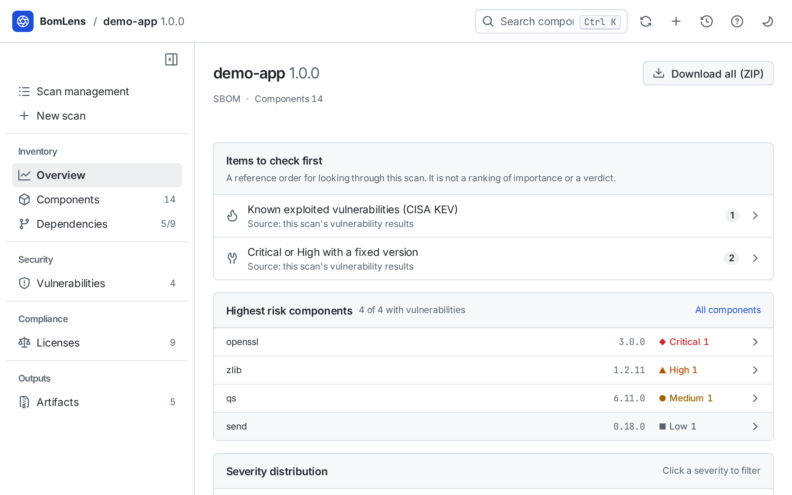

<p align="center">
  <picture>
    <source media="(prefers-color-scheme: dark)" srcset="docs/images/logo-dark.svg" />
    
  </picture>
</p>

<h1 align="center">BomLens</h1>

BomLens generates an [SBOM](https://sktelecom.github.io/bomlens/concepts/what-is-sbom/) (the list of open-source components in a piece of software), an open-source notice, and a security and license risk report for one project. The SBOM is CycloneDX, the OWASP standard JSON format. It reads a source folder or GitHub URL, a container image, a binary or firmware, an SBOM you received (`--analyze`), or a HuggingFace AI model, a model file, a Figshare or HuggingFace dataset, or a publisher's declaration. It runs on your own machine, with no hosted service to sign up for. BomLens is an [OWASP Incubator project](https://owasp.org/www-project-bomlens/).

[](https://github.com/sktelecom/bomlens/releases) [](https://github.com/sktelecom/bomlens/pkgs/container/bomlens) [](LICENSE)
[](https://owasp.org/www-project-bomlens/) [](https://www.bestpractices.dev/projects/13059) [](https://securityscorecards.dev/viewer/?uri=github.com/sktelecom/bomlens)

한국어 문서: [sktelecom.github.io/bomlens/ko](https://sktelecom.github.io/bomlens/ko/). 한국어로 질문하거나 이슈를 남겨도 됩니다.

<p align="center"></p>

## Which way should I start?

| If you want to | Use |
|---|---|
| Scan with no commands, on Windows or macOS | The desktop app: [BomLens-Setup.exe](https://github.com/sktelecom/bomlens/releases/latest/download/BomLens-Setup.exe) or [BomLens-Setup.dmg](https://github.com/sktelecom/bomlens/releases/latest/download/BomLens-Setup.dmg) (one file for Apple Silicon and Intel Macs). It checks Docker, pulls the image and opens the UI. It is unsigned for now; the [no-CLI quick start](docs/start/no-cli.md) shows how to open it. The signing rules and the privacy policy are in the [code signing policy](docs/reference/code-signing-policy.md). |
| Script scans or run them in CI | The command line, below. Linux has no desktop app, so use the web UI with `scan-sbom.sh --ui` |
| See results before installing | The read-only [live demo](https://sktelecom.github.io/bomlens/demo/), with one finished scan of each kind |

## Quick start

Everything runs on a Docker engine (20.10+). On Windows the desktop app needs [Rancher Desktop](https://rancherdesktop.io/) (free) or Docker Desktop; docker-ce inside WSL2 works for the command line only.

```bash
mkdir -p ~/bomlens && cd ~/bomlens
curl -fsSL https://github.com/sktelecom/bomlens/releases/latest/download/bomlens-cli.tar.gz | tar -xz
./scripts/scan-sbom.sh --project MyApp --version 1.0.0 --target examples/nodejs --all --generate-only

# Web UI: run it from the folder you want to scan; it opens http://localhost:8080
cd ~/my-project && ~/bomlens/scripts/scan-sbom.sh --ui
```

The archive works on Linux, macOS and WSL, and the first scan pulls the scanner image of that release. The scan writes its files to a `MyApp_1.0.0/` folder in the current directory. `--all` adds the notice, the security report and an SPDX copy to the SBOM, and [Artifacts](docs/reference/artifacts.md) says what each file is. In PowerShell a `.sh` file does not run and prints nothing, so download [bomlens-cli-windows.zip](https://github.com/sktelecom/bomlens/releases/latest/download/bomlens-cli-windows.zip) instead, unzip it and double-click `scripts\sbom-ui.bat` for the web UI, or run the same scan with `scripts\scan-sbom.bat` (needs Git for Windows). `sbom-ui.bat` does not pass your Maven or Gradle settings, so a project that needs a company repository is scanned with the desktop app or `scan-sbom.bat` ([Company network](docs/guides/company-network.md)).

## Documentation

The full docs, in English and Korean, are at [sktelecom.github.io/bomlens](https://sktelecom.github.io/bomlens/) and under [docs/](docs/).

- [First scan](docs/start/first-scan.md) and the [no-CLI quick start](docs/start/no-cli.md): install through your first SBOM
- [Android (Gradle)](docs/guides/android-gradle.md), [Java (Maven)](docs/guides/java-maven.md), [iOS (SwiftPM and CocoaPods)](docs/guides/ios-swift.md), [C/C++ and embedded](docs/guides/identify-vendored.md): what to prepare for each
- [Input scenarios](docs/guides/by-input.md) for every input form, and [Ecosystems](docs/reference/ecosystems.md) for what each language reads
- [Company network](docs/guides/company-network.md): proxy, company CA and internal package repositories
- [CLI reference](docs/reference/cli.md), [CI/CD integration](docs/guides/ci-cd.md), [Verify a release](docs/guides/verify-release.md), [What BomLens does not do](docs/concepts/limitations.md) and the [changelog](CHANGELOG.md)

## Why it exists

SK Telecom asks its suppliers to submit an SBOM, and the `skt-submission` conformance profile checks one against the [submission requirements](https://sktelecom.github.io/guide/supply-chain/for-suppliers/requirements/) ([supplier SBOM guide](docs/guides/supplier-sbom.md)). Anyone can use BomLens. For company-wide governance, [TRUSCA](https://github.com/trustedoss/trusca) can run BomLens as its scan engine, and the SBOM can be uploaded to Dependency-Track ([upload guide](docs/guides/upload.md)).

## Contributing and license

Issues and PRs are welcome. See [CONTRIBUTING.md](CONTRIBUTING.md) ([한국어](CONTRIBUTING.ko.md)), the [architecture](docs/concepts/architecture.md), and [SUPPORT.md](SUPPORT.md) for where to ask. Apache License 2.0, © 2026 SK Telecom Co., Ltd. Bundled third-party tools keep their own licenses; see [NOTICE](NOTICE) and [THIRD_PARTY_LICENSES.md](THIRD_PARTY_LICENSES.md).
