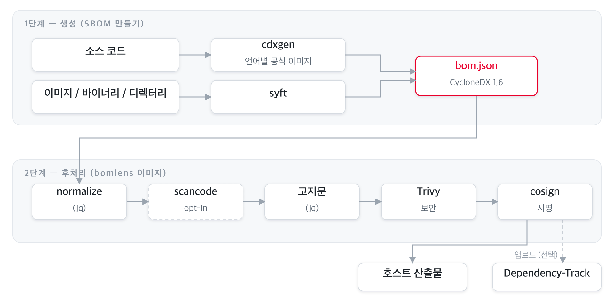
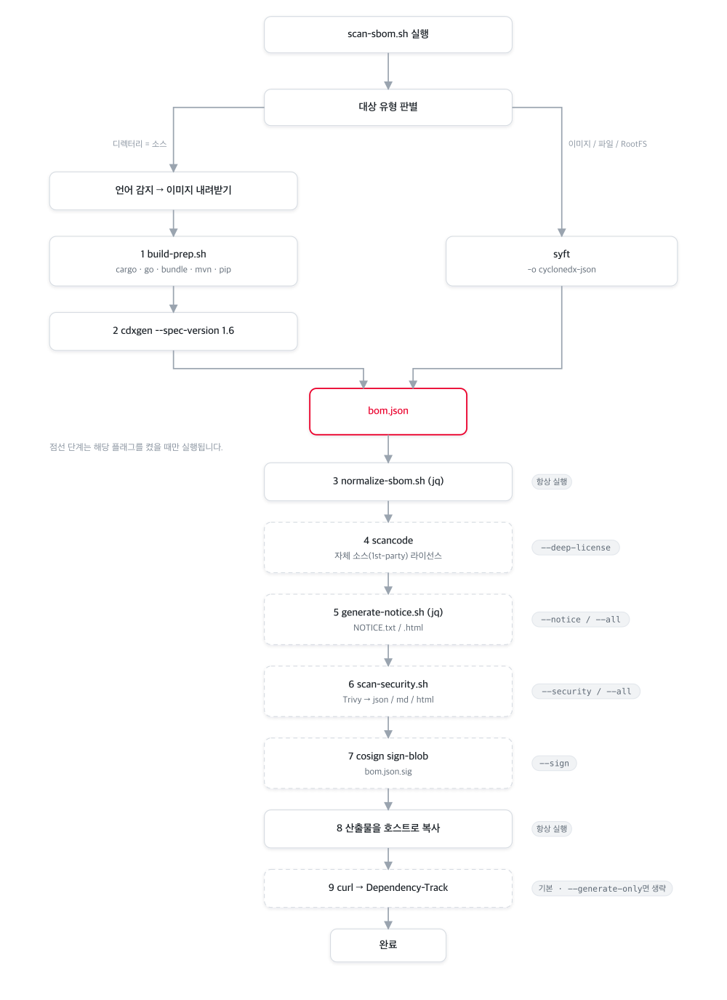
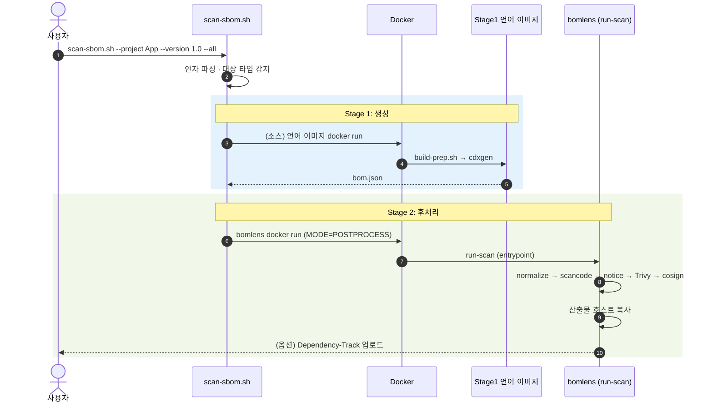
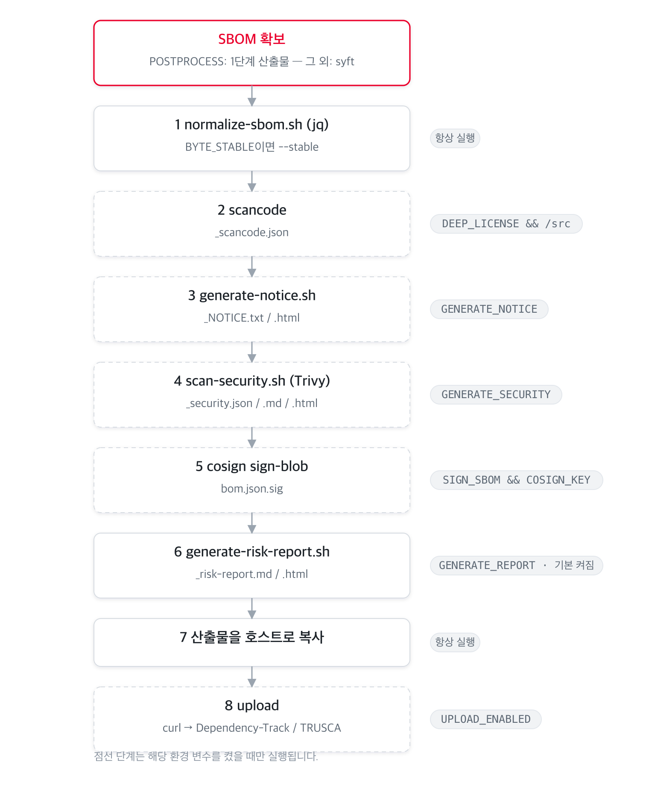
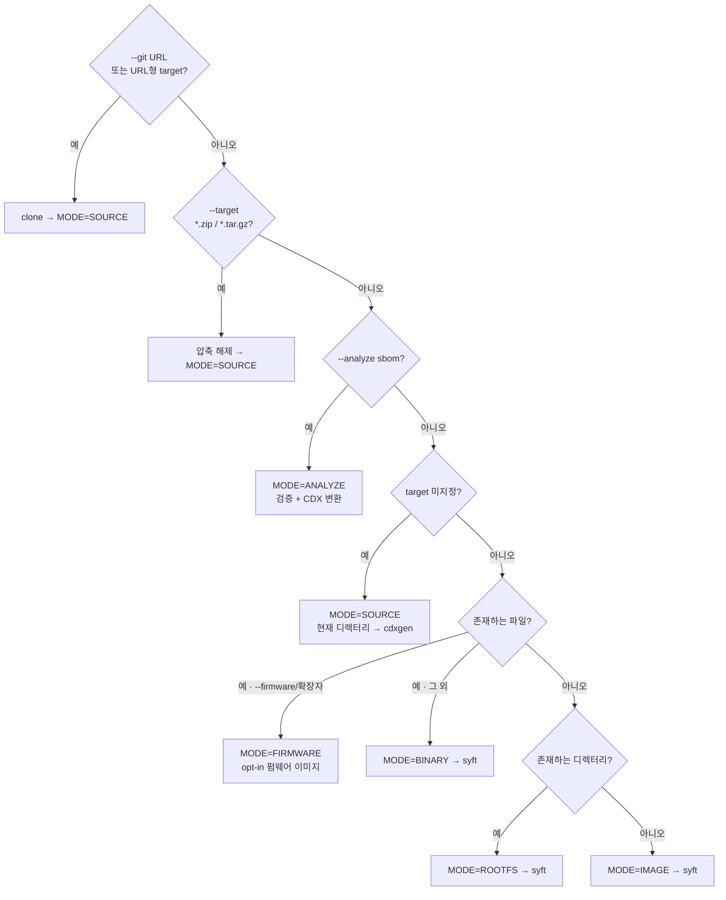
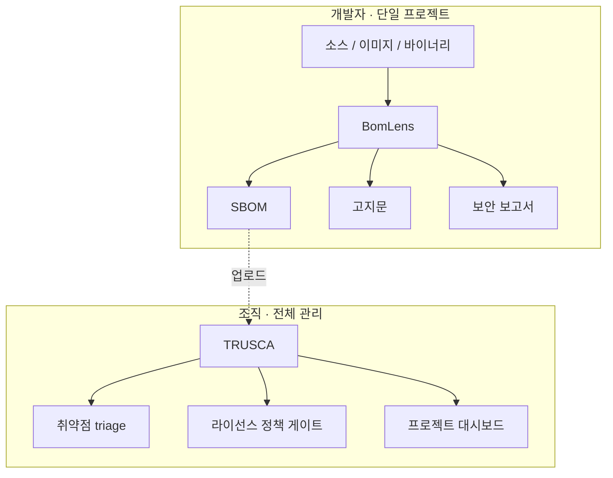

# 아키텍처

BomLens의 전체 시스템 구조와, 스캔 파이프라인에서 각 도구가 어느 단계에서 어떤 순서로 호출되는지 설명합니다.

입력 형태별 도구 흐름(ScanCode와 SCANOSS 옵션을 포함한 소스코드, 펌웨어, 받은 SBOM, AI 모델)은 [입력 형태별 파이프라인](pipeline-by-input.ko.md)을 참고하세요.

> 이 문서는 현재 구현된 2단계(2-stage) 아키텍처를 기준으로 작성되었습니다. 소스 코드의 Stage 1 라우팅(언어 감지 후 cdxgen 공식 언어 이미지 실행)은 `scripts/scan-sbom.sh`에 구현되어 동작합니다.

## 한눈에 보기

BomLens는 두 종류의 Docker 이미지가 협력하는 2단계 파이프라인입니다.

- Stage 1, 생성: 소스 코드는 cdxgen 언어별 공식 이미지가, 컨테이너 이미지·바이너리·디렉터리는 syft가 SBOM을 만듭니다. 기본은 CycloneDX 1.6이고, `--spec-version 1.7`을 주면 1.7입니다.
- Stage 2, 후처리: 경량 `bomlens` 이미지가 SBOM을 받아 정규화, (정밀 라이선스), 고지문, 보안 보고서, 서명, 업로드를 차례로 수행합니다.

오케스트레이션의 단일 진입점은 `scripts/scan-sbom.sh`(Windows는 `scan-sbom.bat`)이며, 사용자는 이 스크립트 하나만 호출합니다.

## 왜 2단계인가

기존에는 모든 언어 런타임 + 분석 도구를 하나의 거대한 이미지에 담았습니다. 재설계된 파이프라인은 책임을 둘로 나눕니다.

| | Stage 1 이미지 | Stage 2 이미지 (`bomlens`) |
|---|---|---|
| 역할 | 소스 → SBOM 생성 | SBOM 후처리(정규화·고지문·보안·서명·업로드) + syft 스캔 |
| 구성 | cdxgen 공식 언어별 이미지 (java·python·node·…) | 언어 toolchain 없음, `python:3.12-slim` 경량 |
| 획득 | 프로젝트 언어 감지 후 on-demand pull | 한 번 pull해서 재사용 |
| 이점 | 언어별 최신 toolchain을 cdxgen이 직접 관리 | 이미지가 작고, 도구 버전 고정으로 재현성 확보 |

> `build-prep.sh`가 cdxgen 전에 그 생태계의 빌드 도구를 실행합니다(Cargo, Bundler, Composer, Swift는 lock 파일이 커밋돼 있지 않을 때만). 그래야 cdxgen이 매니페스트의 직접 의존성만이 아니라 전체 의존성 그래프를 볼 수 있습니다. 생태계마다 실행하는 것은 [의존성을 해석하는 방식](dependency-resolution.ko.md)에 있습니다. cdxgen 단독 실행과 비교해 보려면 [`tests/compare-cdxgen-vs-docker.sh`](https://github.com/sktelecom/bomlens/blob/main/tests/compare-cdxgen-vs-docker.sh)를 참고하세요.

## 도구 목록

파이프라인에서 호출되는 도구입니다.

| 도구 | 단계 | 역할 | 활성 조건 |
|------|------|------|-----------|
| cdxgen | Stage 1 | 소스 코드 SBOM 생성 (`--spec-version 1.6`, 스캔이 1.7을 요청하면 `1.7`) | `MODE=SOURCE` |
| build-prep.sh | Stage 1 | cdxgen 전에 생태계의 빌드 도구를 실행하고(일부 단계는 lock 파일이 없을 때만), SBOM을 배포되는 구성으로 좁힘 | `MODE=SOURCE` |
| syft | Stage 1 | 이미지·바이너리·RootFS 스캔 | `MODE=IMAGE/BINARY/ROOTFS` |
| jq (`normalize-sbom.sh`) | Stage 2 | SBOM 정규화·정렬 | 항상 |
| ScanCode Toolkit | Stage 2 | 1st-party 소스 정밀 라이선스 탐지 | `--deep-license` (opt-in 빌드) |
| SCANOSS | Stage 2 | 패키지 매니저 없는 C/C++ 소스의 vendored 오픈소스 식별 | `--identify-vendored` |
| jq (`generate-notice.sh`) | Stage 2 | 오픈소스 고지문(NOTICE) 생성 | `--notice` / `--all` |
| Trivy | Stage 2 | 취약점(CVE) 보안 보고서 | `--security` / `--all` |
| Cosign | Stage 2 | SBOM detached 서명 | `--sign` |
| curl | Stage 2 | Dependency-Track 업로드 | 기본(=`--generate-only` 아님) |

> 버전은 `docker/Dockerfile`의 `ARG`로 고정되며, [Docker 이미지](../reference/docker-image.ko.md)에 정리돼 있습니다. 이미지 경량화를 위해 ScanCode는 opt-in 빌드 인자입니다(`--build-arg SBOM_DEEP_LICENSE=true`). SCANOSS 클라이언트는 기본 포함이며, 빼려면 `--build-arg SBOM_SCANOSS=false`로 빌드합니다. 펌웨어 언팩·식별(unblob, cve-bin-tool)은 별도 opt-in `bomlens-firmware` 이미지에, AI 모델 SBOM 생성(OWASP AIBOM Generator)은 `bomlens-aibom`에 들어갑니다. 입력 형태별 도구 흐름은 [입력 형태별 파이프라인](pipeline-by-input.ko.md)을 참고하세요.

## 전체 파이프라인 흐름

도구 호출 순서를 한 장으로 본 그림입니다. 점선 박스는 플래그로 켜지는 선택적 단계입니다.

사용자 호출부터 후처리까지의 시퀀스:

## Stage 1: SBOM 생성

대상 타입에 따라 생성 도구가 갈립니다.

### 소스 코드 (`MODE=SOURCE`): cdxgen 언어 이미지

`scan-sbom.sh`가 `detect_lang()`으로 프로젝트 언어를 감지하고, `img_for_lang()`으로 해당 cdxgen 공식 언어 이미지를 골라 pull한 뒤, 그 이미지 안에서 `build-prep.sh`를 실행합니다(`scripts/scan-sbom.sh`, 언어 감지는 `docker/lib/source-detect.sh`). 후처리 경량 이미지에는 언어 toolchain이 없으므로, 생성은 전적으로 언어 이미지가 담당합니다.

언어별 cdxgen 이미지 매핑은 다음과 같습니다 (`docker/lib/source-detect.sh`의 `img_for_lang()`, 태그는 `CDXGEN_TAG`로 고정). 이 이미지는 cdxgen 프로젝트가 `ghcr.io/cdxgen`에 배포하며, 각 언어를 처음 스캔할 때 내려받습니다. 자세한 내용은 [의존성을 해석하는 방식](dependency-resolution.ko.md#빌드-도구는-어디에-있나)에 있습니다.

| 감지 언어 | 이미지 |
|-----------|--------|
| rust | `cdxgen-debian-rust` |
| go | `cdxgen-debian-golang124` |
| ruby | `cdxgen-debian-ruby34` |
| java | `cdxgen-temurin-java21` |
| python | `cdxgen-python312` |
| node | `cdxgen-alpine-node24` |
| php | `cdxgen-debian-php84` |
| dotnet | `cdxgen-debian-dotnet9` |
| swift | `cdxgen-debian-swift` |
| android | `bomlens-android-sdk<API>`, Android SDK를 재배포할 수 없어 스캔하는 컴퓨터에서 빌드 (compileSdk 자동 추출) |
| mixed / unknown | cdxgen all-in-one (`CDXGEN_ALLINONE`) |

이미지 안에서의 두 단계:

1. `build-prep.sh`(`docker/lib/build-prep.sh`)가 cdxgen 직전에 프로젝트를 준비합니다. 그 생태계의 빌드 도구를 실행하고(일부 단계는 lock 파일이 커밋돼 있지 않을 때만), cdxgen이 끝나면 SBOM을 배포되는 구성으로 좁힙니다. 이 단계가 실패해도 스캔은 멈추지 않습니다. 생태계마다 실행하는 것은 [의존성을 해석하는 방식](dependency-resolution.ko.md)에 있습니다.

2. cdxgen 실행: `build-prep.sh`가 이미지별로 다른 cdxgen 바이너리 경로를 자동 탐지해 `cdxgen -r --spec-version 1.6 -o bom.json`을 실행합니다(`--spec-version 1.7`을 주면 `1.7`). 생성된 SBOM은 이어서 Stage 2(`MODE=POSTPROCESS`) 후처리 이미지로 넘어갑니다.

### 이미지 / 바이너리 / 디렉터리: syft

`bomlens` 이미지에 포함된 syft가 직접 SBOM을 생성합니다. (`docker/entrypoint.sh`)

| MODE | 입력 | syft 호출 |
|------|------|-----------|
| `IMAGE` | Docker 이미지 | `syft <image> -o cyclonedx-json` (docker.sock을 마운트하면 Docker 데몬에서, 아니면 레지스트리나 아카이브에서 읽음) |
| `BINARY` | 단일 파일 | `syft file:<path> -o cyclonedx-json` (실패 시 최소 SBOM 폴백) |
| `ROOTFS` | 디렉터리 | `syft dir:<path> -o cyclonedx-json` |

## Stage 2: 후처리 파이프라인

`bomlens` 이미지의 진입점 `run-scan`(`docker/entrypoint.sh`)이 SBOM을 받아 고정된 순서로 단계를 실행합니다. 각 단계는 환경변수(=CLI 플래그)로 켜지며, 산출물은 `ARTIFACTS` 목록에 누적됩니다.

단계별 상세:

| # | 단계 | 스크립트 / 도구 | 조건 | 산출물 |
|---|------|-----------------|------|--------|
| ① | 정규화 | `normalize-sbom.sh` (jq) | 항상 (`--byte-stable`이면 결정론적 모드) | `bom.json` 갱신 |
| ② | 정밀 라이선스 | `scancode` | `--deep-license` + `/src` 존재 | `_scancode.json` |
| ③ | 고지문 | `generate-notice.sh` (jq) | `--notice` / `--all` | `_NOTICE.txt`, `_NOTICE.html` |
| ④ | 보안 보고서 | `scan-security.sh` (Trivy) | `--security` / `--all` | `_security.{json,md,html}` |
| ⑤ | 서명 | `cosign sign-blob` | `--sign` + `COSIGN_KEY` | `bom.json.sig` |
| ⑥ | 오픈소스 위험 보고서 | `generate-risk-report.sh` | 기본 (`--no-report`로 생략) | `_risk-report.{md,html}` (+ ANALYZE면 `_conformance.*`) |
| ⑦ | 호스트 복사 | `cp` | 항상 | `HOST_OUTPUT_DIR`로 복사 |
| ⑧ | 업로드 | `curl` | 기본 (`--generate-only`이면 생략) | Dependency-Track 서버 또는 TRUSCA 네이티브 ingest로 업로드 (`UPLOAD_TARGET`로 선택) |

> 순서가 고정인 이유: 정규화는 이후 모든 단계의 입력을 안정화하므로 가장 먼저, 서명은 최종 `bom.json`을 대상으로 해야 하므로 가장 나중에 실행됩니다. 각 단계는 실패해도 `|| true`/경고로 처리되어 전체 스캔을 중단시키지 않습니다(서명·업로드 제외).

## 입력 타입별 분기

`scan-sbom.sh`는 `--git`/`--analyze`/`--firmware`와 `--target` 값을 보고 모드를 자동 결정합니다.

위에서부터 순차로 판정합니다(먼저 맞는 분기 채택).

> `--ui`는 위 분기와 별개로 `MODE=UI`(웹 서버 `server.py`)를 띄우고, 후속 스캔을 폼/업로드로 실행합니다.

| 모드 | 트리거 | 생성 도구 | 비고 |
|------|--------|-----------|------|
| `SOURCE` | target 미지정 · `--git <url>` · `--target *.zip/*.tar.gz` | cdxgen | 언어 감지 → 언어별 이미지. git는 clone, 아카이브는 자동 해제 후 소스로 처리. (웹 UI의 SOURCE는 컨테이너 내 `syft dir:`) |
| `ANALYZE` | `--analyze <sbom>` (별칭 `--sbom`) | — | 공급사 SBOM(CycloneDX/SPDX) 검증 → CDX 변환 → 재집계. `_conformance.*` 생성 |
| `FIRMWARE` | `--target <file> --firmware` 또는 펌웨어 확장자 | unblob + syft + cve-bin-tool | opt-in 이미지 `bomlens-firmware`. 상세 [펌웨어 분석 가이드](../guides/firmware.ko.md) |
| `BINARY` | `--target <파일>` | syft | `file:` 스킴 |
| `ROOTFS` | `--target <디렉터리>` | syft | `dir:` 스킴 |
| `IMAGE` | `--target <이미지명>` | syft | Docker 데몬(docker.sock 마운트) 또는 레지스트리 |
| `AIBOM` | `--model <owner/name>` | OWASP AIBOM Generator | opt-in 이미지 `bomlens-aibom`. HuggingFace 모델 카드로 CycloneDX 1.7 ML-BOM 생성, G7 적합성 검사 추가 |
| `MODELFILE` | `--model-file <경로>` | `identify-model-file.py`(표준 라이브러리) | 기본 이미지, 오프라인. 모델 파일 헤더로 CycloneDX 1.7 ML-BOM 생성(GGUF, safetensors, PyTorch, pickle, npz, npy, ONNX), 같은 G7 검사 추가 |
| `DATASET` | `--model <Figshare 항목>` 또는 `--model datasets/<owner>/<name>` | `scan-figshare.py`, `scan-hf-dataset.py`(표준 라이브러리) | 기본 이미지. 공개 Figshare 항목 조회로 연구 데이터셋을 읽는다(계정 불필요). 라이선스, DOI, 저자, 파일별 MD5 값이 CycloneDX 1.7 `data` 컴포넌트가 된다. HuggingFace 데이터셋(`datasets/<owner>/<name>`, `https://huggingface.co/datasets/<owner>/<name>`, `hf:<owner>/<name>`)도 같은 `data` 컴포넌트가 되어 라이선스, 허브 리비전, 파일별 SHA-256 값을 담고, 카드의 `source_datasets`에 적힌 데이터셋도 함께 읽는다 |
| `AIDECLARE` | `--ai-declare <파일>`만 지정(`--model`, `--model-file`, `--target` 없음) | `declare-ai-model.py`(표준 라이브러리) | 기본 이미지. 허브 저장소나 파일이 아직 없는 모델을 공개자의 선언으로 기술한다. 모델은 프로젝트 이름과 버전을 붙인 `metadata.component`가 되고 `bomlens:origin=declared-input`으로 표시한다. 선언에 적은 기반 모델과 HuggingFace 데이터셋은 모델 스캔과 같은 방식으로 허브에서 id로 읽는다. 선언한 값은 대부분 SPDX 3.0.1 AI 문서에만 들어가며, 선언한 서비스와 모델의 입력과 출력 종류, 학습 연산량, 적대적 시험 여부는 CycloneDX SBOM에도 발행자 선언으로 표시되어 들어간다 |
| `UI` | `--ui` | — | 브라우저 UI, 모든 스캔 대상을 폼/업로드로 실행 |

## 플래그 ↔ 단계 매핑

CLI 플래그가 어떤 환경변수로 변환되어 어느 단계를 켜는지 정리합니다 (`scan-sbom.sh`가 변환해 `entrypoint.sh`로 전달).

| 플래그 | 환경변수 | 켜지는 단계 |
|--------|----------|-------------|
| (기본) | `GENERATE_REPORT=true` (+ notice·security) | normalize + 오픈소스 위험 보고서 + 업로드 |
| `--no-report` | `GENERATE_REPORT=false` | 오픈소스 위험 보고서·고지문·보안 강제 활성화 안 함 |
| `--notice` | `GENERATE_NOTICE=true` | ③ 고지문 |
| `--security` | `GENERATE_SECURITY=true` | ④ 보안 보고서 |
| `--all` | 위 둘 다 | ③ + ④ |
| `--git <url>` / `--branch` | (호스트에서 clone) | SOURCE 입력 수집 |
| `--analyze <sbom>` | `MODE=ANALYZE` | 공급사 SBOM 검증·변환·보고서 |
| `--firmware` | `MODE=FIRMWARE` (펌웨어 이미지) | 언팩 → syft + cve-bin-tool |
| `--model <owner/name>` | `MODE=AIBOM` (aibom 이미지) | HuggingFace 모델로 ML-BOM 생성 + G7 검사 |
| `--model-file <경로>` | `MODE=MODELFILE` | 모델 파일 헤더를 오프라인으로 읽어 ML-BOM 생성 + G7 검사 |
| `--model <Figshare 항목>`, `--model datasets/<owner>/<name>` | `MODE=DATASET` | 공개된 데이터셋을 Figshare 항목이나 HuggingFace 데이터셋 페이지에서 기술, 공개 데이터셋은 계정 불필요 |
| `--ai-declare <파일>`만 지정 | `MODE=AIDECLARE` | 아직 공개하지 않은 모델을 선언으로 기술 + G7 검사, SPDX 3.0.1 AI 문서 |
| `--deep-license` | `DEEP_LICENSE=true` | ② scancode |
| `--byte-stable` | `BYTE_STABLE=true` | ① 결정론적 정규화 (웹 UI의 Reproducible output 토글도 동일) |
| `--sign` | `SIGN_SBOM=true` (+ `COSIGN_KEY`/`COSIGN_PASSWORD`) | ⑤ 서명 |
| `--generate-only` | `UPLOAD_ENABLED=false` | ⑦ 업로드 생략 |
| `--ui` | `MODE=UI` | 웹 UI |

> 오픈소스 위험 보고서(`_risk-report.{md,html}`)는 모든 모드에서 기본 생성됩니다(라이선스+취약점 집계). 이를 위해 고지문·보안 스캔이 자동으로 함께 켜지며, `--no-report`로 끌 수 있습니다.

각 기능의 사용법은 [고지문·보안 보고서 가이드](../guides/reports.ko.md)를 참조하세요.

## 산출물

`{P}`=프로젝트 이름, `{V}`=버전 (특수문자는 `_`로 정규화).

| 파일 | 생성 조건 |
|------|-----------|
| `{Project}_{Version}_bom.json` | 항상 (CycloneDX 1.6, `--spec-version 1.7`이면 1.7. AI 모델은 1.7 ML-BOM) |
| `{Project}_{Version}_NOTICE.txt` / `.html` / `.pdf` | `--notice` / `--all` / 오픈소스 위험 보고서 기본 생성 시 (PDF는 `SBOM_PDF` 빌드에서만) |
| `{Project}_{Version}_security.json` / `.md` / `.html` | `--security` / `--all` / 오픈소스 위험 보고서 기본 생성 시 |
| `{Project}_{Version}_risk-report.md` / `.html` | 기본 (전 모드), `--no-report`로 생략 |
| `{Project}_{Version}_conformance.json` / `.md` / `.html` | `--analyze` (공급사 SBOM 검증) |
| `{Project}_{Version}_scancode.json` | `--deep-license` |
| `{Project}_{Version}_bom.json.sig` | `--sign` |

## 확장 포인트

### 새 언어 지원 추가
1. 해당 언어의 cdxgen 공식 이미지가 있는지 확인하고, 있으면 라우팅 테이블에 추가.
2. cdxgen이 전이 의존성을 자동 해석하지 못하면 `docker/lib/build-prep.sh`에 보강 로직 추가.
3. `examples/{언어}/`에 예제 프로젝트, `tests/cases/test-{언어}.sh`에 테스트 케이스 추가.

자세한 절차: [패키지 매니저 추가 가이드](../contribute/package-managers.ko.md).

### 새 후처리 단계 추가
`docker/lib/`에 헬퍼 스크립트를 추가하고, `entrypoint.sh`의 공통 파이프라인 구간(정규화 이후)에서 환경변수 가드와 함께 호출한 뒤 산출물을 `ARTIFACTS`에 추가합니다. 서명 단계보다 앞에 배치해야 산출물이 서명 대상에 포함됩니다.

## 설계 원칙

- 격리성: 모든 분석은 Docker 컨테이너에서 수행, 호스트 환경 무오염.
- 책임 분리: 생성(Stage 1)과 후처리(Stage 2)를 분리해 후처리 이미지를 경량화.
- 재현성: 도구 버전을 `ARG`로 고정, `--byte-stable`로 바이트 동일 출력.
- 표준 준수: CycloneDX 스펙 준수. 기본은 1.6, `--spec-version 1.7`이면 1.7.
- 견고성: 후처리 단계는 실패해도 전체 스캔을 중단시키지 않음.
- 단일 인터페이스: 모든 언어·모드를 `scan-sbom.sh` 하나로 호출.

## 역할 분담 (TRUSCA)

BomLens는 생성(generation) 전문 도구입니다. 전사(全社) 프로젝트 관리, 취약점 분류, 라이선스 정책 게이트 같은 거버넌스는 자매 프로젝트 [TRUSCA](https://github.com/trustedoss/trusca)(구 TrustedOSS Portal)에 위임합니다. 두 도구 모두 cdxgen/Trivy를 공유하므로 산출물(CycloneDX)이 그대로 호환됩니다.

> 관련 문서: [입력 형태별 파이프라인](pipeline-by-input.ko.md) | [시작하기](../start/first-scan.ko.md) | [CLI 레퍼런스](../reference/cli.ko.md) | [Docker 이미지 직접 사용](../reference/docker-image.ko.md) | [패키지 매니저 추가](../contribute/package-managers.ko.md)
