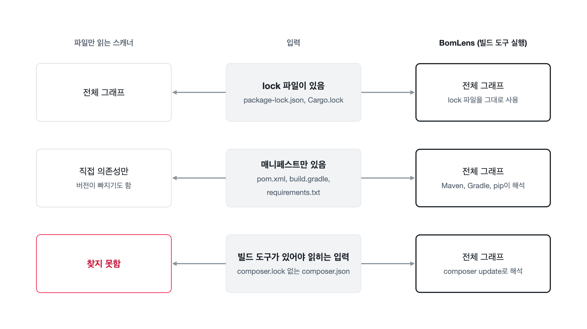
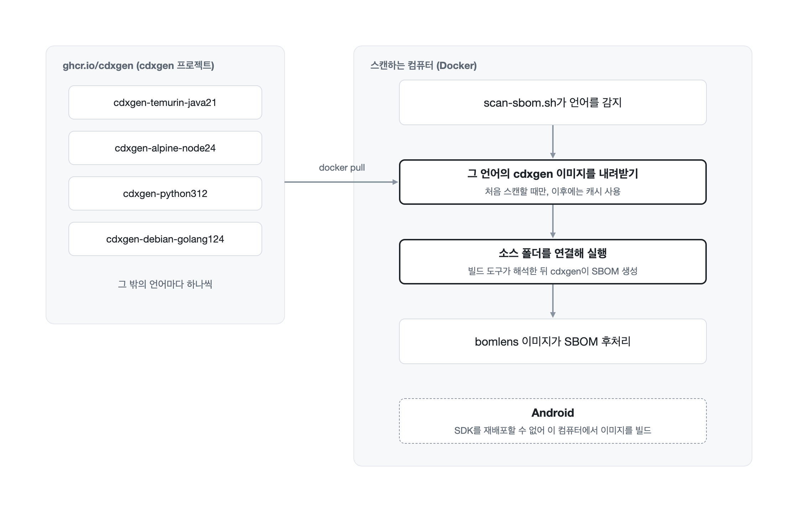
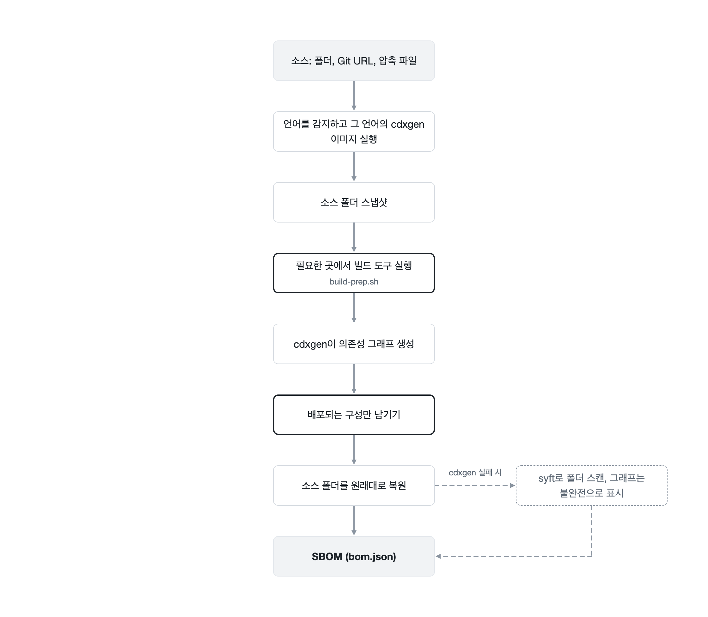
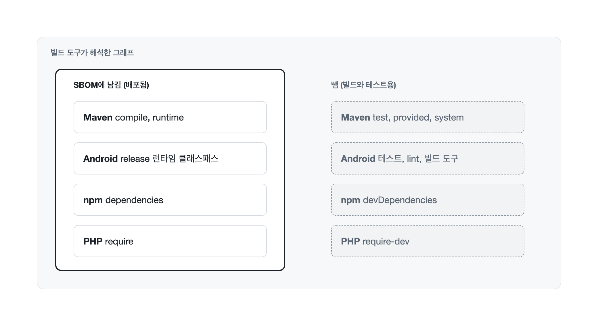
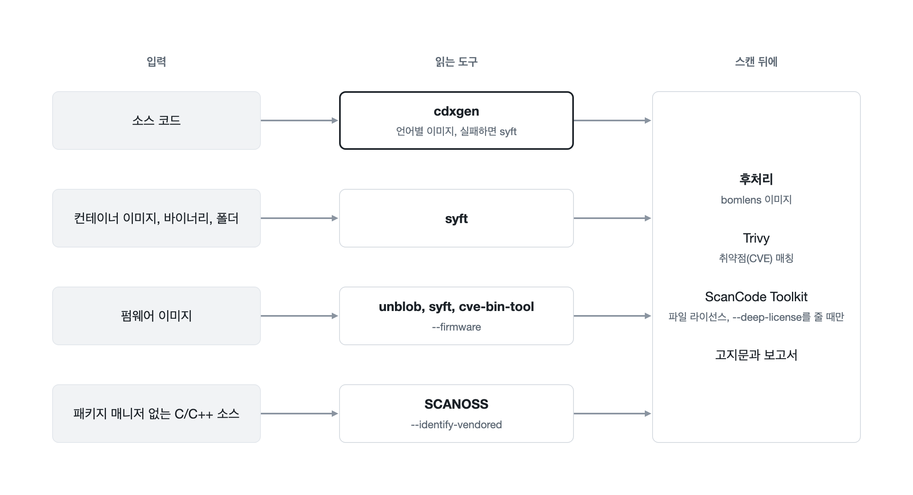

# 의존성을 해석하는 방식

BomLens는 의존성 파일을 글자 그대로 읽는 데서 그치지 않습니다. 소스 코드를 스캔할 때는 그 생태계의 빌드 도구를 컨테이너 안에서 실행해 전체 의존성 그래프를 해석하고, 그중 실제로 배포되는 것만 남깁니다. 이 페이지는 이 방식이 왜 필요한지, 생태계마다 무엇을 실행하는지, 그 대가로 무엇이 필요한지 설명합니다.

## 파일을 읽는 것과 해석하는 것의 차이

`pom.xml`, `package.json`, `composer.json` 같은 매니페스트에는 직접 의존성만 적혀 있고, 버전도 `^2.0`, `>=1.4`처럼 범위로 적히는 경우가 많습니다. 그 의존성이 다시 필요로 하는 전이 의존성과, 빌드에 실제로 들어가는 정확한 버전은 여기에 없습니다. 이 정보는 lock 파일(`package-lock.json`, `Cargo.lock`, `composer.lock`)에 있습니다. 하지만 lock 파일을 커밋하지 않는 프로젝트가 많습니다. 라이브러리는 보통 lock 파일을 저장소에 넣지 않고, Maven과 Gradle은 기본적으로 lock 파일을 쓰지 않습니다.

그래서 파일만 읽는 스캐너는 입력에 따라 결과가 셋으로 갈립니다.

- lock 파일이 있으면 전체 그래프를 얻습니다.
- 매니페스트만 있으면 직접 의존성만 얻고, 버전이 빠지기도 합니다.
- 빌드 도구 없이는 읽을 수 없는 입력(예: `composer.lock`이 없는 Composer 프로젝트)에서는 아무것도 얻지 못합니다.

답을 아는 것은 빌드 도구입니다. Maven, Gradle, Composer, Bundler, Cargo, Go 도구 모음은 매니페스트와 패키지 저장소를 보고 그래프를 해석합니다. BomLens는 이 도구들을 직접 실행하므로, lock 파일이 없는 프로젝트도 빌드 도구가 고른 버전으로 전이 의존성까지 얻습니다.

다만 전체 그래프가 곧 배포되는 소프트웨어는 아닙니다. 빌드 도구는 테스트 프레임워크와 린터, 빌드 플러그인까지 함께 해석합니다. BomLens는 생태계가 의존성의 용도(scope)를 기록하는 경우 이런 항목을 걸러 냅니다. 자세한 내용은 [배포되는 구성만 남기기](#배포되는-구성만-남기기)에 있습니다.

## 빌드 도구는 어디에 있나

`bomlens` 이미지 자체에는 언어 도구 모음이 없고, BomLens가 그런 이미지를 따로 배포하지도 않습니다. [cdxgen](https://github.com/CycloneDX/cdxgen) 프로젝트가 `ghcr.io/cdxgen`에 언어마다 이미지를 하나씩 배포하며, 각 이미지에 빌드 도구가 들어 있습니다. Java는 JDK와 Maven, Gradle, 그 밖에는 Node.js와 npm, Python과 pip, Go, Cargo, Ruby와 Bundler, PHP와 Composer, .NET SDK, Swift입니다. 소스 스캔을 시작하면 `scan-sbom.sh`가 언어를 감지하고, 그 언어의 이미지를 BomLens가 고정한 태그로 내려받아 소스 폴더를 연결한 채 실행합니다. 이미지는 그 언어를 처음 스캔할 때 한 번 내려받고, 이후에는 Docker에 남아 있는 것을 다시 씁니다.

Android는 예외입니다. Android SDK는 재배포할 수 없으므로, 이미지를 사용하는 컴퓨터에서 프로젝트의 `compileSdk`에 맞춰 직접 빌드합니다. 이미지가 없으면 `scan-sbom.sh`가 빌드 명령을 안내합니다. `ghcr.io`에 접속할 수 없는 네트워크에서는 `CDXGEN_IMAGE_PREFIX`로 사내 레지스트리 미러를 지정할 수 있습니다([CLI 레퍼런스](../reference/cli.ko.md)). 이미지 목록은 [아키텍처](architecture.ko.md#소스-코드-modesource-cdxgen-언어-이미지)에 있습니다.

스캔하는 컴퓨터에는 Docker 말고 설치할 것이 없고, 결과가 그 컴퓨터에 설치된 도구 버전에 좌우되지도 않습니다.

## 생태계마다 실행하는 것

cdxgen이 프로젝트를 읽기 전에 `docker/lib/build-prep.sh`가 프로젝트를 준비합니다. 커밋된 lock 파일을 바꾸지는 않습니다. lock 파일을 만드는 것이 목적인 단계(Cargo, Bundler, Composer, Swift)는 lock 파일이 커밋돼 있으면 건너뛰므로, SBOM에 프로젝트가 실제로 빌드하는 버전이 담깁니다. 나머지 단계는 그래프를 완성하거나 cdxgen이 이어서 읽을 정보를 모으므로 스캔할 때마다 실행합니다.

| 생태계 | 실행하는 것 | 실행 조건 |
|--------|-------------|-----------|
| Java (Maven) | cdxgen이 Maven을 실행해 그래프를 만듭니다. 컴포넌트 해시를 구하려고 의존성 jar도 내려받습니다 | 매번 |
| Java (Gradle) | `gradle dependencies`(`./gradlew`가 있으면 그것을 씀) | 매번 |
| Android | Gradle로 release 런타임 클래스패스를 해석해 아래 범위 필터에 씁니다 | 매번 |
| Node.js (npm) | cdxgen이 이미지 안의 npm으로 `package.json`을 해석하고, 범위 필터용 프로덕션 의존성 목록을 따로 해석합니다 | 매번 |
| Python | `pip install -r requirements.txt`. 한꺼번에 설치하다 실패하면 항목마다 다시 시도해, 고정 버전 하나가 실패해도 나머지는 잃지 않습니다 | `requirements.txt`가 있을 때 |
| Python (Poetry) | `[tool.poetry.dependencies]`의 정확한 고정 버전을 `requirements.txt`로 씁니다. 범위, git, 경로 항목은 빠집니다 | `poetry.lock`과 `requirements.txt`가 모두 없을 때 |
| Go | `go mod tidy`, 실패하면 `go mod download`. `go.sum`을 채웁니다 | `go.mod`가 있으면 항상 |
| Rust | `cargo generate-lockfile`(cdxgen은 Cargo를 스스로 실행하지 않음) | `Cargo.lock`이 없을 때 |
| Ruby | `bundle lock`, 실패하면 `bundle install` | `Gemfile.lock`이 없을 때 |
| PHP | `composer.json`에서 `require-dev`를 뺀 뒤 `composer update --no-dev`를 실행하고, 끝나면 원래 파일로 되돌립니다(cdxgen은 `composer.json`을 스스로 해석하지 않음) | `composer.lock`이 없을 때 |
| Swift | `swift package resolve`. CocoaPods는 `Podfile.lock`에서 읽습니다 | `Package.resolved`가 없을 때 |
| .NET | cdxgen이 이미지 안의 .NET SDK로 프로젝트를 읽습니다. `packages.lock.json`을 커밋하면 버전이 고정됩니다 | 매번 |

이 단계들은 스캔 대상 폴더에 파일을 씁니다. 새 `Cargo.lock`이 생기거나, `go.mod`가 바뀌거나, `vendor/`나 `build/` 폴더가 생깁니다. BomLens는 실행 전에 스냅샷을 떠 두었다가 끝나면 폴더를 원래대로 되돌리므로, 스캔이 소스에 변경을 남기지 않습니다. 해석 결과를 남겨 두려면 `BOMLENS_KEEP_BUILD_OUTPUT=1`을 설정하세요.

실행한 단계와 커밋된 lock 파일로 대신한 단계는 SBOM에 기록되고, 실패한 단계는 따로 기록됩니다. 이 두 기록으로 SBOM이 자신의 의존성 그래프를 완전(complete)과 불완전(incomplete) 중 어느 쪽으로 표시할지 정합니다. [의존성 그래프 완전성](../reference/artifacts.ko.md#의존성-그래프-완전성)을 참고하세요.

## 배포되는 구성만 남기기

해석한 그래프에는 빌드와 테스트 도구가 섞여 있습니다. 작은 Node.js 앱에서도 개발용 의존성(테스트 실행기, 린터, 번들러)이 프로덕션 의존성보다 몇 배 많을 수 있습니다. BomLens는 생태계가 용도를 기록하는 경우 SBOM을 배포 대상으로 좁힙니다.

| 생태계 | 남기는 것 | 빼는 것 | 전부 남기려면 |
|--------|-----------|---------|---------------|
| Maven | `compile`, `runtime` 범위 | `test`, `provided`, `system` | `BOMLENS_MAVEN_FULL_GRAPH=1` |
| Android | release 런타임 클래스패스, 없으면 알파벳순 첫 flavor의 release 변형 | 테스트, lint, 빌드 도구 | `BOMLENS_ANDROID_FULL_GRAPH=1` |
| Node.js (npm) | 임시 사본에서 `npm install --omit=dev --package-lock-only`로 해석한 프로덕션 의존성 | `devDependencies`와 그것만 필요로 하는 것 | `BOMLENS_NODE_FULL_GRAPH=1` |
| PHP | `require` | `require-dev` | `BOMLENS_PHP_FULL_GRAPH=1` |

`package-lock.json`이 없는 yarn, pnpm, bun 워크스페이스 루트는 프로덕션 의존성 목록에 멤버의 의존성이 잡히지 않으므로 Node.js 전체 그래프를 그대로 둡니다. 환경 변수 목록은 [Docker 이미지](../reference/docker-image.ko.md#환경-변수)에, 그 밖에 생태계마다 다른 제약은 [지원 생태계](../reference/ecosystems.ko.md)에 있습니다.

## 도구마다 맡는 일

모든 입력을 잘 다루는 오픈소스 도구는 하나도 없습니다. 그래서 BomLens는 여러 도구를 실행하고, 각 도구에 가장 잘하는 일을 맡깁니다.

| 도구 | 맡는 일 |
|------|---------|
| cdxgen | 언어별 이미지에서 소스 코드의 의존성 그래프 생성 |
| syft | 컨테이너 이미지, 단일 바이너리, 루트 파일시스템 스캔과 소스 코드의 폴백 |
| Trivy | 컴포넌트에 대응하는 취약점(CVE) 매칭 |
| ScanCode Toolkit | 프로젝트 자신의 파일에 적힌 라이선스 탐지(`--deep-license`) |
| SCANOSS | 패키지 매니저 없이 C/C++ 소스에 복사해 넣은 오픈소스 식별(`--identify-vendored`) |
| unblob, cve-bin-tool | 펌웨어 압축 해제와 정적 링크된 바이너리 식별(`--firmware`) |

cdxgen을 실행할 수 없거나 처리 도중 실패하면 BomLens는 폴더를 syft로 대신 스캔합니다. syft는 lock 파일을 직접 읽지만 빌드 도구를 실행하지 않으므로 전이 의존성이 줄어듭니다. 이때 SBOM에는 사유와 함께 `bomlens:sbom-tool-degraded`가 남고, 그래프는 불완전으로 표시됩니다. 입력 형태별 흐름은 [입력 형태별 파이프라인](pipeline-by-input.ko.md)에, 고정된 도구 버전은 [Docker 이미지](../reference/docker-image.ko.md)에 있습니다.

## 그 대가로 필요한 것

- 컨테이너가 패키지 저장소(Maven Central, npm, PyPI, crates.io, Packagist 또는 사내 미러)에 접속할 수 있어야 합니다. 접속하지 못하면 Maven과 Gradle은 직접 의존성만 내고 라이선스도 많이 빕니다.
- lock 파일이 없으면 빌드 도구는 스캔 시점에 범위 안에서 가장 새로운 버전을 고릅니다. 한 달 간격으로 스캔하면 결과가 다를 수 있고, 어느 쪽도 실제 배포한 버전과 같다는 보장은 없습니다. SBOM을 빌드와 일치시키는 방법은 lock 파일을 커밋하는 것뿐입니다.
- 해석은 파일을 읽는 것보다 오래 걸립니다. 캐시가 빈 Gradle 프로젝트는 15분 넘게 걸릴 수 있습니다. Docker 엔진의 메모리가 부족하면 Java나 Android 빌드가 중단되어 직접 의존성만 남습니다(BomLens는 약 3.5 GiB 미만이면 경고합니다).
- 범위 필터는 생태계가 기록한 정보에 의존합니다. release 설정이 없는 Android 프로젝트처럼 용도를 읽을 수 없으면, 배포되는 컴포넌트를 잘못 빼지 않도록 전체 그래프를 그대로 둡니다.
