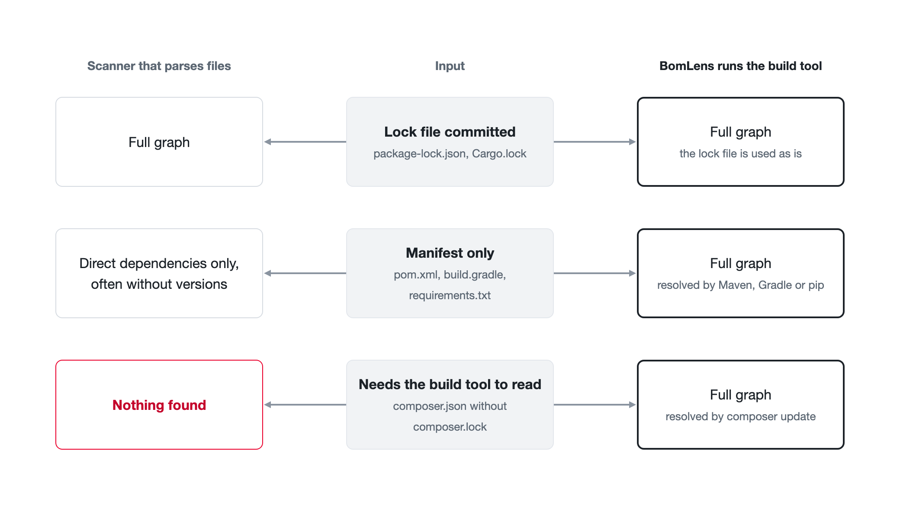

# How dependencies are resolved

BomLens does not stop at reading dependency files. For source code it runs the ecosystem's own build tool inside a container, resolves the full dependency graph, and then keeps only what the project ships. This page explains why that matters, what BomLens runs for each ecosystem, and what it costs.

## Reading files versus resolving them

A manifest such as `pom.xml`, `package.json` or `composer.json` lists the direct dependencies, often as version ranges (`^2.0`, `>=1.4`). The dependencies of those dependencies, and the exact versions that end up in the build, are not in it. A lock file (`package-lock.json`, `Cargo.lock`, `composer.lock`) has them, but many projects do not commit one: libraries usually leave it out, and some ecosystems such as Maven and Gradle do not use one by default.

A scanner that only parses files therefore gets one of three results:

- With a lock file, the full graph.
- With a manifest only, the direct dependencies, sometimes without versions.
- With an ecosystem it cannot parse without the build tool (a Composer project with no `composer.lock`, for example), nothing.

The build tool itself knows the answer. Maven, Gradle, Composer, Bundler, Cargo and the Go toolchain all resolve the graph from the manifest and the package registry. BomLens runs them, so a project without a lock file still gets its transitive dependencies with the versions the build tool picks.

A full graph is not the same as the shipped software, though. Build tools also resolve test frameworks, linters and build plugins. BomLens filters those out where the ecosystem records the scope, as described in [Keeping only what ships](#keeping-only-what-ships).

## Where the build tools come from

The `bomlens` image itself carries no language toolchain, and BomLens does not publish one. The [cdxgen](https://github.com/CycloneDX/cdxgen) project publishes one image per language on `ghcr.io/cdxgen`, each with the build tool already in it: a JDK with Maven and Gradle for Java, Node.js and npm, Python and pip, Go, Cargo, Ruby and Bundler, PHP and Composer, the .NET SDK, and Swift. When a source scan starts, `scan-sbom.sh` detects the language, pulls the matching image at the tag BomLens pins, and runs it with the source folder mounted. The first scan of a language downloads the image; later scans reuse the copy Docker keeps.

Android is the exception. The Android SDK may not be redistributed, so its image is built on the machine that uses it, at the project's `compileSdk`; `scan-sbom.sh` prints the build command when the image is missing. On a network that cannot reach `ghcr.io`, `CDXGEN_IMAGE_PREFIX` points the pulls at an internal registry mirror ([CLI reference](../reference/cli.md)). The image list is in [Architecture](architecture.md#source-code-modesource-cdxgen-language-image).

Nothing needs to be installed on the scanning machine besides Docker, and the toolchain version does not depend on what that machine happens to have.

## What runs for each ecosystem

Before cdxgen reads the project, `docker/lib/build-prep.sh` prepares it. A committed lock file is never replaced: where the step only creates a lock file (Cargo, Bundler, Composer, Swift), it is skipped when one is committed, so the SBOM lists the versions the project builds with. The other steps run on every scan, because they complete the graph or collect what cdxgen reads afterwards.

| Ecosystem | What runs | When |
|-----------|-----------|------|
| Java (Maven) | cdxgen runs Maven to build the graph; the dependency jars are also fetched so components get hashes | Every scan |
| Java (Gradle) | `gradle dependencies`, with `./gradlew` when present | Every scan |
| Android | Gradle resolves the release runtime classpath, used for the scope filter below | Every scan |
| Node.js (npm) | cdxgen resolves `package.json` with the npm in its image; the production set is resolved separately for the scope filter | Every scan |
| Python | `pip install -r requirements.txt`; when the bulk install fails, each requirement is retried on its own, so one bad pin does not lose the rest | When `requirements.txt` exists |
| Python (Poetry) | Exact pins in `[tool.poetry.dependencies]` are written to a `requirements.txt`; ranges, git and path entries are left out | No `poetry.lock` and no `requirements.txt` |
| Go | `go mod tidy`, falling back to `go mod download`, so `go.sum` is complete | Whenever `go.mod` exists |
| Rust | `cargo generate-lockfile` (cdxgen does not run Cargo on its own) | No `Cargo.lock` |
| Ruby | `bundle lock`, falling back to `bundle install` | No `Gemfile.lock` |
| PHP | `composer update --no-dev` with `require-dev` taken out of `composer.json`, which is put back afterwards (cdxgen does not resolve `composer.json` on its own) | No `composer.lock` |
| Swift | `swift package resolve`; CocoaPods is read from `Podfile.lock` | No `Package.resolved` |
| .NET | cdxgen reads the project with the .NET SDK in its image; a committed `packages.lock.json` pins the versions | Every scan |

These steps write into the scanned folder (a new `Cargo.lock`, a rewritten `go.mod`, a `vendor/` or `build/` folder). BomLens takes a snapshot first and puts the folder back afterwards, so the scan leaves no changes behind. Set `BOMLENS_KEEP_BUILD_OUTPUT=1` to keep what the resolution produced.

Every step that ran, or was satisfied by a committed lock file, is recorded in the SBOM, and a step that failed is recorded separately. Together they decide whether the SBOM marks its dependency graph as complete or incomplete; see [Dependency-graph completeness](../reference/artifacts.md#dependency-graph-completeness).

## Keeping only what ships

A resolved graph includes the build and test tools. On a small Node.js app the development tree (test runner, linter, bundler) can be many times larger than the production dependencies. BomLens narrows the SBOM to the deployable set where the ecosystem records it.

| Ecosystem | Kept | Removed | Keep everything with |
|-----------|------|---------|----------------------|
| Maven | `compile` and `runtime` scope | `test`, `provided`, `system` | `BOMLENS_MAVEN_FULL_GRAPH=1` |
| Android | The release runtime classpath, or the first flavored release variant when there is none | Test, lint and build tooling | `BOMLENS_ANDROID_FULL_GRAPH=1` |
| Node.js (npm) | The production set, resolved with `npm install --omit=dev --package-lock-only` in a scratch copy | `devDependencies` and what only they need | `BOMLENS_NODE_FULL_GRAPH=1` |
| PHP | `require` | `require-dev` | `BOMLENS_PHP_FULL_GRAPH=1` |

A yarn, pnpm or bun workspace root without `package-lock.json` keeps the full Node.js graph, because the production set cannot see the members' dependencies. The environment variables are listed in [Docker image](../reference/docker-image.md#environment-variables), and other ecosystem-specific limits in [Supported ecosystems](../reference/ecosystems.md).

## Which tool does what

No single open source tool covers every input well, so BomLens runs several and gives each the part it is good at.

| Tool | Used for |
|------|----------|
| cdxgen | Dependency graph of source code, in the per-language image |
| syft | Container images, single binaries and root filesystems, and the fallback for source code |
| Trivy | Vulnerabilities (CVE) matched against the components |
| ScanCode Toolkit | License text in the project's own files (`--deep-license`) |
| SCANOSS | Open source copied into C/C++ source with no package manager (`--identify-vendored`) |
| unblob and cve-bin-tool | Unpacking firmware and identifying statically linked binaries (`--firmware`) |

When cdxgen cannot run or fails partway through, BomLens scans the folder with syft instead. syft reads lock files directly but does not run the build tool, so the result has fewer transitive dependencies. The SBOM then carries `bomlens:sbom-tool-degraded` with the reason, and the graph is marked incomplete. The flow for each input type is in [Pipeline by input type](pipeline-by-input.md), and the pinned tool versions are in [Docker image](../reference/docker-image.md).

## What this costs

- The container needs to reach the package registries (Maven Central, npm, PyPI, crates.io, Packagist, or an internal mirror). Without access, Maven and Gradle give only the direct dependencies and many licenses stay empty.
- Without a lock file, the build tool picks the newest versions the ranges allow at scan time. Two scans a month apart can differ, and neither is guaranteed to match what was deployed. Committing a lock file is the only way to make the SBOM match the build.
- Resolving takes longer than reading a file. A Gradle project with an empty cache can take more than 15 minutes, and a Java or Android build is stopped when the Docker engine has too little memory (BomLens warns below about 3.5 GiB), leaving only the direct dependencies.
- Scope filters depend on what the ecosystem records. When the scope cannot be read (for example, an Android project with no release configuration), BomLens keeps the full graph rather than risk dropping shipped components.
