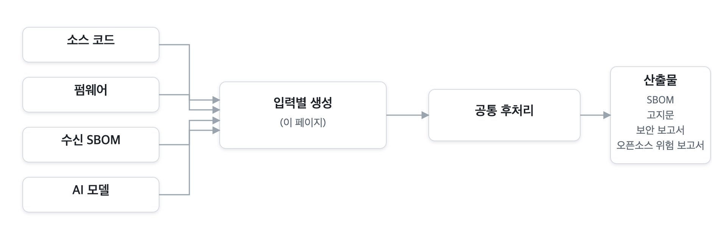
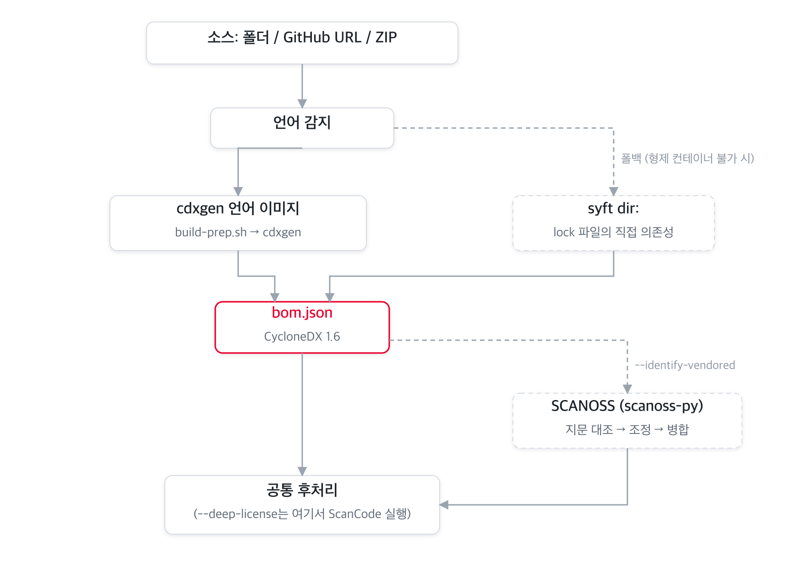
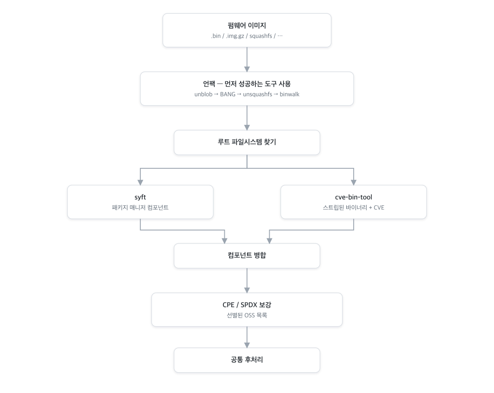
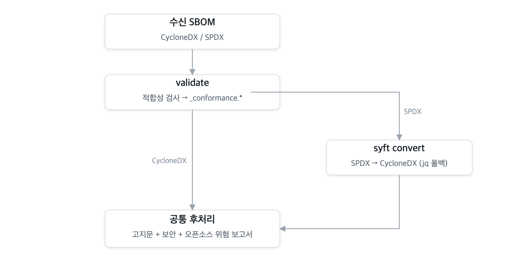
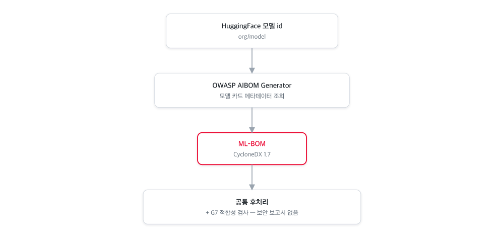
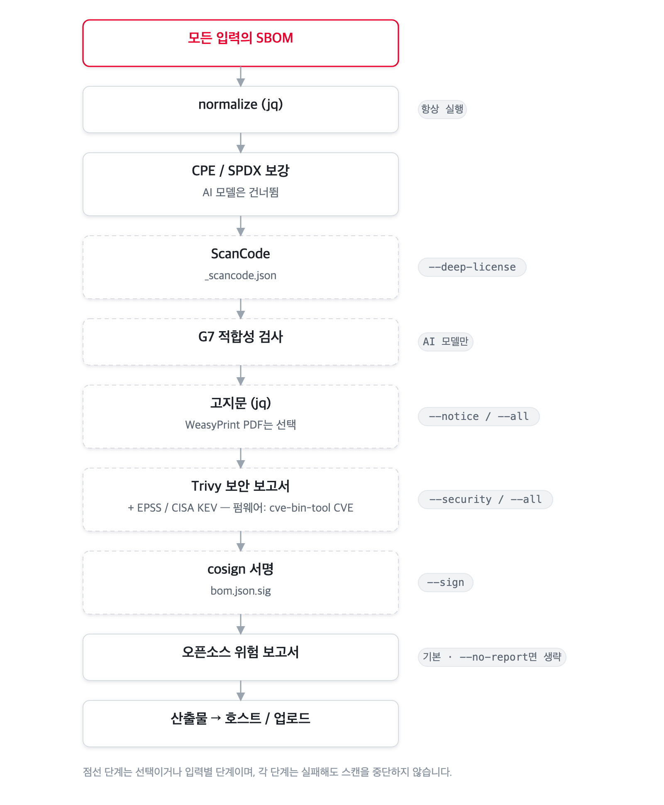

# 입력 형태별 파이프라인

BomLens는 여러 입력을 받습니다. 소스코드, 펌웨어, 받은 SBOM, AI 모델입니다. 각 입력은 CycloneDX SBOM을 만드는 **생성** 단계를 따로 거친 뒤, 모두 하나의 공통 **후처리** 파이프라인(고지문, 보안, 위험 보고서)으로 합류합니다. 이 문서는 입력별 도구 흐름을 따라갑니다. 2단계 개요는 [아키텍처](architecture.ko.md)를 참고하세요.

아래 외부 도구는 모두 오픈소스입니다. [사용 오픈소스 도구](#사용-오픈소스-도구) 표에 각 도구의 역할, 라이선스, 프로젝트 링크를 정리했습니다.

---

## 소스코드

소스 폴더, GitHub URL, ZIP 아카이브입니다. 언어 감지로 알맞은 공식 [cdxgen](https://github.com/CycloneDX/cdxgen) 언어 이미지를 골라, 의존성을 준비(`build-prep.sh`)한 뒤 SBOM을 생성합니다. 형제 컨테이너를 실행할 수 없을 때(예: 웹 UI의 소스 스캔)나 cdxgen 자체가 처리 도중 실패했을 때(내부 예외, 또는 자체 문서 검증이 결과를 거부한 경우)는 디렉터리를 [syft](https://github.com/anchore/syft)로 스캔하는 방식으로 폴백하며, 이때는 락 파일에서 직접 의존성을 잡습니다. 어느 경우든 SBOM에는 사유와 함께 `bomlens:sbom-tool-degraded`가 남습니다. Node/npm에서는 폴백 결과가 프로젝트의 선언된 의존성을 하나도 포함하지 않으면 그 결과를 버리고 안내와 함께 스캔을 실패로 끝내며, 실제로는 아무것도 못 잡았는데 완전한 것처럼 보이는 결과를 보고하지 않습니다. 소스가 의존성을 선언했는데(매니페스트나 lock 파일에 의존성이 있음) 컴포넌트를 하나도 찾지 못하면, SBOM에 해당 파일을 적은 `bomlens:sbom-empty-with-manifests`가 남고 결과 매니페스트는 `generate` 단계를 degraded(`no_components`)로 기록합니다.

cdxgen이 프로젝트를 읽기 전에 빌드 도구가 하는 일과 그 도구가 들어 있는 이미지는 [의존성을 해석하는 방식](dependency-resolution.ko.md)에 있습니다.

소스 스캔에만 적용되는 옵션이 두 가지 있고, 둘 다 기본은 꺼짐입니다.

- **내장 OSS 식별**(`--identify-vendored`, [SCANOSS](https://github.com/scanoss/scanoss.py)) — 패키지 매니저 없이 복사해 넣은 C/C++ 등의 코드를 위한 옵션입니다. SCANOSS 클라이언트가 파일 지문을 만들어 호스팅 OSSKB 서비스에 조회하고, 패키지 매니저 스캔이 이미 찾은 것과 대조해 중복을 제거한 뒤 나머지를 SBOM에 병합합니다.
- **정밀 라이선스 탐지**(`--deep-license`, [ScanCode Toolkit](https://github.com/aboutcode-org/scancode-toolkit)) — 1st-party 소스의 라이선스 헤더를 탐지합니다. 후처리 단계에서 돌며 별도 `_scancode.json`을 남깁니다.

> 컨테이너 이미지, 단일 바이너리, 디렉터리(루트 파일시스템)는 cdxgen을 건너뛰고 syft가 바로 스캔한 뒤 같은 후처리를 따릅니다.

---

## 펌웨어

네트워크 장비 펌웨어 이미지(`.bin`, `.img.gz`, squashfs 등)이며, opt-in `bomlens-firmware` 이미지가 담당합니다. 펌웨어는 운영체제와 라이브러리 수십 개를 한 파일에 밀봉하므로, 먼저 압축을 풀고 두 가지로 구성요소를 식별합니다. 패키지 매니저 메타데이터는 syft로, strip된 정적 바이너리는 [cve-bin-tool](https://github.com/intel/cve-bin-tool)의 시그니처 검사기로 식별해 CPE를 붙입니다. 두 결과를 병합한 뒤, 잘 알려진 OSS(busybox, dropbear, dnsmasq 등)의 CPE/SPDX를 채우는 보강 단계를 거치고, 그 결과를 Trivy와 고지문 생성이 이어받아 활용합니다. 패키지 PURL이 없는 컴포넌트는 이어서 이미지에 들어 있는 NVD CPE 인덱스와 CPE로 대조합니다.

언팩은 먼저 성공한 도구를 쓰는 순서로 시도합니다. [unblob](https://github.com/onekey-sec/unblob)(기본), 표준 squashfs용 `unsquashfs`, Windows 배포물이 담겨 오는 컨테이너 형식용 `7z`, 그다음 `binwalk`입니다.

> 펌웨어 도구는 GPL 계열이라 `bomlens-firmware` 이미지에만 들어가고 기본 이미지에는 설치하지 않습니다. [펌웨어 가이드](../guides/firmware.ko.md)와 그 한계를 참고하세요.

---

## 받은 SBOM

협력사 등 외부에서 받은 SBOM(CycloneDX 또는 SPDX)이며, 소스 코드가 필요 없습니다. BomLens는 먼저 품질 기준에 맞는지 검사해 적합성 검사 보고서를 쓰고, 이후 파이프라인이 분석할 수 있도록 입력을 CycloneDX로 정규화합니다. SPDX는 `syft convert`로 변환하며, syft를 쓸 수 없으면 `jq` 폴백이 SPDX JSON을 처리합니다. 이 모드에서는 고지문, 보안, 위험 보고서가 항상 생성됩니다.

> 적합성 검사는 변환 전 원본을 기준으로 하므로, SPDX는 SPDX로 검사합니다. 자세한 내용은 [공급사 SBOM 가이드](../guides/supplier-sbom.ko.md)에 있습니다.

Yocto 빌드 디렉터리도 이 경로로 들어옵니다. `--target`으로 빌드 디렉터리를 지정하면 그렇게 인식해서, 빌드가 `tmp/deploy/images/` 아래에 만든 이미지 SBOM이 같은 경로를 탑니다. 다만 일반 SPDX 변환이 아니라 전용 파서가 읽어, 이미지에 설치된 패키지 목록과 빌드가 기록한 취약점 판정을 살립니다. 그 뒤 펌웨어 스캔과 같이 컴포넌트에 upstream 저장소 purl을 붙입니다. 빌드 판정이 없는 SPDX 2.2 아카이브만 `--security`를 켰을 때 CPE를 이미지에 들어 있는 NVD CPE 인덱스와 대조합니다.

---

## AI 모델

HuggingFace 모델 id(`org/model`)이며, opt-in `bomlens-aibom` 이미지가 담당합니다. [OWASP AIBOM Generator](https://github.com/GenAI-Security-Project/aibom-generator)가 네트워크로 모델 카드 메타데이터를 가져와, 모델과 데이터셋 중심의 CycloneDX 1.7 ML-BOM을 만듭니다. 이후 후처리에서 G7 최소 요소 적합성 검사를 더합니다. AI 모델에는 패키지 CVE가 없으므로 보안 보고서는 건너뜁니다.

AI 입력에는 기본 이미지에서 전부 처리되는 두 번째 경로가 있습니다. 모델 파일 자체를 읽는 경로(`--model-file`, 웹 UI에서는 모델 파일 업로드)입니다. 생성기도 네트워크도 쓰지 않고, 표준 라이브러리로 작성한 리더가 파일 헤더를 해석합니다. 형식은 파일 이름이 아니라 매직 바이트로 판별하고, 파일 해시를 구한 뒤 같은 CycloneDX 1.7 ML-BOM 모양으로 씁니다. 이후 후처리는 동일합니다. 공급사가 보낸 가중치나 공개한 적 없는 모델이 이 경로에 해당합니다. 채울 수 있는 정보는 형식마다 다릅니다. GGUF는 이름과 라이선스, 아키텍처를 선언하고 safetensors는 대개 텐서 정보만 선언하며, 둘 다 없는 파일도 무결성 해시는 남깁니다.

AI 입력에는 기본 이미지에서 처리되는 세 번째 경로도 있습니다. 공개된 연구 데이터셋을 Figshare 항목으로 주는 경로입니다(`--model`에 항목 주소나 DOI, 항목 번호). 공개 항목 조회는 계정 없이 응답하고, SBOM에 필요한 값(라이선스, DOI, 저자, 파일별 해시)이 모델 카드의 서술이 아니라 필드로 들어 있어서, 표준 라이브러리로 작성한 리더가 그대로 옮겨 CycloneDX 1.7 `data` 컴포넌트로 만듭니다. 이후 후처리는 동일합니다. 논문이 공개한 데이터가 이 경로에 해당하며, 실제로 많은 연구 데이터가 그곳에 있습니다. 표준 식별자로 옮길 수 있는 라이선스는 SPDX 식별자로 기록하고 그 밖의 것은 추측하지 않고 표기 그대로 남기며, 계정 없이는 읽을 수 없는 항목은 라이선스가 없는 데이터셋으로 기록하지 않고 오류로 알립니다.

HuggingFace 데이터셋도 같은 경로로 처리합니다. 앞에 아무것도 붙이지 않은 `owner/name`은 모델 id이므로, 접두어나 주소(`datasets/<owner>/<name>`, `https://huggingface.co/datasets/<owner>/<name>`, `hf:<owner>/<name>`)를 붙여 줍니다. 표준 라이브러리로 작성한 리더가 허브에서 라이선스, 허브 리비전, 파일별 SHA-256 값을 가져오고, 카드의 `source_datasets`에 적힌 데이터셋은 모델 카드가 적은 데이터셋과 같은 방식으로 읽습니다. 접근 제한이 있거나 비공개인 데이터셋은 `HF_TOKEN`이 필요하며, 읽을 수 없는 데이터셋은 빈 SBOM이 아니라 오류로 알립니다.

아직 공개하지 않은 모델은 읽을 대상이 없으므로, 마지막 AI 입력은 모델 공개자의 선언 파일 하나입니다(`--model`, `--model-file`, `--target` 없이 `--ai-declare <파일>`만 주거나, 웹 UI의 "모델 정보 직접 입력" 타일). 기본 이미지의 표준 라이브러리 스크립트가 모델을 SBOM의 주 대상으로 만들어 프로젝트 이름과 버전을 붙이고 `bomlens:origin=declared-input`으로 표시하며, 선언에 적은 기반 모델과 HuggingFace 데이터셋은 모델 스캔과 같은 방식으로 허브에서 id로 읽습니다. 선언한 값은 대부분 SPDX 3.0.1 AI 문서에만 들어갑니다. 이후 후처리는 동일하며, SBOM의 수명 주기 단계는 `design`입니다.

어느 AI 스캔이든 선언(`--ai-declare`로 준 파일이나 웹 UI에서 저장해 둔 선언)이 있으면, 위험 판정과 G7 검사 전에 두 단계가 선언의 일부를 CycloneDX SBOM에 반영합니다. 첫 단계는 선언이 허브 id로 적은 데이터셋 원천을 읽어, 그 원천이 데이터셋과 함께 판정되게 합니다. 둘째 단계는 모델을 실행하는 서비스(`services[]`, 그 `dependencies[]`, 표준을 담은 `declarations.claims[]`)와 모델에 선언한 입력과 출력 종류, 학습 연산량, 적대적 시험 여부를 기록하고, 모두 발행자 선언으로 표시합니다. 두 단계 모두 SPDX 3.0.1 변환기가 받아들인 선언만 적용하며, 이어지는 G7 검사가 시스템 속성 요소를 이 서비스에서 읽습니다. [모델을 실행하는 서비스](../guides/ai-model.ko.md#모델을-실행하는-서비스)를 참고하세요.

> 모델 카드의 공개 항목(가중치, 아키텍처, 학습 데이터, 학습 과정)과 G7 결과는 웹 UI의 모델·데이터셋과 G7 섹션에 나타납니다. [웹 UI 레퍼런스](../reference/ui.ko.md)를 참고하세요. 단계별 안내는 [AI 모델 가이드](../guides/ai-model.ko.md)에 있습니다.

---

## 공통 후처리

어떤 입력이든 SBOM은 같은 순서의 단계를 거칩니다. 정규화는 이후 모든 단계의 입력을 안정시키므로 가장 먼저 돌고, 서명은 최종 SBOM을 대상으로 해야 하므로 마지막에 돕니다. 점선 단계는 선택이거나 입력별입니다. 각 단계는 실패하더라도 전체 스캔을 중단하지 않고 경고와 함께 건너뜁니다(서명과 업로드는 예외).

위험 보고서는 모든 모드에서 기본으로 생성됩니다(라이선스와 취약점을 종합). `--no-report`로 끕니다. 플래그별 단계 매핑은 [아키텍처](architecture.ko.md)를 참고하세요.

---

## 사용 오픈소스 도구

분석 도구는 모두 오픈소스입니다. 기본 이미지에 설치하는 도구는 permissive 라이선스이고, GPL 도구는 opt-in `bomlens-firmware` 이미지에, AI 생성기는 `bomlens-aibom`에 격리합니다. 리눅스 이미지가 다 그렇듯 모든 이미지가 Debian 베이스의 GPL 시스템 패키지를 함께 담고 있으며, 이는 [번들 도구 라이선스](https://github.com/sktelecom/bomlens/blob/main/THIRD_PARTY_LICENSES.ko.md)에 정리돼 있습니다.

| 도구 | 역할 | 입력 | 라이선스 | 이미지 | 프로젝트 |
|------|------|------|----------|--------|----------|
| cdxgen | 소스에서 SBOM 생성 | 소스 | Apache-2.0 | 언어 이미지 | [CycloneDX/cdxgen](https://github.com/CycloneDX/cdxgen) |
| syft | 이미지·바이너리·디렉터리·펌웨어 rootfs의 SBOM | 소스(폴백)·이미지·바이너리·rootfs·펌웨어 | Apache-2.0 | base / firmware | [anchore/syft](https://github.com/anchore/syft) |
| SCANOSS (scanoss.py) | 파일 지문으로 내장 OSS 식별 | 소스(`--identify-vendored`) | MIT | base | [scanoss/scanoss.py](https://github.com/scanoss/scanoss.py) |
| ScanCode Toolkit | 1st-party 정밀 라이선스 탐지 | 소스(`--deep-license`) | Apache-2.0 | base(opt-in) | [aboutcode-org/scancode-toolkit](https://github.com/aboutcode-org/scancode-toolkit) |
| unblob | 펌웨어 언팩(기본) | 펌웨어 | MIT | firmware | [onekey-sec/unblob](https://github.com/onekey-sec/unblob) |
| sasquatch | 표준 unsquashfs가 거부하는 벤더 변형 squashfs | 펌웨어 | GPL-2.0 | firmware(선택) | [onekey-sec/sasquatch](https://github.com/onekey-sec/sasquatch) |
| cve-bin-tool | strip된 바이너리 식별 | 펌웨어 | GPL-3.0 | firmware | [intel/cve-bin-tool](https://github.com/intel/cve-bin-tool) |
| OWASP AIBOM Generator | HuggingFace 모델 카드로 ML-BOM 생성 | AI 모델 | Apache-2.0 | aibom | [GenAI-Security-Project/aibom-generator](https://github.com/GenAI-Security-Project/aibom-generator) |
| Trivy | 취약점(CVE) 보안 보고서 | 공통 | Apache-2.0 | base | [aquasecurity/trivy](https://github.com/aquasecurity/trivy) |
| cosign | SBOM detached 서명 | 공통(`--sign`) | Apache-2.0 | base | [sigstore/cosign](https://github.com/sigstore/cosign) |
| WeasyPrint | 고지문 PDF 렌더링(선택) | 공통(`SBOM_PDF` 빌드) | BSD-3-Clause | base(opt-in) | [Kozea/WeasyPrint](https://github.com/Kozea/WeasyPrint) |
| jq | SBOM 정규화·고지문·보고서 조립 | 공통 | MIT | base | [jqlang/jq](https://github.com/jqlang/jq) |

> 전체 라이선스 목록와 펌웨어 이미지의 GPL 소스 제공은 [THIRD_PARTY_LICENSES.ko.md](https://github.com/sktelecom/bomlens/blob/main/THIRD_PARTY_LICENSES.ko.md)를 참고하세요.

---

> **관련 문서**: [아키텍처](architecture.ko.md) | [펌웨어 가이드](../guides/firmware.ko.md) | [공급사 SBOM 가이드](../guides/supplier-sbom.ko.md) | [내장 OSS 식별](../guides/identify-vendored.ko.md)
