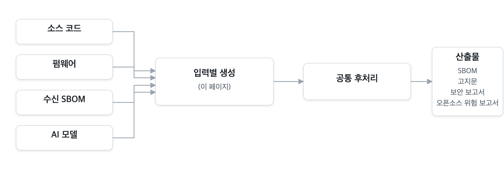
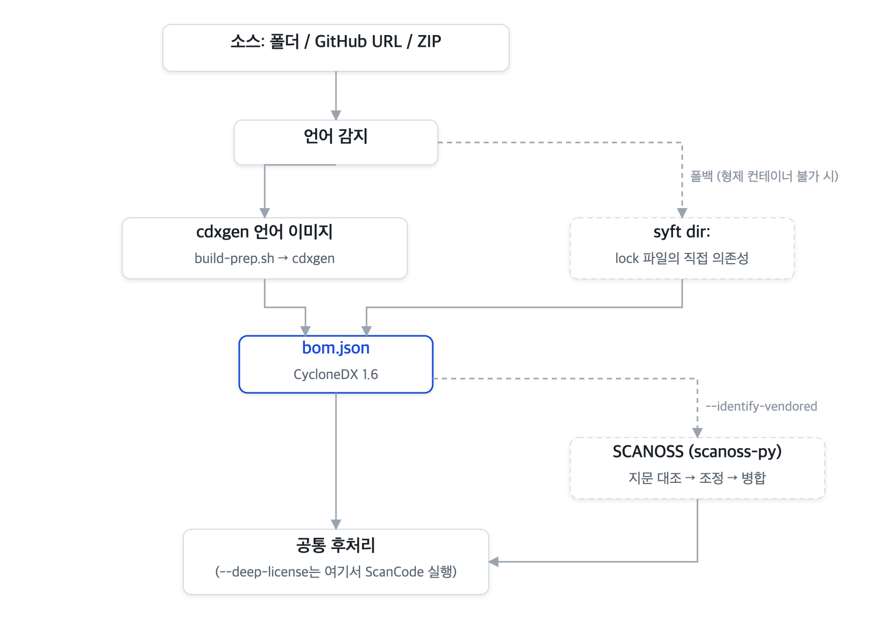
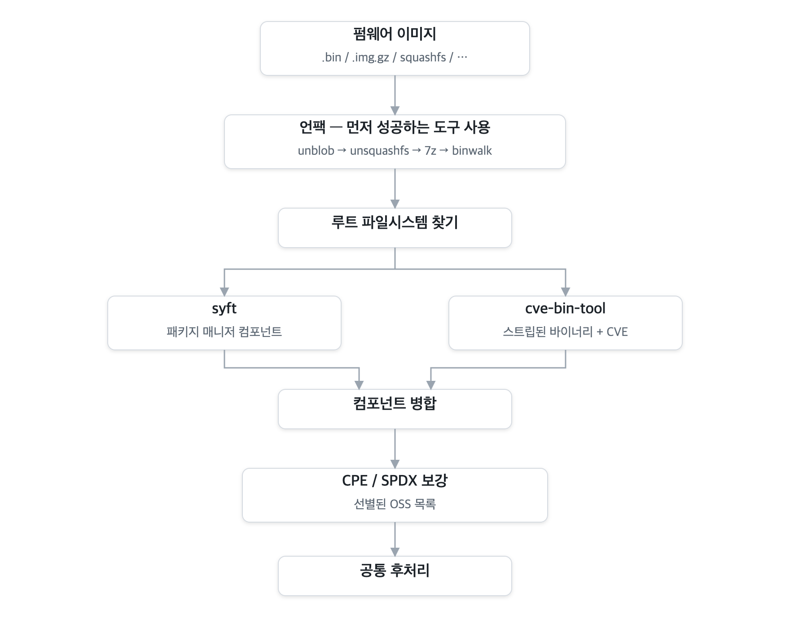
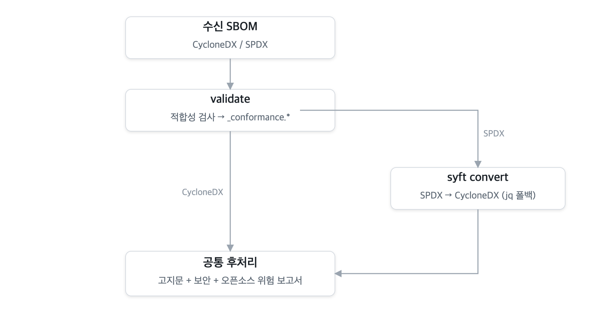
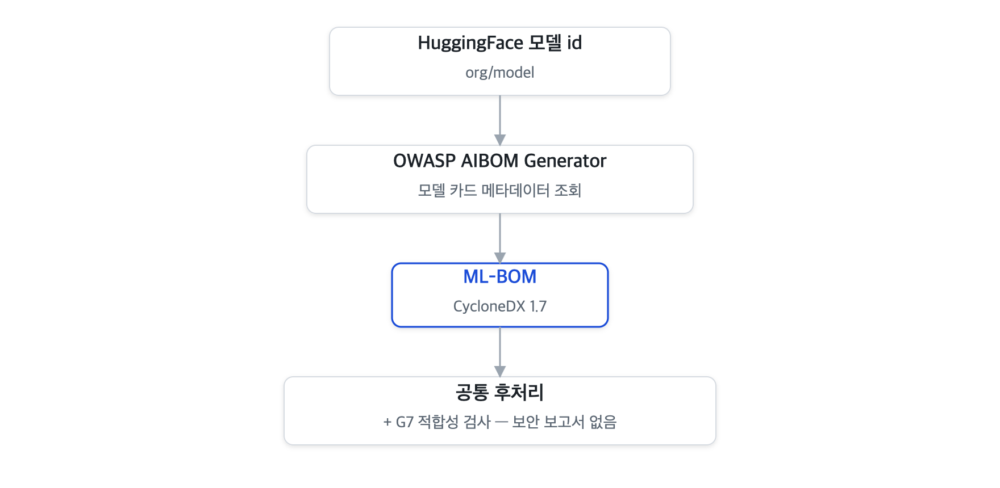
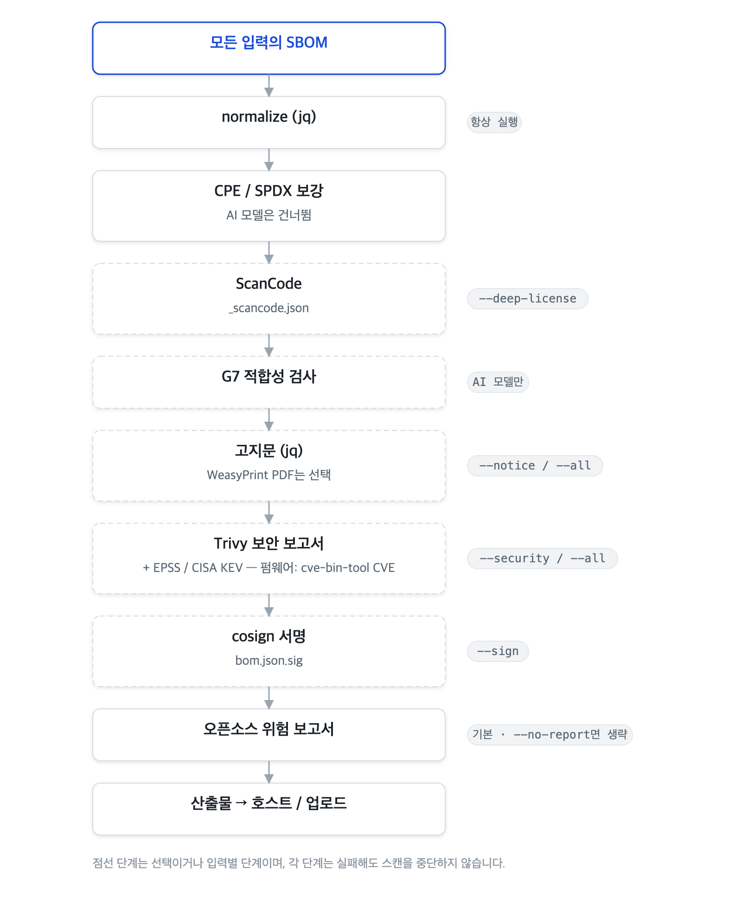

# 입력 형태별 파이프라인

BomLens는 여러 입력을 받습니다. 소스코드, 펌웨어, 받은 SBOM, AI 모델입니다. 각 입력은 CycloneDX SBOM을 만드는 **생성** 단계를 따로 거친 뒤, 모두 하나의 공통 **후처리** 파이프라인(고지문, 보안, 위험 보고서)으로 합류합니다. 이 문서는 입력별 도구 흐름을 따라갑니다. 2단계 개요는 [아키텍처](architecture.ko.md)를 참고하세요.

아래 외부 도구는 모두 오픈소스입니다. [사용 오픈소스 도구](#사용-오픈소스-도구) 표에 각 도구의 역할, 라이선스, 프로젝트 링크를 정리했습니다.

---

## 소스코드

소스 폴더, GitHub URL, ZIP 아카이브입니다. 언어 감지로 알맞은 공식 [cdxgen](https://github.com/CycloneDX/cdxgen) 언어 이미지를 골라, 의존성을 준비(`build-prep.sh`)한 뒤 SBOM을 생성합니다. 형제 컨테이너를 실행할 수 없을 때(예: 웹 UI의 소스 스캔)나 cdxgen 자체가 처리 도중 실패했을 때(내부 예외, 또는 자체 문서 검증이 결과를 거부한 경우)는 디렉터리를 [syft](https://github.com/anchore/syft)로 스캔하는 방식으로 폴백하며, 이때는 락 파일에서 직접 의존성을 잡습니다. 어느 경우든 SBOM에는 사유와 함께 `bomlens:sbom-tool-degraded`가 남습니다. Node/npm에서는 폴백 결과가 프로젝트의 선언된 의존성을 하나도 포함하지 않으면 그 결과를 버리고 안내와 함께 스캔을 실패로 끝내며, 실제로는 아무것도 못 잡았는데 완전한 것처럼 보이는 결과를 보고하지 않습니다. 소스가 의존성을 선언했는데(매니페스트나 lock 파일에 의존성이 있음) 컴포넌트를 하나도 찾지 못하면, SBOM에 해당 파일을 적은 `bomlens:sbom-empty-with-manifests`가 남고 결과 매니페스트는 `generate` 단계를 degraded(`no_components`)로 기록합니다.

cdxgen이 프로젝트를 읽기 전에 빌드 도구가 하는 일과 그 도구가 들어 있는 이미지는 [의존성을 해석하는 방식](dependency-resolution.ko.md)에 있습니다.

소스 스캔에만 적용되는 옵션이 두 가지 있고, 둘 다 기본은 꺼짐입니다.

- **내장 OSS 식별**(`--identify-vendored`, [SCANOSS](https://github.com/scanoss/scanoss.py)) — 패키지 매니저 없이 복사해 넣은 C/C++ 등의 코드를 위한 옵션입니다. SCANOSS 클라이언트가 파일 지문을 만들어 호스팅 OSSKB 서비스에 조회하고, 패키지 매니저 스캔이 이미 찾은 것과 대조해 중복을 제거한 뒤 나머지를 SBOM에 병합합니다.
- **정밀 라이선스 탐지**(`--deep-license`, [ScanCode Toolkit](https://github.com/aboutcode-org/scancode-toolkit)) — 1st-party 소스의 라이선스 헤더를 탐지합니다. 후처리 단계에서 돌며 별도 `_scancode.json`을 남깁니다.

> 컨테이너 이미지, 단일 바이너리, 디렉터리(루트 파일시스템)는 cdxgen을 건너뛰고 syft가 바로 스캔한 뒤 같은 후처리를 따릅니다.

---

## 펌웨어

네트워크 장비 펌웨어 이미지(`.bin`, `.img.gz`, squashfs 등)이며, opt-in `bomlens-firmware` 이미지가 담당합니다. 펌웨어는 운영체제와 라이브러리 수십 개를 한 파일에 밀봉하므로, 먼저 압축을 풀고 두 가지로 구성요소를 식별합니다. 패키지 매니저 메타데이터는 syft로, strip된 정적 바이너리는 [cve-bin-tool](https://github.com/intel/cve-bin-tool)의 시그니처 검사기로 식별해 CPE를 붙입니다. 두 결과를 병합한 뒤, 잘 알려진 OSS(busybox, dropbear, dnsmasq 등)의 CPE/SPDX를 채우는 보강 단계를 거치고, 그 결과를 Trivy와 고지문 생성이 이어받아 활용합니다. 패키지 PURL이 없는 컴포넌트는 이어서 이미지에 들어 있는 NVD CPE 인덱스와 CPE로 대조합니다.

언팩은 먼저 성공한 도구를 쓰는 순서로 시도합니다. [unblob](https://github.com/onekey-sec/unblob)(기본), 표준 squashfs용 `unsquashfs`, Windows 배포물이 담겨 오는 컨테이너 형식용 `7z`, 그다음 `binwalk`입니다.

> 펌웨어 도구는 GPL 계열이라 `bomlens-firmware` 이미지에만 들어가고 기본 이미지에는 설치하지 않습니다. [펌웨어 가이드](../guides/firmware.ko.md)와 그 한계를 참고하세요.

### 이미지 안의 추가 파일시스템

하나의 이미지가 파일시스템을 여럿 담을 수 있고, rootfs 안이 아니라 옆에 놓인 트리도 함께 식별합니다. 세 가지를 알아보며, 판정 근거는 디렉터리 이름이 아니라 그 안에 무엇이 설치돼 있는지를 적은 기록입니다. 첫째는 컨테이너 이미지 저장소로 Docker가 남기는 이미지 색인으로 알아봅니다(스위치 운영체제에서 흔한 구조로, 실제로 동작하는 것 대부분이 컨테이너 안에 있습니다). 둘째는 자체 패키지 데이터베이스를 가진 또 하나의 파일시스템입니다. 셋째는 Python `site-packages`처럼 인터프리터가 설치한 라이브러리 묶음입니다. rootfs만 읽으려면 `FW_EXTRA_ROOTS=false`로 둡니다. 컨테이너 저장소에서 나온 구성요소에는 어느 컨테이너 이미지에서 나왔는지가 `bomlens:container:image` 속성으로 남고, 이미지 자체도 `container` 구성요소로 들어갑니다. 컨테이너 안에서 `dpkg`로 설치된 패키지는 그 컨테이너가 어떤 배포판을 쓰는지를 자기 계층의 `os-release`에서 읽어 식별하며, 그래야 취약점 단계에서 대조할 대상이 생깁니다. 이렇게 식별한 것에는 `bomlens:purlSource` 속성이 붙습니다. SPDX로 내보내도 이 내용이 남습니다. 이미지와 배포판은 SPDX 패키지가 되고, 소속은 `CONTAINS` 관계로 들어갑니다.

### upstream 저장소 purl

펌웨어, 루트 파일시스템, 바이너리 스캔과 Yocto 빌드의 기록에서 읽은 SBOM은 컴포넌트에 upstream 소스 저장소와 릴리스 태그로 purl을 붙입니다([펌웨어 가이드](../guides/firmware.ko.md#upstream-저장소-purl)). 컴포넌트를 찾는 방식은 다음과 같습니다.

변환에는 저장소와 태그 표기를 확인한 프로젝트만 담은 변환표(`docker/lib/upstream-purl-map.json`)를 씁니다. BusyBox, curl, OpenSSL 1.x와 3.x, OpenSSH, Linux, zlib, U-Boot, Net-SNMP, ncurses, net-tools, libxml2, SQLite, glibc, Dropbear, Mbed TLS, Python, Boa, readline, jansson, json-c, libbpf, iproute2, musl, util-linux가 들어 있습니다. json-c는 태그에 릴리스 날짜가 들어 있어, 변환표에 적은 0.13.1부터 0.19까지의 버전만 다룹니다. 컴포넌트는 자기 이름, 빌드에 쓰인 소스의 이름, CPE 가운데 하나로 찾습니다. 빌드에 쓰인 소스의 이름으로는 Yocto 레시피(`bomlens:yocto:recipe`), OpenWrt 소스 패키지(`syft:metadata:source`의 마지막 부분), 벤더가 `*`인 CPE의 제품명을 씁니다. Yocto는 `CVE_PRODUCT`를 이 형태로 적습니다. 예를 들어 Yocto의 `openssl-bin`과 `libssl3`은 레시피 이름에 따라 `openssl`로, OpenWrt의 `libmbedtls12`와 `ip-full`은 소스 패키지 이름에 따라 `mbedtls`와 `iproute2`로 읽습니다. 툴체인 패키지(`libc`처럼 OpenWrt 소스 경로가 `toolchain`으로 끝나는 패키지)와 커널 모듈 패키지(`package/kernel/linux`에서 빌드한 `kmod-*`)는 소스 패키지 이름으로 찾지 않습니다. 그래서 원래 식별자를 그대로 두고, `kmod-*` 패키지에 커널의 purl이 붙지 않습니다. 찾은 뒤에는 변환표가 다루는 형식의 버전이 있을 때만 바꿉니다. 이때 `-1` 같은 패키지 재빌드 번호와 커널 빌드 해시는 먼저 떼고, `5.4.0`처럼 적힌 Linux와 glibc의 기본 릴리스는 `5.4`의 태그로 바꿉니다. 변환표에 없는 컴포넌트는 원래 식별자를 그대로 둡니다. 저장소나 태그를 추측하면 다른 버전을 가리키게 되기 때문입니다. 예외는 변환표에 없는 프로젝트의 소스 내려받기 주소가 릴리스를 직접 밝히는 경우입니다. 변환표에 있는 프로젝트는 변환표로만 정합니다. Yocto SPDX 2.2 판독기는 레시피의 첫 번째 소스 주소를 `bomlens:sourceUrl`에 기록합니다. 그 주소가 GitHub 릴리스 파일이나 태그 압축 파일이고 태그가 컴포넌트 버전을 나타내면(`v1.2`, `V_1_2`, `name-1.2`, `1.2`) `pkg:github/<owner>/<repo>@<tag>`를 붙이고, GNU 릴리스(`ftp.gnu.org`나 `ftpmirror.gnu.org`의 `/gnu/<name>/<name>-<version>.tar.*`)이면 그 버전이 컴포넌트 버전과 같을 때만 `pkg:gnu/<name>@<version>`을 붙입니다. 다른 곳의 일반 압축 파일이나 git 커밋은 릴리스로 보지 않습니다. syft가 BusyBox를 운영체제 컴포넌트와 바이너리 컴포넌트로 함께 보고할 때처럼 같은 purl이 운영체제 컴포넌트와 패키지나 바이너리 컴포넌트에 함께 붙게 되면 패키지나 바이너리 쪽에만 붙입니다. 버전, CPE, 식별 근거는 바꾸지 않으므로 이를 근거로 찾은 CVE도 보고서에 그대로 남습니다. 새 purl에는 `bomlens:purlSource = upstream-map`이 붙고, 바꾸기 전 purl은 `bomlens:originalPurl`에 남습니다. 끄려면 `ENRICH_UPSTREAM_PURL=false`를 설정합니다.

### 바이너리 지식 베이스

[펌웨어 가이드](../guides/firmware.ko.md#바이너리-지식-베이스로-컴포넌트-식별하기)의 옵트인 베이스를 만드는 방법과 찾은 결과에 기록되는 내용입니다.

`--bg` 폴더에는 보고하지 않을 패키지의 tarball을 넣습니다. 이 패키지의 문자열은 보고 대상 컴포넌트와 공유하는 문자열의 비중을 낮출 뿐이며, 여러 프로그램에 복사된 라이브러리가 원래 패키지의 것으로 판정되는 근거가 됩니다. 스캔 대상의 이웃(C 라이브러리, 셸 도구, 공유기의 자체 데몬)을 넣어야 합니다. 이웃이 없는 베이스는 코드만 공유하는 다른 프로그램을 컴포넌트로 보고합니다. 컴포넌트마다 심볼이 있는 참조 빌드(`--ref refs.csv`)를 주면 정적 링크에서도 남는 상수 테이블 서명이 더해지고, `--ref-bg`에는 테이블을 서명에서 뺄 파일 목록을 줍니다. 베이스는 SQLite 파일이며 코드도, 소스의 문장도 담지 않습니다. 문자열 리터럴은 SHA-256의 앞 8바이트와 길이로, 상수 테이블은 16바이트 구간 하나와 길이, SHA-256으로 저장합니다. 해시는 소스의 문장을 재배포하지 않으려는 것이며 무엇을 숨기는 수단이 아닙니다. 공개 tarball이 있으면 누구나 같은 해시를 계산할 수 있습니다. 베이스를 만든 모든 tarball의 SHA-256을 기록하고, `kb.csv`에 주소와 purl이 있으면 함께 기록합니다. `--ref`로 준 참조 빌드는 기록하지 않습니다. 읽기 전용으로 열며, 이 형식 이전에 만든 베이스도 읽습니다. 판정 기준값은 베이스에 저장되며, 만들 때 `--rule-score`와 `--rule-unique`로 정합니다(기본값 300과 10). 적정값은 베이스마다 다릅니다. 베이스의 컴포넌트가 하나도 없는 루트 파일시스템을 스캔해서, 오탐이 사라질 때까지 점수 기준을 올립니다.

결과에 담기는 것은 다음과 같습니다.

- 베이스에서 맞는 릴리스가 정확히 하나일 때만 `version`을 씁니다. 여럿이 맞으면 버전 없이 보고하고 `bomlens:versionCandidates`와 `bomlens:versionRange`에 후보를 적습니다. 아무도 고를 수 없는 릴리스에 취약점을 대조하지 않기 위해서입니다.
- 맞는 릴리스가 하나이고 그것이 베이스가 가진 가장 새 릴리스이면, 버전 없이 보고하고 `bomlens:versionMayBeNewer`를 붙이며 그 릴리스를 `bomlens:versionCandidates`에 적습니다. 베이스에 없는 버전은 가장 가까운 이웃으로 나오고, 베이스의 모든 릴리스보다 새 버전이면 그 이웃은 마지막 릴리스입니다. 이것을 버전으로 쓰면 더 새 릴리스가 이미 고친 취약점에 대조하게 됩니다. 이런 컴포넌트는 버전 보충용 템플릿에 들어가 직접 채우게 합니다. `FW_BINKB_TRUST_NEWEST=true`를 주면 버전을 그대로 쓰되 표시는 남깁니다.
- 컴포넌트의 코드가 그 컴포넌트 자체 라이브러리나 프로그램이 아닌 파일 안에서 발견되면(정적 링크나 복사된 소스 파일), 결과에 `bomlens:linkage`(`embedded`, 자체 파일도 함께 있으면 `own-file-and-embedded`)와 그 파일 목록을 담은 `bomlens:embeddedIn`이 붙습니다. 취약한 라이브러리가 어느 프로그램에 들어 있는지 따라갈 수 있습니다.
- 점수가 베이스에 저장된 판정 기준의 2.5배 미만인 결과에는 `bomlens:kbConfidence=low`가 붙고, 검토 화면이 이 항목을 먼저 보여 주며 파일이 정말 그 컴포넌트인지 확인하라고 안내합니다. 점수가 높은 결과에는 `high`가 붙습니다.
- 빌더는 대문자 상수 이름뿐인 문자열 리터럴(예: `X509_V_ERR_UNABLE_TO_GET_ISSUER_CERT_LOCALLY`)을 저장하지 않습니다. 그 이름을 정의한 패키지는 매크로로 쓰므로 자기 소스에는 리터럴로 나타나지 않고, 그 이름을 출력하는 다른 패키지가 대신 점수를 가져가기 때문입니다.
- `bomlens:identifiedBy`는 `binary-kb`이고, 근거로 `bomlens:kbRelease`, `bomlens:kbSha256`(DB 파일의 해시), `bomlens:kbScore`, `bomlens:kbUniqueStrings`(또는 `bomlens:kbTables`)와 찾은 파일(`evidence.occurrences`)이 붙습니다.
- 상수 테이블로만 찾은 컴포넌트는 버전이 없고 `presence-only`로 표시합니다.
- 베이스에 그 컴포넌트의 purl이 있으면 결과에 붙입니다. 버전이 있으면 버전까지 붙이고 `bomlens:purlSource=binary-kb`를 함께 씁니다. 병합 단계에서 이 기록은 다른 기록에 없는 값만 채웁니다. 병합된 컴포넌트의 기준 기록이 되지 않고, 이름과 버전이 같은 다른 기록에 purl이 있으면 이 purl과 `bomlens:purlSource`는 버립니다. 버전 보충 파일로 버전을 채우면 이 purl에도 버전이 들어갑니다.

### CPE로 CVE 대조하기

펌웨어, 루트 파일시스템, 바이너리 스캔은 패키지 PURL이 없는 컴포넌트를 CPE로 이미지 안의 NVD CPE 인덱스와 대조합니다([펌웨어 가이드](../guides/firmware.ko.md#cve-대조-방식)).

Yocto SPDX 3.0 문서와 매니페스트로 읽은 빌드는 이렇게 대조하지 않습니다. 이미 Yocto가 내린 판정을 담고 있어서, CPE로 다시 대조하면 Yocto가 패치했거나 해당 없다고 판정한 CVE를 열린 것으로 보고하게 되기 때문입니다. Yocto는 CPE를 `cpe:2.3:*:*:busybox:1.36.1`처럼 적습니다. 종류가 `*`이면 애플리케이션으로 읽고, 벤더가 `*`이면 Yocto의 cve-check와 같이 그 제품명을 쓰는 모든 벤더에서 제품명으로 찾습니다. 여러 벤더 아래 올라 있는 제품은 대부분 NVD가 한 프로젝트를 여러 이름으로 등록한 경우입니다(`linux_kernel`은 `linux`와 `kernel`, `curl`은 `haxx`, `curl`, `daniel_stenberg`). Yocto는 맞지 않는 벤더의 CVE를 `CVE_STATUS`의 `cpe-incorrect`로 걸러 내지만 SPDX 2.2 빌드에는 이 정보가 담기지 않으므로, 다른 프로젝트와 제품명이 같으면 그 프로젝트의 CVE도 함께 나올 수 있습니다. SPDX 2.2를 쓴 빌드는 레시피가 어떤 CVE를 패치했는지도 기록하지 않으므로, 이렇게 찾은 CVE에는 레시피가 이미 패치한 것이 섞일 수 있습니다. SPDX 3.0은 이를 기록합니다(`INHERIT += "create-spdx-3.0"`). 결과 매니페스트에는 이 단계가 `match-cpe`로 남고 `offered`, `components`, `cves` 개수가 함께 기록됩니다.

cve-bin-tool은 바이너리 식별에만 쓰며, 취약점 데이터베이스를 내려받거나 읽지 않습니다. `CVE_BIN_TOOL_MODE=components-only`로 두면 식별은 그대로 하고 CPE 대조만 끕니다. `--build-arg SBOM_CPE_INDEX=false`로 빌드한 이미지에는 인덱스가 없으며, 이때 이 단계는 `skipped`(`not_installed`)로 기록됩니다.

---

## 받은 SBOM

협력사 등 외부에서 받은 SBOM(CycloneDX 또는 SPDX)이며, 소스 코드가 필요 없습니다. BomLens는 먼저 품질 기준에 맞는지 검사해 적합성 검사 보고서를 쓰고, 이후 파이프라인이 분석할 수 있도록 입력을 CycloneDX로 정규화합니다. SPDX는 `syft convert`로 변환하며, syft를 쓸 수 없으면 `jq` 폴백이 SPDX JSON을 처리합니다. 이 모드에서는 고지문, 보안, 위험 보고서가 항상 생성됩니다.

> 적합성 검사는 변환 전 원본을 기준으로 하므로, SPDX는 SPDX로 검사합니다. 자세한 내용은 [공급사 SBOM 가이드](../guides/supplier-sbom.ko.md)에 있습니다.

Yocto 빌드 디렉터리도 이 경로로 들어옵니다. `--target`으로 빌드 디렉터리를 지정하면 그렇게 인식해서, 빌드가 `tmp/deploy/images/` 아래에 만든 이미지 SBOM이 같은 경로를 탑니다. 다만 일반 SPDX 변환이 아니라 전용 파서가 읽어, 이미지에 설치된 패키지 목록과 빌드가 기록한 취약점 판정을 살립니다. 그 뒤 펌웨어 스캔과 같이 컴포넌트에 upstream 저장소 purl을 붙입니다. 빌드 판정이 없는 SPDX 2.2 아카이브만 `--security`를 켰을 때 CPE를 이미지에 들어 있는 NVD CPE 인덱스와 대조합니다.

---

## AI 모델

HuggingFace 모델 id(`org/model`)이며, opt-in `bomlens-aibom` 이미지가 담당합니다. [OWASP AIBOM Generator](https://github.com/GenAI-Security-Project/aibom-generator)가 네트워크로 모델 카드 메타데이터를 가져와, 모델과 데이터셋 중심의 CycloneDX 1.7 ML-BOM을 만듭니다. 이후 후처리에서 G7 최소 요소 적합성 검사를 더합니다. AI 모델에는 패키지 CVE가 없으므로 보안 보고서는 건너뜁니다.

AI 입력에는 기본 이미지에서 전부 처리되는 두 번째 경로가 있습니다. 모델 파일 자체를 읽는 경로(`--model-file`, 웹 UI에서는 모델 파일 업로드)입니다. 생성기도 네트워크도 쓰지 않고, 표준 라이브러리로 작성한 리더가 파일 헤더를 해석합니다. 형식은 파일 이름이 아니라 매직 바이트로 판별하고, 파일 해시를 구한 뒤 같은 CycloneDX 1.7 ML-BOM 모양으로 씁니다. 이후 후처리는 동일합니다. 공급사가 보낸 가중치나 공개한 적 없는 모델이 이 경로에 해당합니다. 채울 수 있는 정보는 형식마다 다릅니다. GGUF는 이름과 라이선스, 아키텍처를 선언하고 safetensors는 대개 텐서 정보만 선언하며, 둘 다 없는 파일도 무결성 해시는 남깁니다.

AI 입력에는 기본 이미지에서 처리되는 세 번째 경로도 있습니다. 공개된 연구 데이터셋을 Figshare 항목으로 주는 경로입니다(`--model`에 항목 주소나 DOI, 항목 번호). 공개 항목 조회는 계정 없이 응답하고, SBOM에 필요한 값(라이선스, DOI, 저자, 파일별 해시)이 모델 카드의 서술이 아니라 필드로 들어 있어서, 표준 라이브러리로 작성한 리더가 그대로 옮겨 CycloneDX 1.7 `data` 컴포넌트로 만듭니다. 이후 후처리는 동일합니다. 논문이 공개한 데이터가 이 경로에 해당하며, 실제로 많은 연구 데이터가 그곳에 있습니다. 표준 식별자로 옮길 수 있는 라이선스는 SPDX 식별자로 기록하고 그 밖의 것은 추측하지 않고 표기 그대로 남기며, 계정 없이는 읽을 수 없는 항목은 라이선스가 없는 데이터셋으로 기록하지 않고 오류로 알립니다.

HuggingFace 데이터셋도 같은 경로로 처리합니다. 앞에 아무것도 붙이지 않은 `owner/name`은 모델 id이므로, 접두어나 주소(`datasets/<owner>/<name>`, `https://huggingface.co/datasets/<owner>/<name>`, `hf:<owner>/<name>`)를 붙여 줍니다. 표준 라이브러리로 작성한 리더가 허브에서 라이선스, 허브 리비전, 파일별 SHA-256 값을 가져오고, 카드의 `source_datasets`에 적힌 데이터셋은 모델 카드가 적은 데이터셋과 같은 방식으로 읽습니다. 접근 제한이 있거나 비공개인 데이터셋은 `HF_TOKEN`이 필요하며, 읽을 수 없는 데이터셋은 빈 SBOM이 아니라 오류로 알립니다.

아직 공개하지 않은 모델은 읽을 대상이 없으므로, 마지막 AI 입력은 모델 공개자의 선언 파일 하나입니다(`--model`, `--model-file`, `--target` 없이 `--ai-declare <파일>`만 주거나, 웹 UI의 "모델 정보 직접 입력" 타일). 기본 이미지의 표준 라이브러리 스크립트가 모델을 SBOM의 주 대상으로 만들어 프로젝트 이름과 버전을 붙이고 `bomlens:origin=declared-input`으로 표시하며, 선언에 적은 기반 모델과 HuggingFace 데이터셋은 모델 스캔과 같은 방식으로 허브에서 id로 읽습니다. 선언한 값은 대부분 SPDX 3.0.1 AI 문서에만 들어갑니다. 이후 후처리는 동일하며, SBOM의 수명 주기 단계는 `design`입니다.

어느 AI 스캔이든 선언(`--ai-declare`로 준 파일이나 웹 UI에서 저장해 둔 선언)이 있으면, 위험 판정과 G7 검사 전에 두 단계가 선언의 일부를 CycloneDX SBOM에 반영합니다. 첫 단계는 선언이 허브 id로 적은 데이터셋 원천을 읽어, 그 원천이 데이터셋과 함께 판정되게 합니다. 둘째 단계는 모델을 실행하는 서비스(`services[]`, 그 `dependencies[]`, 표준을 담은 `declarations.claims[]`)와 모델에 선언한 입력과 출력 종류, 학습 연산량, 적대적 시험 여부를 기록하고, 모두 발행자 선언으로 표시합니다. 두 단계 모두 SPDX 3.0.1 변환기가 받아들인 선언만 적용하며, 이어지는 G7 검사가 시스템 속성 요소를 이 서비스에서 읽습니다. [모델을 실행하는 서비스](../guides/ai-model.ko.md#모델을-실행하는-서비스)를 참고하세요.

> 모델 카드의 공개 항목(가중치, 아키텍처, 학습 데이터, 학습 과정)과 G7 결과는 웹 UI의 모델·데이터셋과 G7 섹션에 나타납니다. [웹 UI 레퍼런스](../reference/ui.ko.md)를 참고하세요. 단계별 안내는 [AI 모델 가이드](../guides/ai-model.ko.md)에 있습니다.

### 모델 카드가 적은 데이터셋

[AI 모델 가이드](../guides/ai-model.ko.md#동작-방식)의 ML-BOM 구성과, 모델 카드가 적은 데이터셋을 어디까지 따라가는지 설명합니다.

문서가 기술하는 대상은 모델입니다. CycloneDX가 SBOM의 대상을 적는 자리인 `metadata.component`에 모델이 들어가고, 참조하는 데이터셋은 그 의존 항목으로 `components[]`에 들어갑니다. ML-BOM을 읽는 도구는 구성요소 목록이 아니라 이 자리에서 모델을 찾아야 합니다.

데이터셋 카드도 자신이 만들어진 원천 데이터셋을 적을 수 있습니다(`source_datasets`). BomLens는 이 원천도 같은 방식으로 따라가며, 최대 3단계 아래까지, 스캔 한 번에 최대 40개 데이터셋까지 조회합니다(`AIBOM_DATASET_DEPTH`, `AIBOM_DATASET_MAX_LOOKUPS`. 깊이를 0으로 두면 모델 카드가 적은 데이터셋만 읽습니다). 원천마다 별도 항목이 되고 그 원천에서 나온 데이터셋과 연결됩니다. 그래서 허용적인 라이선스로 공개된 혼합 데이터셋 안에 더 좁은 조건의 원천이 있으면 그것이 드러납니다. HuggingFace 데이터셋 id 형태인 값만 조회하며, `HF_ENDPOINT`가 설정되어 있으면 그 주소로 조회합니다. 카드가 문장으로 적은 원천("Wikipedia dump 2023-01", `extended|other`)이나 자리표시 값(`extended`만 적은 경우, `unknown`, `N/A`)은 적힌 그대로 남기고 검토 필요로 표시합니다. 이름이 비슷한 데이터셋을 찾아 맞추거나 추정하지 않습니다. 대부분의 데이터셋 카드는 원천을 적지 않으므로, 이 기능이 정보를 더하는 것은 주로 학습용 혼합 데이터셋 같은 일부 데이터셋입니다.

---

## 공통 후처리

어떤 입력이든 SBOM은 같은 순서의 단계를 거칩니다. 정규화는 이후 모든 단계의 입력을 안정시키므로 가장 먼저 돌고, 서명은 최종 SBOM을 대상으로 해야 하므로 마지막에 돕니다. 점선 단계는 선택이거나 입력별입니다. 각 단계는 실패하더라도 전체 스캔을 중단하지 않고 경고와 함께 건너뜁니다(서명과 업로드는 예외).

위험 보고서는 모든 모드에서 기본으로 생성됩니다(라이선스와 취약점을 종합). `--no-report`로 끕니다. 플래그별 단계 매핑은 [아키텍처](architecture.ko.md)를 참고하세요.

---

## 사용 오픈소스 도구

분석 도구는 모두 오픈소스입니다. 기본 이미지에 설치하는 도구는 permissive 라이선스이고, GPL 도구는 opt-in `bomlens-firmware` 이미지에, AI 생성기는 `bomlens-aibom`에 격리합니다. 리눅스 이미지가 다 그렇듯 모든 이미지가 Debian 베이스의 GPL 시스템 패키지를 함께 담고 있으며, 이는 [번들 도구 라이선스](https://github.com/sktelecom/bomlens/blob/main/THIRD_PARTY_LICENSES.ko.md)에 정리돼 있습니다.

| 도구 | 역할 | 입력 | 라이선스 | 이미지 | 프로젝트 |
|------|------|------|----------|--------|----------|
| cdxgen | 소스에서 SBOM 생성 | 소스 | Apache-2.0 | 언어 이미지 | [CycloneDX/cdxgen](https://github.com/CycloneDX/cdxgen) |
| syft | 이미지·바이너리·디렉터리·펌웨어 rootfs의 SBOM | 소스(폴백)·이미지·바이너리·rootfs·펌웨어 | Apache-2.0 | base / firmware | [anchore/syft](https://github.com/anchore/syft) |
| SCANOSS (scanoss.py) | 파일 지문으로 내장 OSS 식별 | 소스(`--identify-vendored`) | MIT | base | [scanoss/scanoss.py](https://github.com/scanoss/scanoss.py) |
| ScanCode Toolkit | 1st-party 정밀 라이선스 탐지 | 소스(`--deep-license`) | Apache-2.0 | base(opt-in) | [aboutcode-org/scancode-toolkit](https://github.com/aboutcode-org/scancode-toolkit) |
| unblob | 펌웨어 언팩(기본) | 펌웨어 | MIT | firmware | [onekey-sec/unblob](https://github.com/onekey-sec/unblob) |
| sasquatch | 표준 unsquashfs가 거부하는 벤더 변형 squashfs | 펌웨어 | GPL-2.0 | firmware(선택) | [onekey-sec/sasquatch](https://github.com/onekey-sec/sasquatch) |
| cve-bin-tool | strip된 바이너리 식별 | 펌웨어 | GPL-3.0 | firmware | [intel/cve-bin-tool](https://github.com/intel/cve-bin-tool) |
| OWASP AIBOM Generator | HuggingFace 모델 카드로 ML-BOM 생성 | AI 모델 | Apache-2.0 | aibom | [GenAI-Security-Project/aibom-generator](https://github.com/GenAI-Security-Project/aibom-generator) |
| Trivy | 취약점(CVE) 보안 보고서 | 공통 | Apache-2.0 | base | [aquasecurity/trivy](https://github.com/aquasecurity/trivy) |
| cosign | SBOM detached 서명 | 공통(`--sign`) | Apache-2.0 | base | [sigstore/cosign](https://github.com/sigstore/cosign) |
| WeasyPrint | 고지문 PDF 렌더링(선택) | 공통(`SBOM_PDF` 빌드) | BSD-3-Clause | base(opt-in) | [Kozea/WeasyPrint](https://github.com/Kozea/WeasyPrint) |
| jq | SBOM 정규화·고지문·보고서 조립 | 공통 | MIT | base | [jqlang/jq](https://github.com/jqlang/jq) |

> 전체 라이선스 목록와 펌웨어 이미지의 GPL 소스 제공은 [THIRD_PARTY_LICENSES.ko.md](https://github.com/sktelecom/bomlens/blob/main/THIRD_PARTY_LICENSES.ko.md)를 참고하세요.

---

> **관련 문서**: [아키텍처](architecture.ko.md) | [펌웨어 가이드](../guides/firmware.ko.md) | [공급사 SBOM 가이드](../guides/supplier-sbom.ko.md) | [내장 OSS 식별](../guides/identify-vendored.ko.md)
