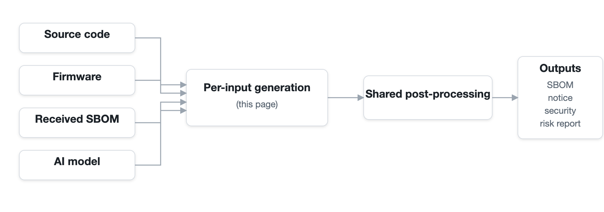
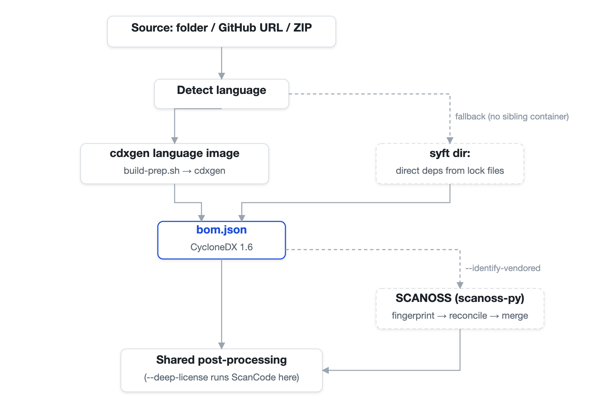
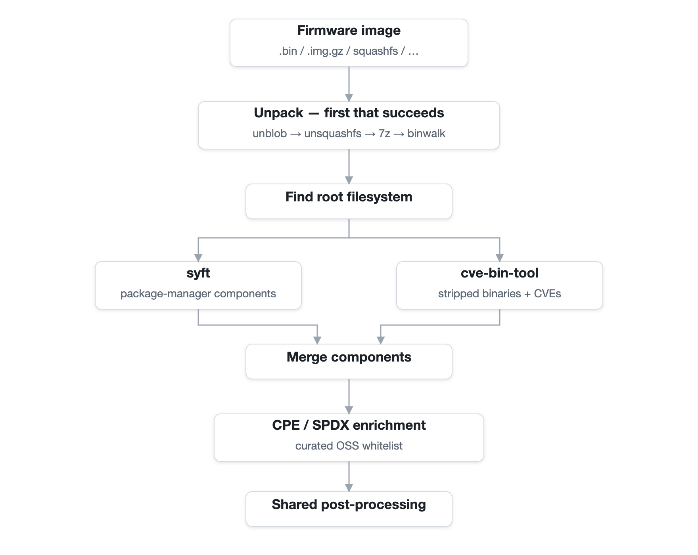
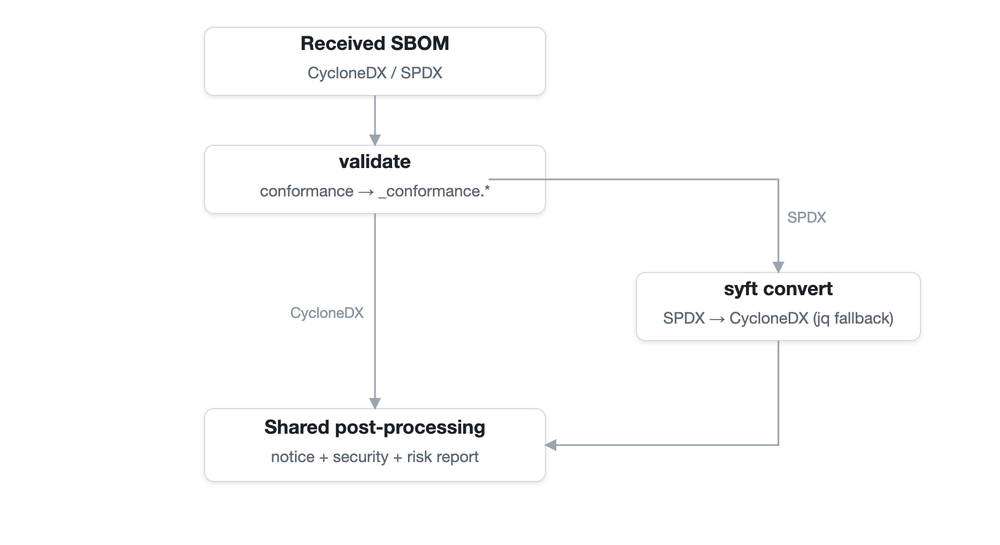
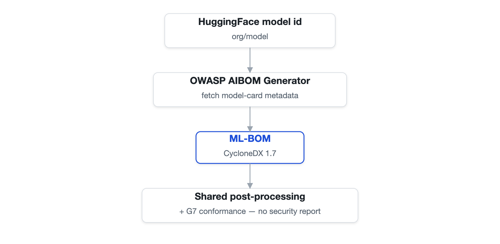
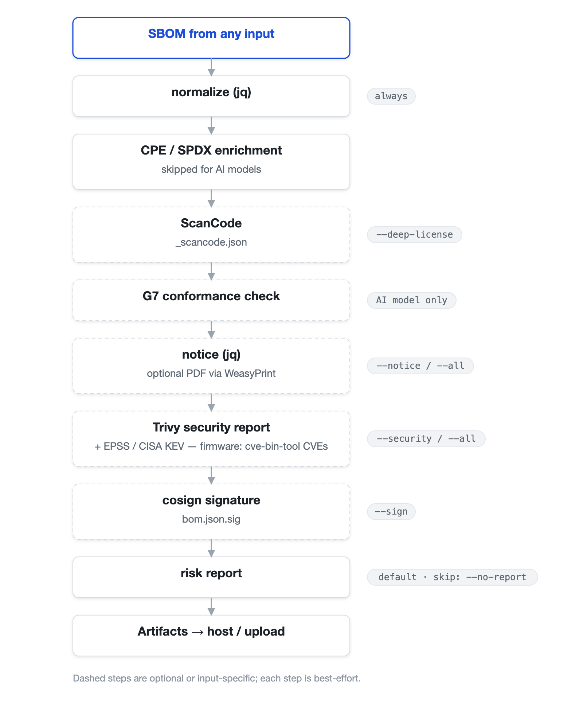

# Pipeline by input type

BomLens accepts several kinds of input — source code, firmware, an SBOM you received, and an AI model. Each has its own **generation** step that builds a CycloneDX SBOM, and then they all converge on one shared **post-processing** pipeline (notice, security, risk report). This page walks the tool flow for each input. For the high-level two-stage view, see [Architecture](architecture.md).

Every external tool below is open source; the table in [Open-source tools used](#open-source-tools-used) lists each one's role, license, and project link.

---

## Source code

A source folder, a GitHub URL, or a ZIP archive. Language detection picks the matching official [cdxgen](https://github.com/CycloneDX/cdxgen) language image, which prepares dependencies (`build-prep.sh`) and generates the SBOM. BomLens falls back to [syft](https://github.com/anchore/syft) over the directory, which captures direct dependencies from lock files, when it cannot run a sibling container (for example the web UI's source scan) or when cdxgen itself fails partway through (an internal exception, or its own document validation rejecting the result). Either way the SBOM carries `bomlens:sbom-tool-degraded` with the reason. For Node/npm, a fallback that covers none of the project's own declared dependencies is discarded and the scan fails with guidance, rather than reporting a misleadingly complete-looking result. When the source declares dependencies (a manifest or lock file lists some) and the scan still finds no component, the SBOM carries `bomlens:sbom-empty-with-manifests` naming those files, and the result manifest records the `generate` step as degraded (`no_components`).

What the build tools do before cdxgen reads the project, and which images they come from, is in [How dependencies are resolved](dependency-resolution.md).

Two options apply to source scans only, and both are off by default.

- **Identify vendored OSS** (`--identify-vendored`, [SCANOSS](https://github.com/scanoss/scanoss.py)) — for C/C++ and other code copied in without a package manager. The SCANOSS client fingerprints files and queries the hosted OSSKB service, then BomLens reconciles the matches against what the package-manager scan already found and merges the rest into the SBOM.
- **Deep license detection** (`--deep-license`, [ScanCode Toolkit](https://github.com/aboutcode-org/scancode-toolkit)) — scans first-party source for license headers. It runs during post-processing and writes a separate `_scancode.json`.

> Container images, single binaries, and directories (root filesystems) skip cdxgen and are scanned directly by syft, then follow the same post-processing.

---

## Firmware

A network-device firmware image (`.bin`, `.img.gz`, squashfs, and more), handled by the opt-in `bomlens-firmware` image. Firmware packs an OS and dozens of libraries into one sealed file, so BomLens first unpacks it, then identifies components in two ways: package-manager metadata with syft, and stripped static binaries with the signature checkers of [cve-bin-tool](https://github.com/intel/cve-bin-tool), which give them a CPE. The two results merge, and a CPE/SPDX enrichment step fills identifiers for a curated list of well-known OSS (busybox, dropbear, dnsmasq, …) so Trivy and the notice can use them. Components with no package PURL are then matched by CPE against the NVD CPE index in the image.

Unpacking tries tools in order, using the first that succeeds: [unblob](https://github.com/onekey-sec/unblob) (primary), `unsquashfs` for standard squashfs, `7z` for the container formats Windows deliveries arrive in, then `binwalk`.

> The firmware tools are GPL-family, so they live only in the `bomlens-firmware` image and the base image installs none of them. See the [firmware guide](../guides/firmware.md) and its limits.

### Extra filesystems in an image

An image can carry more than one filesystem, and a tree sitting beside the rootfs rather than inside it is cataloged too. Three kinds are recognized, each by the record of what is installed in it rather than by its directory name: a container image store, identified by the image index Docker keeps (the usual layout on a switch OS, where most of what runs is in a container); a second filesystem carrying its own package database; and an interpreter's installed library set, such as a Python `site-packages`. Set `FW_EXTRA_ROOTS=false` to read only the rootfs. Components from a container store record the image they belong to in `bomlens:container:image`, and the images themselves appear as `container` components. A package installed by `dpkg` inside a container is identified by the distribution the container runs, read from the `os-release` in its own layers, so that the vulnerability step has something to match it against; those carry `bomlens:purlSource`. An SPDX export keeps this: the images and the distribution are packages there, and the membership is a `CONTAINS` relationship.

### Upstream repository purl

A firmware, root filesystem or binary scan, and an SBOM read from a Yocto build's records, give a component the purl of its upstream source repository at its release tag ([Firmware guide](../guides/firmware.md#upstream-repository-purl)). This is how a component is matched.

The conversion uses a closed table (`docker/lib/upstream-purl-map.json`) of projects whose repository and tag spelling were checked: BusyBox, curl, OpenSSL 1.x and 3.x, OpenSSH, Linux, zlib, U-Boot, Net-SNMP, ncurses, net-tools, libxml2, SQLite, glibc, Dropbear, Mbed TLS, Python, Boa, readline, jansson, json-c, libbpf, iproute2, musl and util-linux. json-c tags carry a release date, so only the listed versions 0.13.1 to 0.19 are covered. A component is matched by its own name, by the name of what it was built from, or by its CPE. The name it was built from is the Yocto recipe (`bomlens:yocto:recipe`, so `openssl-bin` and `libssl3` are read as `openssl`), the OpenWrt source package (the last part of `syft:metadata:source`, so `libmbedtls12` is read as `mbedtls` and `ip-full` as `iproute2`), or the product of a CPE whose vendor is `*`, the form in which Yocto writes `CVE_PRODUCT`. A toolchain package (an OpenWrt source path ending in `toolchain`, such as `libc`) and a kernel module package (`kmod-*`, built from `package/kernel/linux`) are not read by their source package name, so they keep what they had; a `kmod-*` package does not take the kernel's purl. A match is used only when it has a version of a form the table covers; a package rebuild count such as `-1` and a kernel build hash are removed first, and a Linux or glibc base release written `5.4.0` takes the tag of `5.4`. A component not in the table keeps the identifier it had, since a guessed repository or tag would name a different version. The one exception is a source download address that states the release, for a project the table does not list (for a listed project the table decides). The Yocto SPDX 2.2 reader records the address of the recipe's first source as `bomlens:sourceUrl`; a GitHub release asset or tag archive there gives `pkg:github/<owner>/<repo>@<tag>` when the tag names the component's version (`v1.2`, `V_1_2`, `name-1.2` or `1.2`), and a GNU release (`ftp.gnu.org` or `ftpmirror.gnu.org`, `/gnu/<name>/<name>-<version>.tar.*`) gives `pkg:gnu/<name>@<version>` when that version equals the component's. A plain tarball elsewhere or a git commit is not read as a release. When a scan reports a project both as the operating-system component and as a package or binary with the same purl, as syft does for BusyBox, only the package or binary gets the purl. The version, the CPE and the evidence are not changed, so the CVEs found from them stay in the report. The new purl is marked `bomlens:purlSource = upstream-map`, and a purl it replaced is kept in `bomlens:originalPurl`. Set `ENRICH_UPSTREAM_PURL=false` to turn it off.

### Binary knowledge base

How the opt-in base of the [firmware guide](../guides/firmware.md#identifying-components-with-a-binary-knowledge-base) is built and what a match records.

The `--bg` folder holds tarballs of packages you do not want reported. Their strings only lower the weight of strings they share with a reported component, which is how a library copied into several programs is credited to the package it came from. Put the neighbours of what you scan in it (the C library, the shell utilities, the router's own daemons); a base without them reports components that merely share code with them. A reference build with symbols per component (`--ref refs.csv`) adds constant-table signatures that survive static linking, and `--ref-bg` lists files whose tables are not signatures. The base is a SQLite file and holds no code and no text from the sources: a string literal is kept as the first 8 bytes of its SHA-256 and its length, and a constant table as one 16-byte window, its length and its SHA-256. It records the SHA-256 of every tarball it was built from, with the URL and purl when `kb.csv` gives them, and is opened read-only. A base built before this format is still read. The detection thresholds are stored in it (`--rule-score` and `--rule-unique` set them at build time, defaults 300 and 10). They depend on the base: scan root filesystems that hold none of its components, and raise the score until the false positives stop.

What a result carries:

- A component has a `version` only when exactly one release in the base fits. When several fit, the component has no version and `bomlens:versionCandidates` and `bomlens:versionRange` list them, so no vulnerability is matched against a release nobody could pick.
- When the one release that fits is the newest the base has, the component is reported without a version, with `bomlens:versionMayBeNewer` and that release in `bomlens:versionCandidates`. A version that is not in the base comes back as its nearest neighbour, and for a version newer than every release in the base that neighbour is the last one; written as the version, it would be matched against vulnerabilities a newer release has fixed. The component goes into the component-versions template for you to fill. Set `FW_BINKB_TRUST_NEWEST=true` to write the version anyway, still marked.
- When a component's code is found inside a file that is not its own library or program (a static link, or a copied source file), the result carries `bomlens:linkage` (`embedded`, or `own-file-and-embedded` when its own file is present too) and `bomlens:embeddedIn` with those files, so a vulnerable library inside a program can be traced to the program that carries it.
- A result whose score is under 2.5 times the base's stored threshold carries `bomlens:kbConfidence=low`; the review page lists it first with a note to check that the files are really that component. Strong results carry `high`.
- The builder does not store a string literal that is only an upper-case constant name (for example `X509_V_ERR_UNABLE_TO_GET_ISSUER_CERT_LOCALLY`). The package that defines such a name writes it through a macro, so it never appears as a literal in that package's own source, while every other package that prints it would be credited with it.
- `bomlens:identifiedBy` is `binary-kb`, with `bomlens:kbRelease`, `bomlens:kbSha256` (the hash of the base file), `bomlens:kbScore` and `bomlens:kbUniqueStrings` (or `bomlens:kbTables`) as the evidence, and the files it was found in as `evidence.occurrences`.
- A component found only by constant tables has no version and is tagged `presence-only`.
- When the base has a purl for the component, the result carries it, with the version when there is one, and `bomlens:purlSource=binary-kb`. The merge does not let that purl keep a package record of the same name and version apart.

### CVE matching by CPE

A firmware, root filesystem or binary scan matches a component with no package PURL by its CPE against the NVD CPE index in the image ([Firmware guide](../guides/firmware.md#how-cves-are-matched)).

A Yocto SPDX 3.0 document and a build read through its manifests are not matched this way: they already carry Yocto's own verdicts, and matching their CPEs again would report as open what Yocto judged patched or not affected. Yocto writes a CPE such as `cpe:2.3:*:*:busybox:1.36.1`. A part of `*` is read as an application, and a vendor of `*` is looked up by product alone across every vendor of that product, as Yocto's own cve-check does. Most products listed under more than one vendor are one project that NVD filed under several names (`linux_kernel` under `linux` and `kernel`, `curl` under `haxx`, `curl` and `daniel_stenberg`). Yocto drops the wrong vendors' CVEs with `CVE_STATUS` `cpe-incorrect`, which an SPDX 2.2 build does not carry, so a product name another project shares can bring that project's CVEs too. An SPDX 2.2 build does not record which CVEs a recipe patched either, so the CVEs matched this way can include ones the recipe already patched; SPDX 3.0 records it (`INHERIT += "create-spdx-3.0"`). The result manifest records the step as `match-cpe` with `offered`, `components` and `cves` counts.

cve-bin-tool only identifies binaries; it does not download or read a vulnerability database. `CVE_BIN_TOOL_MODE=components-only` turns the CPE match off while identification still runs. An image built with `--build-arg SBOM_CPE_INDEX=false` has no index, and the step is recorded as `skipped` (`not_installed`).

---

## Received SBOM

An SBOM (CycloneDX or SPDX) received from a supplier or another team — no source code needed. BomLens first checks it against the quality criteria and writes a conformance check report, then normalizes the input to CycloneDX so the rest of the pipeline can analyze it. SPDX is converted with `syft convert` (a `jq` fallback handles SPDX JSON if syft is unavailable). Notice, security, and the risk report are always produced in this mode.

> Validation is based on the original input before conversion, so SPDX is checked as SPDX. Details are in the [supplier SBOM guide](../guides/supplier-sbom.md).

A Yocto build directory enters here too. Pointing `--target` at one is recognized, and the image SBOM the build published under `tmp/deploy/images/` takes this same path, read by a dedicated parser that keeps the installed package set and the vulnerability verdicts the build recorded, rather than by the generic SPDX conversion. As in a firmware scan, its components then get the upstream repository purl. Only an SPDX 2.2 archive, which carries no build verdicts, has its CPEs matched against the NVD CPE index in the image with `--security`.

---

## AI model

A HuggingFace model id (`org/model`), handled by the opt-in `bomlens-aibom` image. The [OWASP AIBOM Generator](https://github.com/GenAI-Security-Project/aibom-generator) fetches the model-card metadata over the network and builds a CycloneDX 1.7 ML-BOM centered on the model and its datasets. Post-processing then adds a G7 minimum-element conformance check. Because an AI model has no package CVEs, the security report is skipped.

There is a second AI input that runs entirely in the base image: a model **file** (`--model-file`, or a model upload in the web UI). No generator and no network are involved — a stdlib reader parses the file's own header, decides the format from its magic bytes rather than its name, hashes the file, and writes the same CycloneDX 1.7 ML-BOM shape, which then takes the identical post-processing. It is the path for weights a supplier sent you and for models that were never published. What it can fill depends on the format: GGUF declares a name, a license and an architecture, safetensors usually declares only tensor shapes, and a file that declares neither still contributes its integrity hash.

A third AI input runs in the base image too: a published research **dataset**, given as a Figshare item (`--model` with the item URL, its DOI, or the item number). The public item endpoint answers without an account, and the fields an SBOM wants — licence, DOI, authors, a digest per file — are fields there rather than prose in a card, so a stdlib reader transcribes them into a CycloneDX 1.7 `data` component that takes the same post-processing. It is the path for data a paper published, which is where a great deal of research data actually lives. A licence the item states as one we can place becomes an SPDX id; anything else is kept verbatim rather than guessed at, and an item nobody can read without an account is an error rather than a dataset described as having no licence.

A HuggingFace dataset takes the same path. Give it with a prefix or an address (`datasets/<owner>/<name>`, `https://huggingface.co/datasets/<owner>/<name>` or `hf:<owner>/<name>`), since a bare `owner/name` is a model id. A stdlib reader takes the licence, the hub revision and a SHA-256 digest per file from the hub, and reads the datasets the card lists under `source_datasets` in the same way as the datasets a model card names. A gated or private dataset needs `HF_TOKEN`, and a dataset that cannot be read is an error rather than an empty SBOM.

A model that is not published yet has nothing to read, so the last AI input is its publisher's declaration alone (`--ai-declare <file>` without `--model`, `--model-file` or `--target`, or the web UI's "Enter model information" tile). A stdlib script in the base image makes the model the SBOM's subject, named by the project and version and marked `bomlens:origin=declared-input`, and reads the base models and HuggingFace datasets the declaration names from the hub by id, as a model scan does. Most declared values go only into the SPDX 3.0.1 AI document. The same post-processing follows, and the SBOM's lifecycle phase is `design`.

When any AI scan has a declaration (given with `--ai-declare`, or saved earlier in the web UI), two steps apply parts of it to the CycloneDX SBOM before the risk assessment and the G7 check. The first reads the dataset sources the declaration names by hub id, so they are judged with their dataset. The second writes the service the model runs in (`services[]`, its `dependencies[]` and its standards as `declarations.claims[]`) and the model's declared input and output kinds, training compute and adversarial testing, each marked as the publisher's declaration. Both apply only a declaration the SPDX 3.0.1 converter accepts, and the G7 check then reads the service for its system-level elements. See [The service a model runs in](../guides/ai-model.md#the-service-a-model-runs-in).

> The model card's disclosure (weights, architecture, training data, training process) and the G7 result appear in the web UI's Models & datasets and G7 sections — see the [web UI reference](../reference/ui.md). For a step-by-step walkthrough, see the [AI model guide](../guides/ai-model.md).

### Datasets a model card names

How the [AI model guide](../guides/ai-model.md#how-it-works)'s ML-BOM is laid out, and how far the datasets it names are followed.

The model is the subject of the document: it sits in `metadata.component`, which is where CycloneDX names what an SBOM is about, and the datasets it references sit under `components[]` as its dependencies. A tool reading the ML-BOM should look for the model there rather than in the component list.

A dataset card can in turn name the datasets it was built from (`source_datasets`). BomLens follows those too, the same way, up to three levels down and at most 40 dataset lookups per scan (`AIBOM_DATASET_DEPTH`, `AIBOM_DATASET_MAX_LOOKUPS`; a depth of 0 reads only the datasets the model card names). Each source becomes its own entry linked to the dataset it came from, so a mixture published under a permissive license shows the source inside it that carries narrower terms. Only a value shaped like a HuggingFace dataset id is looked up, at the hub `HF_ENDPOINT` names when it is set. A source the card names in words ("Wikipedia dump 2023-01", `extended|other`) or with a placeholder (`extended` alone, `unknown`, `N/A`) is kept as written and marked for review; nothing is matched to it by name or guessed. Most dataset cards name no sources at all, so this adds information for a minority of datasets, typically training mixtures.

---

## Shared post-processing

Whatever the input, the SBOM flows through the same ordered steps. Normalization runs first to stabilize the input for every later step; signing runs last so it covers the final SBOM. Dashed steps are optional or input-specific. Each step is best-effort — a failure is skipped with a warning rather than aborting the scan (signing and upload excepted).

The risk report is generated by default in every mode (it aggregates licenses and vulnerabilities); skip it with `--no-report`. For the step-by-step flag mapping, see [Architecture](architecture.md#flag-to-step-mapping).

---

## Open-source tools used

Every analysis tool is open source. The tools installed into the base image are permissively licensed; the GPL ones are isolated in the opt-in `bomlens-firmware` image, and the AI generator in `bomlens-aibom`. Every image also carries the GPL system packages of its Debian base, as any Linux image does — see [Third-party licenses](https://github.com/sktelecom/bomlens/blob/main/THIRD_PARTY_LICENSES.md).

| Tool | Role | Input | License | Image | Project |
|------|------|-------|---------|-------|---------|
| cdxgen | Generate the SBOM from source | source | Apache-2.0 | language images | [CycloneDX/cdxgen](https://github.com/CycloneDX/cdxgen) |
| syft | SBOM for images, binaries, directories, firmware rootfs | source (fallback), image, binary, rootfs, firmware | Apache-2.0 | base / firmware | [anchore/syft](https://github.com/anchore/syft) |
| SCANOSS (scanoss.py) | Identify vendored OSS via file fingerprints | source (`--identify-vendored`) | MIT | base | [scanoss/scanoss.py](https://github.com/scanoss/scanoss.py) |
| ScanCode Toolkit | Deep first-party license detection | source (`--deep-license`) | Apache-2.0 | base (opt-in) | [aboutcode-org/scancode-toolkit](https://github.com/aboutcode-org/scancode-toolkit) |
| unblob | Firmware unpacking (primary) | firmware | MIT | firmware | [onekey-sec/unblob](https://github.com/onekey-sec/unblob) |
| sasquatch | Vendor squashfs variants standard unsquashfs refuses | firmware | GPL-2.0 | firmware (opt) | [onekey-sec/sasquatch](https://github.com/onekey-sec/sasquatch) |
| cve-bin-tool | Stripped-binary identification | firmware | GPL-3.0 | firmware | [intel/cve-bin-tool](https://github.com/intel/cve-bin-tool) |
| OWASP AIBOM Generator | ML-BOM from a HuggingFace model card | AI model | Apache-2.0 | aibom | [GenAI-Security-Project/aibom-generator](https://github.com/GenAI-Security-Project/aibom-generator) |
| Trivy | Vulnerability (CVE) security report | all | Apache-2.0 | base | [aquasecurity/trivy](https://github.com/aquasecurity/trivy) |
| cosign | Detached SBOM signature | all (`--sign`) | Apache-2.0 | base | [sigstore/cosign](https://github.com/sigstore/cosign) |
| WeasyPrint | Optional PDF rendering of the notice | all (`SBOM_PDF` build) | BSD-3-Clause | base (opt-in) | [Kozea/WeasyPrint](https://github.com/Kozea/WeasyPrint) |
| jq | SBOM normalization, notice, report assembly | all | MIT | base | [jqlang/jq](https://github.com/jqlang/jq) |

> For the full license inventory and the GPL source-offer for the firmware image, see [THIRD_PARTY_LICENSES.md](https://github.com/sktelecom/bomlens/blob/main/THIRD_PARTY_LICENSES.md).

---

> **Related**: [Architecture](architecture.md) | [Firmware guide](../guides/firmware.md) | [Supplier SBOM guide](../guides/supplier-sbom.md) | [Identify bundled OSS](../guides/identify-vendored.md)
