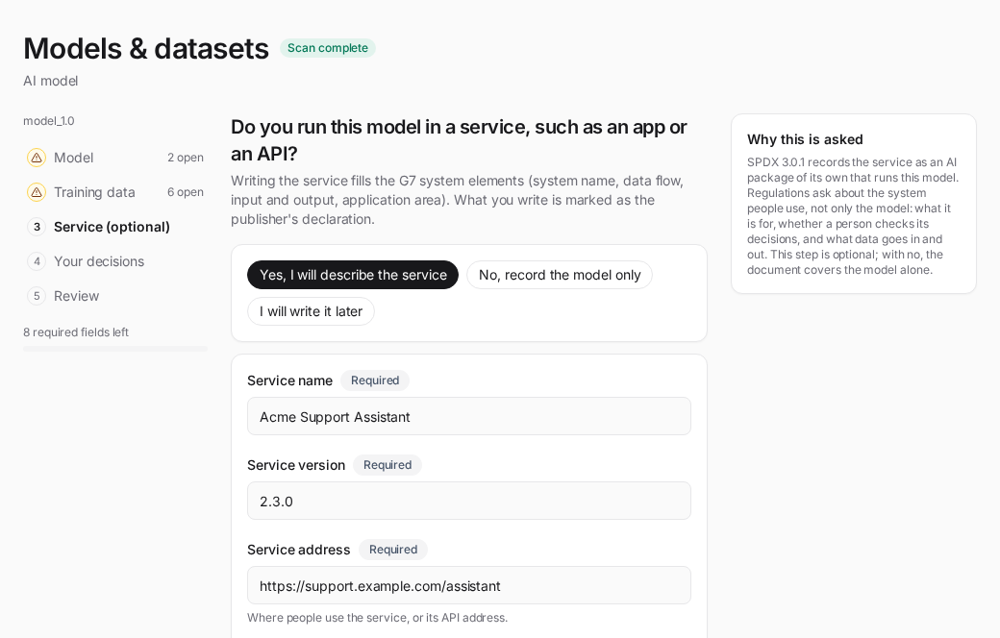

# AI model SBOM guide

How to generate a CycloneDX ML-BOM (machine-learning bill of materials) for a HuggingFace model and read the result. You give a model id; BomLens fetches the model-card metadata over the network — no source code and no model-weight download.

## How it works

An AI model's "bill of materials" is its model card: identifier, architecture, task, license, supplier, datasets, and the integrity of its files. BomLens uses the [OWASP AIBOM Generator](https://github.com/GenAI-Security-Project/aibom-generator) to read a HuggingFace model card and build a **CycloneDX 1.7 ML-BOM** centered on the model and the datasets it references. It then adds a **G7 minimum-element conformance** check (advisory). Because a model has no package dependencies, there is no security (CVE) report.

The model is the subject of the document: it sits in `metadata.component`, which is where CycloneDX names what an SBOM is about, and the datasets it references sit under `components[]` as its dependencies. A tool reading the ML-BOM should look for the model there rather than in the component list.

A model card names its training datasets and stops there. BomLens looks each one up on HuggingFace and records what it finds — the declared license, the upstream datasets it derives from, and a content digest — as its own entry in the SBOM, linked to the model as a dependency. A dataset that cannot be read (withdrawn, renamed, or private to someone else) is kept in the SBOM as a name marked unreadable; no license is invented for it. This is also what decides the training-data disclosure axis: `open-data` needs at least one dataset that actually opened, and a card naming datasets nobody can retrieve reads `declared-unverified` instead.

A dataset card can in turn name the datasets it was built from (`source_datasets`). BomLens follows those too, the same way, up to three levels down and at most 40 dataset lookups per scan (`AIBOM_DATASET_DEPTH`, `AIBOM_DATASET_MAX_LOOKUPS`; a depth of 0 reads only the datasets the model card names). Each source becomes its own entry linked to the dataset it came from, so a mixture published under a permissive license shows the source inside it that carries narrower terms. Only a value shaped like a HuggingFace dataset id is looked up, at the hub `HF_ENDPOINT` names when it is set. A source the card names in words ("Wikipedia dump 2023-01", `extended|other`) or with a placeholder (`extended` alone, `unknown`, `N/A`) is kept as written and marked for review; nothing is matched to it by name or guessed. Most dataset cards name no sources at all, so this adds information for a minority of datasets, typically training mixtures.

The full tool flow is in [Pipeline by input type](../concepts/pipeline-by-input.md#ai-model).

## Before you start

You need two things.

- **A Docker engine, installed and running.** If you have none, start with the requirements in [Getting started](../start/first-scan.md).
- **A way to run BomLens.** The desktop app needs no commands; for the command line, [Getting started](../start/first-scan.md) covers cloning the repository. AI model scans need a separate image that bundles the OWASP AIBOM Generator. It is opt-in and reaches the network (HuggingFace), so it ships separately from the base image.

```bash
docker pull ghcr.io/sktelecom/bomlens-aibom:latest
```

That image is about 3.5 GB to download, far larger than the base scanner image (about 250 MB). The first pull can take tens of minutes depending on your connection, so start it with time to spare. It is downloaded once.

Pulling ahead of time is optional. `--model` uses this image by default and fetches it when missing, and the web UI and desktop app fetch it on the first AI-model scan while showing progress. To use a different tag, set `SBOM_AIBOM_IMAGE`.

## Running it

### From the web UI

Use the desktop app, or the web UI you already run. Where Docker is reachable the AI model tile is enabled, and the aibom image runs as a separate container fetched on the first scan — which makes that first run slow to start.

```bash
./scripts/scan-sbom.sh --ui
```

Launching the UI from the aibom image itself handles the scan in-process, with no second container. This is what you need where the Docker socket is unavailable.

```bash
SBOM_SCANNER_IMAGE=ghcr.io/sktelecom/bomlens-aibom:latest ./scripts/scan-sbom.sh --ui
#   Windows: set SBOM_SCANNER_IMAGE before double-clicking sbom-ui.bat
```

Choose **AI model** under the New scan source tiles, enter the HuggingFace model id as `org/model` (for example `google-bert/bert-base-uncased` or `Qwen/Qwen2.5-0.5B` — not a collection name or a full URL), and run.

### From the CLI

Pass the model id to `--model`:

```bash
./scripts/scan-sbom.sh --project bert-base --version 1.0.0 \
  --model "google-bert/bert-base-uncased" --generate-only
```

`--model` is mutually exclusive with `--target`, `--analyze`, `--git`, and `--merge`. It pulls the `bomlens-aibom` image automatically, produces the notice and the risk report, and skips the security report (a model has no package CVEs).

### Private and gated models

A public model id resolves anonymously. A private repository, or a gated one you have been granted access to, needs a HuggingFace access token with read scope in `HF_TOKEN`:

```bash
HF_TOKEN=hf_... ./scripts/scan-sbom.sh --project my-llm --version 0.9.0 \
  --model "my-org/my-llm" --generate-only
```

`HUGGING_FACE_HUB_TOKEN` is accepted as well. The value is passed to the container by name, never as a command-line argument, so it does not appear in the process list, and it is not written to the SBOM or any report.

This is what lets you review a model before you publish it: push it to a private repository, generate the ML-BOM, close the gaps the conformance check report shows, and only then make the repository public. For a gated repository, the token's account also needs its access request approved — a token alone is not enough. The same token is what resolves the model's training datasets, so a model whose data sits in a private repository needs it too.

The web UI reads the same variable from the environment that launched it, so start it with `HF_TOKEN=hf_... ./scripts/scan-sbom.sh --ui`. There is no token field in the interface: the server keeps no credentials, and a token sent over HTTP would linger in its logs.

### Scanning a model file

Everything above starts from a model id, which assumes the model is on HuggingFace. Often it is not: a supplier delivers the weights themselves, the model is an internal fine-tune, or the machine has no network at all. Point at the file:

```bash
./scripts/scan-sbom.sh --project internal-llm --version 1.0.0 \
  --model-file ./models/internal-llm-q4.gguf --generate-only
```

In the web UI, choose **Model file** under AI model and upload it (up to 8 GB; past that the CLI is the answer, because it reads the file where it lies and transfers nothing).

The file's own header is the only source, and no image is pulled — this runs in the base image, offline. The format is decided by the magic bytes rather than the file name, and a mismatch between the two is reported on the component instead of being quietly corrected.

| Format | What the file can tell us |
| --- | --- |
| GGUF | model name, license, architecture, quantization, tensor count |
| safetensors | tensor count, dtypes, parameter count, plus whatever the optional `__metadata__` block declares (often a license) |
| PyTorch (`.pt`/`.pth`/`.ckpt`), pickle | the archive layout, and that the weights are pickle-format |
| Keras (`.h5`/`.keras`) | the format itself, and whether a `Lambda` layer is present |
| npz, npy | the member list |
| ONNX | the format itself (deeper metadata needs a protobuf parser) |

Every format contributes the file size and a SHA-256 over the whole file, which is what ties the document to the artifact you were sent. A field the file does not declare is left out: a model whose weights carry no license produces an SBOM with no license, and the risk assessment then reads `review` rather than treating silence as permission.

#### Does loading it run code?

Pickle is not a data format. Loading one runs whatever the stream tells the interpreter to run, which is why a checkpoint in that format is a risk of its own — separate from its license, and separate from any CVE. A Keras `.h5`/`.keras` file carries the same kind of risk in a different shape: a `Lambda` layer can embed a Python function serialized with `marshal`, which runs when Keras deserializes the layer. For a model on HuggingFace, BomLens reports what the Hub's own scan found. A file nobody published has no such record, so the scan runs here instead — [picklescan](https://github.com/mmaitre314/picklescan) for the pickle formats (the same tool the Hub uses), and a plain text check for the `Lambda` marker for Keras, since nothing needs deserializing to find that.

The verdict lands on the model component and feeds the file-security axis of the risk assessment:

| Verdict | Meaning | Assessment |
| --- | --- | --- |
| Code-execution globals found | a dangerous global such as `os.system` is reachable in the pickle stream | caution |
| Something that needs a look | a pickle global that could be code (typically a custom class), or a Keras file with a `Lambda` layer | review |
| No code-execution risk found | the pickle payload held nothing of the kind, or no `Lambda` layer was found in the Keras file | ok |
| Format does not execute code | GGUF, safetensors, ONNX, plain npy | ok |
| Could not be read | the file did not parse | review |

Two things worth knowing about the middle rows. "Something that needs a look" is common in perfectly legitimate checkpoints — a model class of its own, or a `Lambda` layer used for an ordinary activation function, is enough to trigger it — so it asks for a human rather than raising an alarm. And a clean result answers one question only: it says the weights do not execute code on load by this specific path, not that the file has been cleared of everything. For pickle it is a pickle analysis, not a malware scan; for Keras it is a text search for the `Lambda` marker, not a parse of the model config.

An `.npz` is opened and only the members that actually hold a pickle are examined: a numpy array of dtype `object` stores its contents as a pickle, which is how a payload hides in what looks like a numeric archive. A file with no such member is reported as not applicable rather than as clean, because nothing was examined.

If the scan cannot run at all, no verdict is written and the assessment simply has no file-security axis. A missing scan reads as "not scanned", never as safe.

#### What this path cannot do

Two things, by construction. It has no model card, so the G7 checks that ask about training data, intended use and evaluation report as gaps — accurately, since the file says nothing about them. And it describes one file: a model split into shards is currently scanned a shard at a time.

### Scanning a published dataset

Research data is published where the paper put it, which for a great deal of science is a repository like Figshare rather than a model hub. Hand `--model` the item instead of a HuggingFace id:

```bash
./scripts/scan-sbom.sh --project cell-imaging-data --version 1.0.0 \
  --model "https://figshare.com/articles/dataset/Title/33412285" \
  --usage product --generate-only
```

The page URL, the DOI, or the item number all work. To read a specific version rather than the latest, give the URL or DOI that names it (`.../33412285/2`, `10.6084/m9.figshare.33413521.v1`). No account and no opt-in image are needed: the public item endpoint answers without authentication, and the mapping ships in the base image.

The item becomes a CycloneDX `data` component carrying its licence, its DOI, its authors, and an MD5 digest per file. A licence the item states as one BomLens can place (the Creative Commons deeds, MIT, Apache 2.0, the GPLs, CC0) becomes an SPDX id; anything else is kept verbatim rather than guessed at. `--usage` applies here as it does to a model: a non-commercial deed reads differently for internal research than for something you ship.

An institutional DOI that does not carry "figshare" (`10.25916/sut.33412285.v1`) cannot be told apart from any other DOI, so give the item URL for those. A private, embargoed or withdrawn item cannot be read without an account, and is reported as an error rather than described as a dataset with no licence.

A dataset on HuggingFace is scanned the same way, also in the base image with no account. Give it as `datasets/<owner>/<name>`, as `https://huggingface.co/datasets/<owner>/<name>` (anything after the name, such as `/tree/main`, is ignored), or as `hf:<owner>/<name>`. A bare `owner/name` stays a model id, because the hub uses the same form for both, so the prefix or the address is what marks a dataset:

```bash
./scripts/scan-sbom.sh --project tulu --version 1.0 \
  --model datasets/allenai/tulu-3-sft-mixture --generate-only
```

The dataset becomes the SBOM's root `data` component with its licence, the hub revision it was read at (`bomlens:dataset:revision`) and a SHA-256 digest per file. The datasets its card lists under `source_datasets` are traced the same way as the datasets a model card names (same `AIBOM_DATASET_DEPTH` and `AIBOM_DATASET_MAX_LOOKUPS` limits), appear as rows under it in Models & datasets, and their risk verdicts reach the root. A gated or private dataset needs `HF_TOKEN`, and a dataset that cannot be read is reported as an error rather than written as an empty SBOM.

**Deliverables**: notice, ML-BOM (CycloneDX 1.7), risk report, conformance check.

## Reading the result

In the web UI, an AI/ML SBOM adds two sections to the left rail.

**Models & datasets** — each model card's identifier, architecture, task, license, supplier and integrity, a four-axis disclosure panel (weights / architecture / training data / training process, as documented in the BOM), and a table of the datasets the model references with each one's license, content digest and upstream. A traced source appears as its own row, indented under the dataset it was traced from, with its own grade and license, so the dataset and the source it inherits terms from read side by side.


**Conformance** — for an AI-model SBOM this section adds the G7 minimum-element checks (all advisory), grouped by the seven G7 clusters, alongside the base format-conformance checks. Each element shows what it is and how to satisfy it. The next section explains what the numbers and badges mean.


The same data is in the artifacts: the ML-BOM (`_bom.json`, CycloneDX 1.7) and the conformance check report (`_conformance.*`).

## The SPDX 3.0.1 AI document

Every AI model and dataset scan also writes the result as an SPDX 3.0.1 document with the AI and Dataset profiles, `{Project}_{Version}_bom.spdx3.json`, next to the CycloneDX ML-BOM. The CycloneDX file stays the primary record; the SPDX document is built from it, plus whatever the model's publisher declares.

A scan can fill what it reads: the model's name, revision, download address, publisher on the hub, licence, architecture, limitations and weight files with their digests; each dataset's address, licence and data type where its card says; the base models and the datasets the card names. It cannot know when the model was released, who made it, which datasets trained it and which only tested it, or the revision of the base model it started from. SPDX 3.0.1 makes several of these required and gives them no "unknown" value, so until they are declared the document is a draft: it says so in its comment, and `{Project}_{Version}_spdx3-check.md` lists each open field.

To fill them, edit the empty declaration the scan writes, `{Project}_{Version}_ai-declaration.template.json`, and scan again with it:

```bash
./scripts/scan-sbom.sh --project my-llm --version 1.0 \
  --model "acme/support-adapter" --ai-declare my-llm_1.0_ai-declaration.template.json --generate-only
```

Most declared values go into the SPDX document only, each marked as declared. The exceptions are the service the model runs in and the model's input and output kinds, training compute and adversarial testing, which also reach the CycloneDX SBOM (see [The service a model runs in](#the-service-a-model-runs-in)). A declaration that names a dataset or base model the scan did not find, a value outside a field's list, or a date not written as `YYYY-MM-DDThh:mm:ssZ` is refused with the reasons. Some fields are a judgement the tool never makes for you: whether the model uses sensitive personal information, its safety risk level, and its autonomy. The check lists them as needing a decision, and leaving them empty is allowed. `model.license` (a HuggingFace licence tag or an SPDX licence id) gives the model's own licence when the scan read none, or only `other`; one that differs from the licence the scan read is listed for review, and the scan's is kept. It is written as an SPDX expression only when it is a hub tag that names exactly one SPDX licence, or a `LicenseRef-`; anything else is kept in words, with `NoAssertionLicense` as the expression.

In the web UI there is no file to edit: **Models & datasets** shows the document's state and a **Fill in empty fields** button that asks for the open fields one step at a time and saves them as the declaration (see [the web UI reference](../reference/ui.md#ai-surfaces)). The saved declaration is the same `{Project}_{Version}_ai-declaration.json` file, so a re-scan applies it again, from the CLI as well.


A model being prepared for release has no repository or file to scan, so it can be described from the declaration alone: give `--ai-declare <file>` without `--model` or `--model-file`, or pick **Enter model information** on the web UI's New scan screen, which asks the same questions and starts the scan with the answers.

```bash
./scripts/scan-sbom.sh --project support-bot --version 1.0 \
  --ai-declare support-bot-declaration.json --generate-only
```

The model becomes the SBOM's subject under the project name and version, marked `bomlens:origin=declared-input`. The base models listed in `model.baseModels[].ref` and the datasets in `datasets[].ref` (`huggingface:<owner>/<name>`) are read from the hub by id, so their lineage, licences and traced sources are the same as in a model scan, and `datasets[].local` holds data the hub does not have. The risk assessment, the G7 check and this document follow as usual. No hub supplies the download address and supplier, so the document stays a draft until they are declared.

Here the whole SBOM is the publisher's statement, so two declared values enter it. The names in `document.createdBy` become the SBOM author when `--sbom-author` is not given, marked `bomlens:sbom-author-source=declaration`. The model's own licence, `model.license`, is the other: the risk assessment judges the model on it, and an ancestor under the same terms is not flagged as a mismatch. Without it the model has no licence and its verdict reads `review`. It enters the SBOM when the scan runs, so a licence changed later with **Fill in empty fields** is listed for review until the model is scanned again.

A dataset's card often lists no sources, so the scan cannot trace them. The declaration can name them for each dataset (`sources[]`, and a "Where this data came from" row in the web UI's questions). A source given by its HuggingFace id is read from the hub on the next scan, before the risk assessment, so its recorded licence counts in the dataset's verdict just as a traced source's does. A source known only by name is written to the SPDX 3.0.1 document with the licence you give, marked as declared and not verified, and does not change the verdict. A declaration the converter refuses is not applied here either. A dataset the model card names (or the dataset a scan describes) with no source on record anywhere is listed in the check for review.

Two rules apply. A value that is not in the scan and not declared is left out rather than estimated, and a base model is written by its id and licence only, so nothing the publisher declares about the model is copied onto it. `--no-spdx3` skips the document.

## The service a model runs in

A model card describes the model. The G7 checklist also asks about the system around it: the system's name, maker and version, how data flows through it, what it does with that data, its input and output, and the field it is meant for. None of that is in a model card or a weight file, so without help those elements stay review items. When you run the model inside an app or an API, the declaration can describe that service, and BomLens writes it into both documents. The EU AI Act's technical documentation (Annex IV, point 1) and the NIST AI Risk Management Framework (MAP 1.1, the intended purpose and context of use) ask for the same kind of description. They are named here only as context; declaring a service does not show that a system meets either.

In the declaration file the service is a top-level `service` object:

```json
"service": {
  "name": "Acme Support Assistant",
  "packageVersion": "2.3.0",
  "downloadLocation": "https://support.acme.example/assistant",
  "suppliedBy": {"type": "Organization", "name": "Acme Corp"},
  "releaseTime": "2025-06-01T00:00:00Z",
  "informationAboutApplication": "Answers customer support questions in the web chat.",
  "domain": ["customer support"],
  "autonomyType": "no",
  "inputModality": ["text"],
  "outputModality": ["text"],
  "dataFlows": [
    {"flow": "inbound", "classification": "personal data",
     "description": "Customer questions typed in the chat window.",
     "source": ["https://support.acme.example/chat"]}
  ],
  "standardCompliance": ["ISO/IEC 42001:2023"],
  "disclosureUrl": "https://support.acme.example/ai-disclosure"
}
```

SPDX requires the first five keys of a service, and the document stays a draft until they are given; the rest are optional. `autonomyType` answers whether a person is involved in the AI's decisions: `no` means a person is involved, `yes` that it acts fully automatically, and `noAssertion` that you do not know. Every key and allowed value is listed in [the artifacts reference](../reference/artifacts.md#the-declared-ai-service). In the web UI the same questions form the optional Service step of Fill in empty fields and of Enter model information.



The SPDX 3.0.1 document writes the service as an `ai_AIPackage` with the purpose `application` that depends on the model at runtime; the model stays the document's root. The scan also writes the service into the CycloneDX SBOM, in a step that runs after the declared dataset sources are read and before the risk assessment and the G7 checks. The service goes into `services[]` with its data flows as `data[]`, its dependency on the model into `dependencies[]`, and each standard it names into `declarations.claims[]`. Each of these is marked `bomlens:origin=declared-input`, and a claim's reasoning says it is the publisher's declaration, not verified by BomLens.

With a service declared, the G7 system-level elements read from it: the system name, producer and version when the SBOM's root does not already give them, and the system data flow, data usage (the description of a data flow), input/output properties and intended application area. An element met this way reads "present (publisher's declaration, not verified by BomLens)", and the web UI gives it a "Publisher's declaration" badge. BomLens records what you state; it does not check that the service behaves that way. An SBOM from another tool counts too when its services carry CycloneDX `data` (serviceData) entries: a flow direction meets the data flow element and a description meets data usage, and both read as plainly present. A security standard named in `standardCompliance` does not meet the security compliance element, which stays a review item.

The CycloneDX SBOM changes only when a scan runs. A service saved in the web UI after the scan goes into the SPDX document at once, but reaches the CycloneDX SBOM and the G7 checks only with the next scan. Until then the SPDX check reports `service.state` as `pendingScan`, and the band on Models & datasets offers a re-scan. A declaration passed with `--ai-declare` is applied in the same run.

### External AI models

A service often calls models it does not run itself, such as a hosted translation or embedding API. List them under `service.externalModels[]`, each with a `key` and a `name`, and optionally `suppliedBy`, `packageVersion` and `endpoint`. They are recorded by identity only: a `software_Package` with the purpose `model` in the SPDX document, and a service of its own in CycloneDX `services[]` that the declared service depends on. BomLens reads nothing about them; the risk assessment does not judge them, and the G7 checks do not count them as models.

### Values for regulatory filings

Rules for large general-purpose models ask for figures no model card holds. The declaration's `model` takes three of them:

- `trainingComputeFlops`, the compute used to train the model in floating-point operations, written as a decimal string such as `"3.2e24"`, with `trainingComputeBasis` saying how it was counted. The EU AI Act asks for the training compute in the technical documentation of a general-purpose AI model (Annex XI, Section 1, point 2(d)) and uses it in Article 51(2) to presume high-impact capabilities. The Korean AI Basic Act enforcement decree, Article 24, also refers to training compute.
- `adversarialTesting` (`yes`, `no` or `noAssertion`), whether adversarial testing such as red-teaming was done. Article 55(1)(a) of the EU AI Act asks providers of general-purpose AI models with systemic risk to conduct and document it.

The articles are named so you know why the fields exist. BomLens does not compare a figure with a threshold or decide whether a rule applies to your model, and filling these fields does not make a model compliant with any of them.

The model also takes `inputModality` and `outputModality` (`text`, `image`, `audio`, `video`, `timeseries`, `structured`, `code`, `other`). All five values go into the SPDX document and onto the model component of the CycloneDX SBOM: the three regulatory values as `bomlens:regulatory:*` properties, and the input and output kinds as formats in `modelCard.modelParameters`. Where the scan already recorded inputs or outputs there, the scanned values are kept. A `bomlens:declared` property names each location filled from the declaration.

### Older BomLens versions

BomLens v1.13 and earlier do not know these keys. They refuse a declaration that has a `service`, or one of the new model keys, with "unknown key(s)" rather than dropping the values without a word; read such a file with a version that has them, or remove the keys. The SPDX 2.3 export and `--diff` do not carry services: the SPDX 2.3 copy is converted from the components of the CycloneDX SBOM, and `--diff` compares models and components.

## Reading the conformance check report

The G7 block leads with a headline such as "N / 41 present". The denominator counts only the checks that have an automated source (41 of the 51), so the number states what the tool could verify on its own. The 10 review-only elements appear next to it as a separate "need review" count, and any automated check that found nothing is counted as advisory. Four of the ten, the system data flow, data usage, input/output properties and application area, leave the review count and join the denominator once the SBOM holds a value for them, which a [declared service](#the-service-a-model-runs-in) supplies.

Each check has one of three statuses. Pass means the element is present in the ML-BOM. Warn means it is missing or could not be confirmed; the review-only elements always show this status, labeled as requiring human review. Fail does not occur for G7 checks in practice: every G7 element is advisory, so a missing one never fails the SBOM as a whole. An overall fail verdict can only come from the base format checks, the required CycloneDX ones.

Some rows read "not applicable" instead, with a count of their own in the summary. Those are checks the document gives nothing to judge: a coverage percentage over zero components, or dependency relationships in a document whose only subject is the model itself. They leave both sides of the fraction rather than counting as met, because crediting them would put a card that declares less above one that declares its datasets and is measured on them. They are not review items either — a reviewer has nothing to look at. A model card that names its training datasets therefore has more checks actually measured, and a smaller denominator is not a better result.

A source badge on each row says where a satisfied value comes from:

- Auto (22 checks): read directly from a field of the ML-BOM.
- Inferred (15): derived from signals in the BOM rather than a single dedicated field.
- Declared (8): present only when a person or a manifest supplied the value. Four of them (the system data flow, data usage, input/output properties and application area) show as review needed until the SBOM holds a value. A pass that comes from the publisher's declaration says so in its detail.
- Review needed (6, or 10 with the four above): no automated source exists; a person has to confirm it.

The same result ships in three formats: `{Project}_{Version}_conformance.json` for machines (CI gates, diffing), `_conformance.md` as a readable table, and `_conformance.html` as a visual summary. Each format also carries the [regulatory crosswalk](#regulatory-crosswalk); in JSON it is the `regulatoryCrosswalk` object, present only when at least one mapped check was evaluated.

The report shows how to close a gap, not only that one exists. Every advisory element with an automated source that is still absent carries a CycloneDX fragment and a link to the authoritative documentation — in the HTML, behind the "Evidence / how to fill" cell on that row; in the Markdown, gathered under "How to fill the gaps". Passing and review-only elements are left out, so a well-documented model shows none of this.

## A worked example

A concrete run helps read the rest. `FINAL-Bench/Aether-7B-5Attn` is a foundation model published on HuggingFace under Apache-2.0 with its weights, architecture, training data and training process all disclosed, so it shows what a well-documented card produces.

```bash
./scripts/scan-sbom.sh --project Aether-7B-5Attn --version 1.0 \
  --model "FINAL-Bench/Aether-7B-5Attn" --generate-only
```

A scan on 2026-10-23 (model revision `da711bdb`) reports `result=pass` with 30 of 41 G7 elements present. The figures follow the model card, so a later revision can give different ones. In the Models cluster 12 of 14 checks pass; the SBOM has no model timestamp and no model description. The disclosure panel reads open on every axis:

| Axis | Value |
| --- | --- |
| Weights | open-weight |
| Architecture | open-architecture |
| Training data | open-data |
| Training process | open-training |

Because the card lists its datasets, BomLens looks up all seven the model was trained on (FineWeb-Edu, the SmolLM corpus, FineMath, open-web-math, an OpenCoder code corpus, and two Korean sets from HAERAE-HUB) and records what each one declares. Eight of the ten Dataset-properties elements come back present. The two that remain are the statistical properties of the data and whether it contains personal or copyrighted material; neither can be read from a repository, so the report asks a person rather than guessing.

The lookup is what makes the next part visible. Four of the seven datasets carry a license: `odc-by` on FineWeb-Edu, FineMath and the SmolLM corpus, and MIT on the OpenCoder corpus. The other three declare none at all: both HAERAE-HUB sets and open-web-math. Counting dataset names would have called this model's training data fully open. Reading the datasets shows a model published under Apache-2.0 whose training corpus is, in part, of unstated license. That is not a finding the tool judges; it is the one a reviewer needs before release, and it only appears once each dataset is looked up.

A report from the same command is here to open as-is: the [conformance check report](../samples/aether-7b-5attn_conformance.html) for the base model. It was generated on 2026-07-22 from model revision `613b24f7`, so its figures (33 of 41 G7 elements, all 14 Models-cluster checks) differ from the run above. It opens with the same G7 rollup the AI compliance profile carries in JSON and Markdown. Add `--lang ko` for the same reports in Korean; the SBOM and the JSON reports stay English either way.

## Next steps

A report is not a finished review. Some elements a tool can fill; others only a person can.

1. Fill the elements that have an automated source but came back empty, then scan again. The shape that satisfies each one sits on its own row in the report.
2. Answer the 10 review-only elements yourself: things like training-data sensitivity or the intended application area, which no model card field can prove. If the model runs in a service, declaring it fills four of them (see [The service a model runs in](#the-service-a-model-runs-in)).
3. Check separately what this tool does not look at, such as training dataset licensing and personal data.

If you are preparing a model for release inside a company, the approval steps and the pre-release checks live alongside this: see [Releasing an AI model](https://sktelecom.github.io/guide/release/ai-model/) in the SK Telecom open source guide.

## The G7 checklist

"G7 Software Bill of Materials for AI — Minimum Elements" is a guideline published in May 2026 under the G7, led by Germany's BSI and Italy's ACN. It defines 50 minimum elements, grouped into seven clusters, that an SBOM for an AI model should carry: who made the model, what it is, what data it was trained on, how it is secured, and how it performs. It is a non-binding recommendation, not a regulation.

It still matters for regulation. The EU AI Act's high-risk and transparency obligations apply from 2 August 2026, and the technical documentation its Annex IV asks for overlaps substantially with the G7 clusters. What the conformance check report gives you is visibility: element by element, it shows what your model's documentation already covers and what a person still has to supply — a concrete way to prepare, not a compliance verdict (see [Limits](#limits) for what it does not certify).

BomLens shows the 50 elements as 51 checks. Model openness (whether weights, architecture, training data and training process are disclosed) is one facet of the Model license element in the G7 text, but it is worth seeing on its own, so it gets a separate row.

| Cluster | Checks | Of which need human review |
| --- | --- | --- |
| Metadata | 10 | 0 |
| System-level properties | 9 | 4 (0 when a service fills them) |
| Models | 14 | 0 |
| Dataset properties | 10 | 2 |
| Infrastructure | 2 | 0 |
| Security properties | 4 | 3 |
| Key performance indicators | 2 | 1 |

Ten elements have no automated source, such as the intended application area or dataset sensitivity, which no model-card field can prove. BomLens lists them as requiring human review instead of guessing. The four system-level ones (data flow, data usage, input/output properties and application area) are read from CycloneDX `services[]`: all four from a declared service, and data flow and data usage also from the services of another tool's SBOM. Once the SBOM holds a value for one, it stops counting as a review item.

## Regulatory crosswalk

The conformance check report links each check that maps to a regulation to the specific documentation obligation it touches. It answers a reviewer's question: when a check comes back short, which regulatory requirement does that gap concern? The reference sits under the requirement it belongs to in the check tables, and a crosswalk section above the detail rolls the coverage up — one row per framework, counting how many mapped checks are present, a gap, or review-only.

Two frameworks cover every analyzed SBOM, AI or not:

- EU Cyber Resilience Act — via BSI TR-03183-2, the German technical guideline written for CRA compliance and the most detailed public SBOM field specification (the CRA itself names no data fields). TR-03183-2 is a national guideline, and the European harmonized standard that will carry the binding wording is still a draft.
- US SBOM minimum elements — the 17 data fields and 6 practices of the 2026 minimum elements, published by CISA, the NSA and the FBI with fifteen international partners and replacing the NTIA elements of 2021. Federal SBOM collection has since been narrowed to agency-level, risk-based decisions, but the fields remain the practical baseline that individual agencies ask for.

The crosswalk above covers SBOM data fields only. For the broader CRA readiness process those fields sit inside — governance, vulnerability handling, the technical file, security updates — see the community-maintained [OpenChain CRA Compliance Requirements & Checklist](https://github.com/OpenChain-Project/CRA-Compliance).

For an AI SBOM, two more frameworks map onto the G7 elements:

- EU AI Act — the technical-documentation sections of Annex IV (Regulation (EU) 2024/1689, Article 11(1)).
- AI Framework Act (Korea) — the Act's articles on transparency (제31조), safety and risk management (제32조), high-impact AI (제33·34조), and impact assessment (제35조). The Act sets framework-level duties, so these links are coarser than the EU ones.

The crosswalk is a preparation aid, not a compliance verdict (see [Limits](#limits)). Each mapping carries the interpretive basis for the link so a person can judge it, and the crosswalk never changes a check's status or the overall result — it only regroups findings the checks already produced.

The mapping lives in `docker/lib/regulation-crosswalk.json`, keyed by check id — the G7 element ids for the AI checks and the plain CycloneDX check ids for the base format checks. It is deliberately conservative: only checks with a defensible correspondence are mapped. Today that is 60 check ids with 70 links across the four frameworks, since one check can point at more than one framework. A test validates every mapped id against the registry so the crosswalk cannot drift silently when a check is renamed.

## AI compliance profile

For an AI SBOM, BomLens also writes a one-page AI compliance profile (`_ai-profile.{json,md,html}`) that gathers into one place what otherwise lives across separate artifacts: the G7 status by cluster, the regulatory crosswalk, and the components whose license is flagged for review (AI behavioral-use or non-commercial). It runs no scan and makes no compliance determination — it regroups findings the pipeline already produced, so a reviewer can read the whole picture at a glance. It is written for the AI-model (`--model`) and supplier-SBOM (`--analyze`) paths, and is a no-op for a plain (non-AI) SBOM.

## Model risk assessment

The AI compliance profile also carries a usability verdict per model, answering the question a development team asks first: can we use this model, and under what conditions? Each model — and each dataset entry — is assessed on the axes the pipeline has evidence for and given one of four verdicts.

| Verdict | Meaning |
| --- | --- |
| ok | Only known unrestricted signals — for example a permissive license. |
| conditional | Usable when the listed conditions are met — for example the Llama community license's user threshold and naming rule, or a copyleft license's notice duties. |
| caution | A known blocking signal — for example a non-commercial or research-only license. |
| review | The tool cannot judge: an unrecognized license, a missing license, or a dataset that could not be read. A person has to look. |

The file-security axis reads the scan results Hugging Face itself runs over every repository — ClamAV for malware and picklescan for executable pickle imports, per file. BomLens reads them through the metadata API without downloading a single file, records the worst status with the flagged file names, and notes whether the weights use a pickle-family format (which can execute code on load) or a safe one such as safetensors. A model whose scan is still pending reads review, not safe. Set `ENRICH_HF_SECURITY=false` to skip the lookup.

The license verdict comes from a curated registry (`docker/lib/ai-risk-knowledge.json`) covering the complete Hugging Face license tag list. Each entry records whether commercial use, redistribution and derivatives are allowed, the conditions that apply, and a link to the license text; the profile prints the summary and the conditions next to the verdict, so the grounds travel with the judgement. A license the registry does not know falls to review — it is never guessed. A model's overall verdict is the worst across its assessed axes, and an axis nothing evaluated shows as not assessed rather than being read as safe.

Two further checks deepen the license verdict. For a model tagged `other`, BomLens reads the repository's LICENSE file (one small text file — still no weight download) and searches it for restrictive wording such as non-commercial, research-only or no-derivatives clauses; a match is quoted verbatim next to the verdict, so the report says "review needed because of this sentence" rather than only "unclassified". No match still reads review — a pattern miss proves nothing. And for a fine-tuned model, BomLens walks the declared base-model chain (up to five ancestors) and compares licenses: when an ancestor carries a license whose conditions extend to derivatives (Llama, Gemma, the RAIL family, non-commercial CC) but the model itself declares something else, the mismatch is flagged as a caution — a common mislabeling on the hub that a tag-only check cannot see.

The datasets axis rolls the referenced datasets up into the model's verdict. Each dataset entry is judged on its own license and on its declared risk markers: a publisher tag such as `pii` (personally identifiable information) or `not-for-all-audiences`, and an access restriction (gated or private repository). The model takes the worst dataset verdict, with the offending datasets named. These markers are the publisher's own declarations — their absence proves nothing, so they only ever raise a verdict, never clear one.

A dataset's traced sources are judged the same way and carried into the dataset's own verdict: the strictest verdict anywhere below a dataset decides it, and the reason names the source and its license (for example `source org/nc: cc-by-nc-4.0 (caution)`). A source that could not be read, declares no license, or is named only in words reads review, and so does a dataset whose sources lie past the depth limit, since those were not read. The rule reads recorded licenses and nothing else; whether a source's owner relicensed the derived data on other terms is not something it can see.

The verdict can be tailored to how you will actually use the model. Pass `--usage` with one of `internal` (in-house review and research), `product` (shipping in a product or service), `redistribute` (fine-tuning and redistribution) or `outputs-only` (using only what the model generates), and only the license conditions that bind that scenario decide the verdict — a non-commercial model, for example, reads conditional for internal research but caution for product use. The report always states which scenario it judged for; without `--usage` every condition counts.

```bash
./scripts/scan-sbom.sh --project my-llm --version 1.0 \
  --model "meta-llama/Llama-3.3-70B-Instruct" --usage product --generate-only
```

The verdicts are guidance, not legal advice, and every report that prints them says so. They gather what a reviewer needs — the terms, the sources, the unknowns — so the final decision is made by a person with the evidence in one place.

## Limits

- A model the tool cannot read produces no SBOM at all. The generator fills the card with generic defaults when a fetch fails, so BomLens checks its log and refuses the run rather than handing back an inventory of placeholders that would read as a pass.
- The result is only as complete as the HuggingFace model card. A sparse card yields a sparse ML-BOM, and the G7 checks reflect what the card documents — not an audit of the model.
- Dataset entries record what a dataset declares about itself. The verdict now shows when a source's recorded terms are stricter than the derived dataset's, but whether the declared license is the right one, and whether the source was relicensed for the derived use, is a judgement the report leaves to a reviewer. Sources a card does not name cannot be traced.
- A compound SPDX license expression (`MIT OR Apache-2.0`) is assessed as a whole rather than by resolving the choice, so a dual-licensed model can read `review` where either option alone would be `ok`. The direction is deliberately cautious — it never under-warns — but it may over-flag; the report names the exact expression so a reviewer can confirm.
- The conformance check report does not certify compliance with the EU AI Act, the Korean AI Framework Act, or any other regulation. It makes documentation gaps visible so a person can close them.
- It fetches metadata over the network, so offline use is not supported. Private and gated models need `HF_TOKEN` (see [Private and gated models](#private-and-gated-models)).
- The model id must be `org/model`. A collection name or a full URL will not resolve.

---

> **Related**: [Pipeline by input type](../concepts/pipeline-by-input.md) | [Web UI reference](../reference/ui.md) | [CLI reference](../reference/cli.md)
