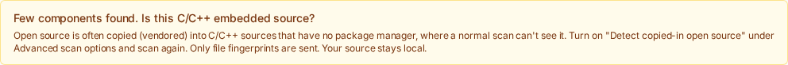
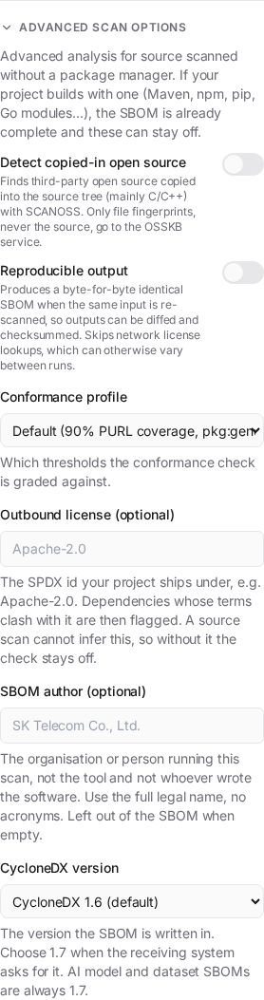
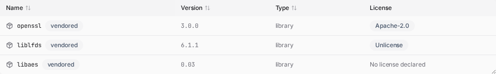

# Identify bundled open source (C/C++)

Use this when you scan a C/C++ embedded source tree and BomLens finds almost nothing.

## When you need it

A normal scan reads a package manager (npm, Maven, pip, Go, Conan, and so on) to learn what open source a project uses. C/C++ embedded firmware usually has no package manager: the open source is copied straight into the source tree (this is called *vendored* source — for example a copy of openssl, zlib, or liblfds under `third_party/`). cdxgen cannot name those files, so the SBOM comes back almost empty, with each file listed as an unidentified `pkg:generic` entry.

When that happens, BomLens prints a one-line hint suggesting this option, and the web UI shows the same hint after the scan. You do not need to recognize the situation yourself.



`--identify-vendored` matches the file fingerprints of your sources against the public OSSKB knowledge base and records each match as a real component (name, version, PURL), so the copied-in open source shows up in the SBOM — and, where the library has known CVEs, in the security report.

## What is sent

Only file **fingerprints** (hashes) are sent to the OSSKB service. Your source code never leaves the machine. The supplier can run this in their own environment before any contract.

## On a package-managed project

This option is for source with no package manager. If your project uses npm, Maven, pip, Go, and so on, the normal scan already resolves your dependencies and you do not need it. If you turn it on anyway, BomLens reconciles the results: dependency and build directories (`node_modules`, `vendor`, `dist`, and the like) are skipped, and any match whose name a package-manager component already carries is dropped in favor of that authoritative identity. So enabling it on a managed project does not duplicate known dependencies or inflate the vulnerability count — at most it adds genuinely copied-in source the package manager could not see.

Matches are recorded read-only, tagged with their source and confidence. BomLens does not provide an accept/reject audit workflow; if you need to confirm or triage matches, upload the SBOM to a vulnerability management system (Dependency-Track, TRUSCA, etc.) and do it there.

## Prerequisites

The published `bomlens` image already includes the SCANOSS client, so no extra setup is needed. If you build the image yourself with a minimal configuration, add the build arg:

```bash
docker build --build-arg SBOM_SCANOSS=true -t bomlens ./docker
```

## Run it

```bash
./scripts/scan-sbom.sh --project trelay --version 26.4.0 --target ./src \
  --identify-vendored --all --generate-only
```

In the web UI or desktop app, open **Advanced** and turn on **File-level identification (SCANOSS)** — the on-screen label differs from this guide's title, but it is the same feature. The option appears only for a source scan (current directory, git URL, or ZIP upload) when the image supports it.

If you are on Windows and new to the command line, follow the desktop-app steps in [Quick start without the CLI](../start/no-cli.md) first.



## What you get

- Copied-in open source appears in the SBOM as named components with versions, each tagged `vendored` (a `bomlens:layer=vendored` property).
- Components that map to a known product get a CPE, so the Trivy security report lists their CVEs. For example a vendored `openssl 1.1.1w` shows up with its advisories.
- Niche libraries with no entry in the vulnerability databases (for example `liblfds`, `libaes`, `djbdns`) are still identified by name and version; they simply have no CVEs to report, which is a limit of the public data, not of the scan.

Only full-file matches become components. Partial (snippet) matches are noisy and are left out, so the report stays clean.



## Endpoint and limits

The default endpoint is the free OSSKB API, which is rate-limited and intended for identification only. From the CLI, you can point at a SCANOSS commercial or self-hosted endpoint with environment variables for high-volume or air-gapped use:

```bash
SCANOSS_API_URL=https://your-scanoss-endpoint \
SCANOSS_API_KEY=your-key \
./scripts/scan-sbom.sh --project trelay --version 26.4.0 --target ./src --identify-vendored --all --generate-only
```

In the web UI and desktop app, you can supply only the token from the screen. If you hit the free OSSKB rate limit, turn on **File-level identification (SCANOSS)** and paste a token from scanoss.com into the field that appears below the toggle, then run again. The token is used once for that scan and is never stored or logged.

The endpoint URL (`SCANOSS_API_URL`) and the reporting threshold (`SCANOSS_MIN_FILES`) are set through CLI or container environment variables only; neither the web UI nor the desktop app exposes a field for them. In particular, the desktop app does not forward `SCANOSS_API_URL` into the container, so a commercial or self-hosted endpoint cannot be used from the desktop app today. If you need one, run from the CLI or `sbom-ui.bat` with the variable set.

Version precision is approximate. A file match reports the release where that file content first appeared, so different files of the same library can resolve to slightly different versions and a copied-in library may be reported a point release off. Treat the version (and any CVEs derived from it) as a starting point for review, not a final verdict.

Attribution can also point at the wrong project. A file that many projects copy (for example zlib's `deflate.c`) may match a downstream project that vendored it rather than the canonical upstream. To cut that noise, BomLens reports a library only when at least two files agree on it (configurable with `SCANOSS_MIN_FILES`; set `1` to keep every match) and resolves the version and PURL from the consensus across those files, so scattered one-off fork matches are dropped and a library split across forks collapses to a single component. This helps but does not fully fix it — a real copy can still be reported under another name, and its CVEs missed. It is a ranking and coverage limit of the knowledge base, more pronounced on the free OSSKB; for higher-fidelity attribution, point `SCANOSS_API_URL` at a SCANOSS commercial or self-hosted endpoint.

Separately, scanning source that is itself published in a public repository will match that repository (your own first-party files can match your own public project) — this does not occur for the intended case of private supplier source.

Results are a best-effort estimate that benefits from human review. See the OSSKB terms and license notes in [THIRD_PARTY_LICENSES.md](https://github.com/sktelecom/bomlens/blob/main/THIRD_PARTY_LICENSES.md).

## Reviewing the matches

`docker/lib/snippet-review.py` turns the raw match result into a review queue. Set `SCANOSS_RAW_OUT=<file>` to keep the raw result of a scan, then:

```bash
python3 docker/lib/snippet-review.py page  scan-raw.json --root <your source> [--origin <release sources>] > review.html
python3 docker/lib/snippet-review.py queue scan-raw.json --decisions snippet-decisions.json
```

Matches are grouped by the source they came from, so one decision covers every file of a group. Groups that need a decision are listed first: a partial copy (11 lines or more and 40% or more of the file), a file that several sources claim, a source with no license found, or files that match different versions. Whole files from one licensed source are listed as confirmed by evidence, and small partial matches (10 lines or fewer) are shown for information only. Neither is hidden.

The page needs no server and loads nothing from the network. With `--root` it shows your source tree and, for the selected file, the whole file with the matched regions highlighted. With `--origin` (the folder holding the release sources a knowledge base was built from) it shows the source tree of the original release and the whole original file beside yours, with its matched regions highlighted. `n` and `p` move between the matched regions of a file and scroll both sides to them; `[` and `]` move between the files of the group. A scan against a public service sends only hashes, so there the page shows the source address and the line numbers the service returned.

Keys: `1` third-party code (adds it to the SBOM), `2` our own code (asks where the original is), `3` coincidence, `4` later, `5` already declared under another name, `6` correct the version, `j` and `k` to move, `u` to undo. The page downloads a decisions file. Set `SCANOSS_DECISIONS=<file>` on the next scan: code decided to be your own, a coincidence or already declared leaves the list, a corrected version replaces the detected one, and every group that still needs a decision is marked `bomlens:review=pending` rather than dropped. A decision records the hash and region of the files it covered, so a file that changed goes back to the queue.

### When one file matches several sources

If the matched lines of one file overlap between two or more sources, the page shows one contest for that file instead of one group per source. It lists the candidates with their versions, licenses, the obligation class of each license (strong copyleft, weak copyleft, permissive, unknown), the share matched and the lines, and shows each candidate's original beside your file. You pick the source the code was taken from (keys `1` to `9`), or mark it as your own code (`o`), a coincidence (`x`) or later (`l`). A choice always asks for a reason. When the candidates carry different obligations, the page says so, and a choice that lands on a weaker obligation than another candidate is marked `needs_sample` in the decisions file and reported by `apply`, so that a second person can look at it. Sources that match different regions of one file are a combination, not a contest, and stay as separate groups.

The system does not pick an origin by itself. The oldest release is not used either: it is not a reliable sign of where a supplier took the code from. Until a decision exists, `apply` keeps every candidate in the SBOM with `bomlens:review=pending` and `bomlens:contested=pending`. After a decision, the chosen source stays, the others are recorded on it as `bomlens:alsoMatched` (they do not become components), and a source whose every file went to another source is left out. A source that still has files of its own stays.

A decision is keyed by the hash of the matched lines, so it survives a moved or renamed file and edits elsewhere in the file. It records the chosen source and the other candidates. When a later scan finds the chosen source gone, or a new candidate with a different obligation, the decision no longer applies and the contest returns to the queue.

Partial copies only reach the SBOM through a decision: accepting one adds the component even though the scan's own list did not carry it. Snippet matching is off by default; set `SCANOSS_SNIPPETS=true` to ask for it. A long copy needs a decision even inside a large file (50 lines or more, or 11 lines and 40% of the file), and many small matches from one source count together.

### What a real scan returns

A scan against the public service names one best match per file, so a contest appears only when the scan returns several matches for the same lines. The best match is not always where the code was taken from. In a test with public zlib sources, the service named a downstream project, whose license text carries a GPL clause, for zlib's own `adler32.c` and `crc32.c`, and a fork for a file that joined zlib's two files. A whole-file match whose license carries a copyleft obligation is therefore never confirmed on its own: the page asks you to check that the source is where the code was taken from. The scan reports the hash of your file as `source_hash` and the hash of the matched file in the knowledge base as `file_hash`; the page keys decisions on your own file. Give `apply` the same source tree (`--root`) that built the page, or none at all; a decision also records the scan's own hash of your file, so both ways match.
