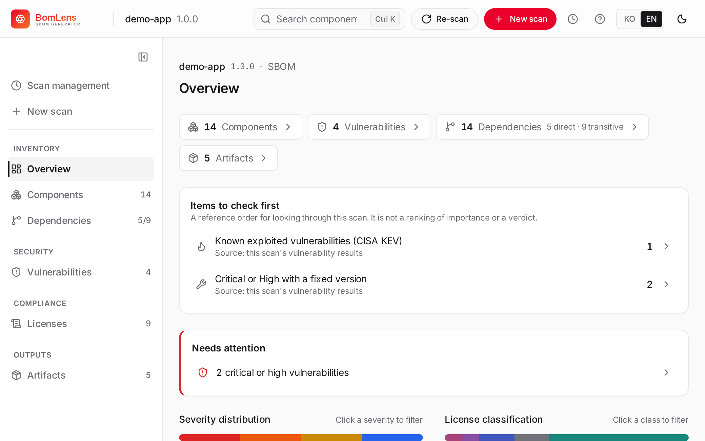

# Generate SBOMs and assess open-source risk, all locally

From source, containers, binaries, firmware, or an SBOM you received.
One run gives you an SBOM, an open-source notice, and a risk report.
No SaaS and no account.

[Try the live demo](https://sktelecom.github.io/bomlens/demo/){ .md-button .md-button--primary }
[Get started](start/first-scan.md){ .md-button }

[Download for Windows (.exe)](https://github.com/sktelecom/bomlens/releases/latest/download/BomLens-Setup.exe). It needs a Docker engine that is already running.

{ .home-shot }

## What it does

A local-first SBOM generator and open-source risk assessor for a single project. From source code, a container image, a binary, firmware, an SBOM you received, or a HuggingFace AI model, it produces an [SBOM](concepts/what-is-sbom.md) (CycloneDX 1.6), an open-source notice, and a security risk report in one run. For an AI model it builds a CycloneDX ML-BOM and checks it against the [G7 minimum elements for AI](guides/ai-model.md), whose clusters overlap with the EU AI Act's Annex IV.

Want to see what a result looks like before installing anything? The [live demo](https://sktelecom.github.io/bomlens/demo/) is the real web UI holding one finished scan of each kind: a Spring Boot project from source, a container image, a device firmware image, an AI model as a CycloneDX ML-BOM, and a supplier SBOM checked against the format requirements. Nothing to install, and nothing is uploaded: it is a frozen copy of results produced by ordinary local runs.

Prefer no command line? Download the installer and double-click it. A Docker engine is required; the free [Rancher Desktop](https://rancherdesktop.io/) works well on Windows. A step-by-step walkthrough is in the [no-CLI quick start](start/no-cli.md).

## Where to start

### If you want to try it

-   :material-rocket-launch: __Getting started__

    Install through your first SBOM (desktop app, web UI, and CLI).

    [:octicons-arrow-right-24: Getting started](start/first-scan.md)

-   :material-cursor-default-click: __No-CLI quick start__

    Make an SBOM and a notice with the desktop app, no command line.

    [:octicons-arrow-right-24: Quick start](start/no-cli.md)

-   :material-format-list-bulleted: __Input scenarios__

    GitHub URL, ZIP, local source, an existing SBOM, firmware.

    [:octicons-arrow-right-24: Scenarios guide](guides/by-input.md)

-   :material-file-document-check: __Supplier SBOM__

    Validate an SBOM you received and issue a risk report.

    [:octicons-arrow-right-24: Supplier SBOM](guides/supplier-sbom.md)

### If you run it in CI or need the reference

-   :material-cog: __CLI reference__

    Every option and analysis mode.

    [:octicons-arrow-right-24: CLI reference](reference/cli.md)

-   :material-source-branch: __CI/CD__

    Run scans in a pipeline and gate on the result.

    [:octicons-arrow-right-24: CI/CD](guides/ci-cd.md)

-   :material-shield-check: __Notice & security report__

    Generate and read the outputs, plus using the web UI.

    [:octicons-arrow-right-24: Reports](guides/reports.md)

-   :material-robot-outline: __AI model SBOM__

    An ML-BOM for a HuggingFace model, checked against the G7 minimum elements and mapped to the EU AI Act.

    [:octicons-arrow-right-24: AI model SBOM](guides/ai-model.md)

