# Web UI & desktop app

Scan from a browser without the CLI. The UI server is built into the scanner image, so no extra install is needed.

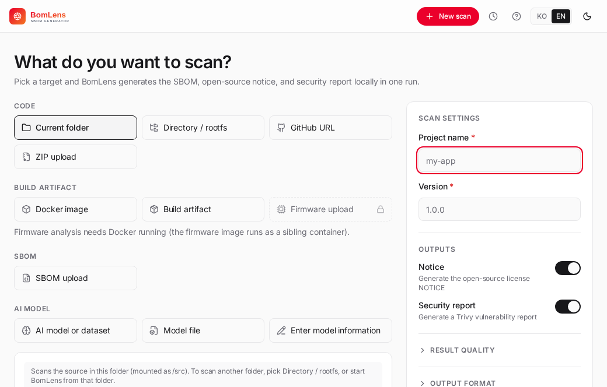

**macOS / Linux:**
```bash
cd ~/sbom-output      # output folder (anywhere is fine)
/path/to/bomlens/scripts/scan-sbom.sh --ui
# → opens http://localhost:8080 automatically
```

**Windows — double-click (no command line):** in the unzipped folder, double-click `scripts\sbom-ui.bat` and a browser opens `http://localhost:8080` shortly after. Docker just needs to be running, and `sbom-ui.bat` works on Rancher Desktop or Docker Desktop (on WSL2, run `scan-sbom.sh --ui` inside WSL).

> The run location is the output base, and it scans that folder's source only when you choose "Current folder" as the scan target. If you use a GitHub URL, an upload, or a Docker image, the run location does not matter. Each scan is saved to its own `{Project}_{Version}/` subfolder; the base defaults and how to change them are in [Where outputs go](cli.md#where-outputs-go).

## The shell

The interface has a top bar across the width, a left rail for the current scan's sections, and a content area:

- **Top bar** — the product mark (links home), the current project, a Re-scan button (shown on a scan that still carries its settings, so you can re-run the same target with the toggles prefilled), global search across components and CVEs, the Scan management menu (the clock icon opens a list of past scans with a delete control and a link to the full list), the New scan button, and the language (한국어 / EN) and light/dark toggles.
- **Left rail** — two named links out of the scan (Scan management, New scan) above the current scan's sections, which are grouped under Inventory, Security, Compliance, AI and Outputs. The rail adapts to the scan: AI sections appear only for AI/ML SBOMs, and a section appears only when its data exists. It collapses to icons on narrow windows. With no scan open — the home screen — there is no rail.
- **Content** — the home (Scan management) screen, the New scan form, the running view, or the active result section.

The first Tab stop on every screen is a "Skip to main content" link that moves focus past the top bar and rail. The global actions (New scan, Scan management) live in the top bar, and the rail repeats them as labelled links above its sections so a result screen always shows a named way back. Every navigation element — the logo, New scan, the rail sections, the summary strip entries and the past-scan links — is a real link backed by a URL hash (`#/scan/<id>/<section>`), so Cmd/Ctrl or middle click opens it in a new tab.

The **Help** menu (the question-mark icon in the top bar) links to Getting started, the documentation, the live demo, the release notes of the running version and the problem report form, and lists the keyboard shortcuts. Press `?` outside a text field to open the same list. On a first run with no scans yet, the Scan management screen offers a link to an example result next to the New scan button.

## New scan

The New scan screen is two panes. On the left, pick a source — grouped into Code (current folder, a directory path, a GitHub URL, a ZIP upload), Artifact (a Docker image, a package or build artifact, a firmware image), SBOM (analyze an existing SBOM) and AI model (generate an ML-BOM from a HuggingFace model, from a model file you upload, or from model information you enter) — and fill in the source-specific input below the tiles. On the right, enter the project name and version, choose the outputs to generate, and start the scan.

| Scan target | Input method | Backend mode |
|-------------|--------------|--------------|
| Current folder | scans the source in the UI's run folder | SOURCE |
| Directory path | a subfolder under the run folder (e.g. an OS rootfs), a folder mounted with `--ui --mount <dir>`, or — in the desktop app — a folder added with the Add folder button | ROOTFS, or ANALYZE when the folder is a [Yocto build directory](#yocto-build-directory) |
| GitHub URL | enter the repository URL | SOURCE (clone) |
| ZIP upload | upload a `.zip`/tar file | SOURCE (extract) |
| Package upload | upload a build artifact — `.jar`, `.war`, `.ear`, `.deb`, `.rpm`, `.whl` | BINARY (a wheel is unpacked and scanned as ROOTFS) |
| SBOM upload | upload an existing SBOM (JSON, or the `.spdx.tar.zst` a Yocto SPDX 2.2 build deploys) | ANALYZE |
| Firmware upload | upload a `.bin`, etc. | FIRMWARE |
| Docker image | enter the image name | IMAGE |
| AI model | enter a HuggingFace model id (`org/model`) | AIBOM |
| Model file | upload a `.gguf`, `.safetensors`, `.pt`, … (up to 8 GB) | MODELFILE |
| Published dataset | enter a Figshare item (its page URL, its DOI, or the item number) or a HuggingFace dataset (`datasets/<owner>/<name>`, its `https://huggingface.co/datasets/...` address, or `hf:<owner>/<name>`) in the same field as the model id | DATASET |
| Enter model information | for a model that has no repository or file yet: the project name becomes the model's name. **Start the questions** first asks whether the model was trained from scratch or started from a base model (then added by HuggingFace id, revision optional), then the model information (the document author unless the form's SBOM author is set, release date, download address, supplier), the training data (HuggingFace datasets by id and data the hub does not hold) and the decisions, then shows a review. An id typed but not added is added when you move on; one that is not an id keeps you on the step. Choosing adapter weights with no base model shows a warning. "Start the scan" has the server check the answers first; a refusal is shown with its reasons in the review, with the answers kept, and only an accepted declaration is uploaded and scanned. Upload to a server is not offered for this input. A re-scan reopens the questions at the review step with the saved answers. The tile is locked when the image lacks the scripts for it | AIDECLARE |

Firmware analysis, an AI model, and Deep CVE matching each run in their own opt-in image rather than the base one. Picking one of these shows a panel that checks whether that image is already present: if so, it names the version already installed; if not, it offers a **Download** button with the download size and, once started, layer-by-layer progress. Downloading it here, before the scan starts, avoids a multi-minute wait in the middle of a scan that would otherwise be indistinguishable from the analysis itself.

Generation options are the open-source notice and the security (vulnerability) report. A scan always writes the SBOM in CycloneDX; an SPDX copy is exported afterwards from the results screen, so there is nothing to decide here. Separately, a **Result quality** group gathers the toggles that change how the source is analyzed rather than which files are produced. An **Output format** group holds the conformance profile, outbound license, SBOM author and CycloneDX version. Options that send data off the machine (the SCANOSS lookup and the upload) carry a "Sends data out" mark, and the scan button stays pinned at the bottom of the settings panel. License scan (ScanCode) scans the project's own source files for per-file license text (1st-party; it does not download the declared dependencies) and applies to source-code scans (current folder, GitHub URL, ZIP upload). File-level identification (SCANOSS) finds third-party open source copied into the tree (mainly C/C++), also for source-code scans. SCANOSS uses the free OSSKB service, which is rate-limited and may return nothing under frequent use, so add a token from scanoss.com for regular runs. Go reachability analysis (govulncheck, the same as `--reachability` on the CLI) applies to a source-code scan or an uploaded package (an executable) and judges whether the code each Go advisory names is reached; it reads the Go vulnerability database online, turns the security report on, and is offered only when the image carries govulncheck. Firmware, Docker images and SBOM uploads have no other advanced options. Choosing SBOM upload (ANALYZE) forces the notice and security reports on for the risk analysis, and an AI-model scan produces the notice only (it has no package CVEs, so the security report is skipped).

The top bar's language toggle (한국어 / EN, see [The shell](#the-shell)) also decides the language of a scan's own generated prose: the conformance, security and AI-profile reports, and the model/dataset risk assessment's reason text, the same as `--lang` on the CLI. It reads whichever language is showing when you press Run scan. The SBOM itself and the third-party notice are not localized either way.

A **Reproducible output** toggle produces byte-identical SBOMs across runs (the UI equivalent of `--byte-stable`); it is available for source, image and firmware scans, not for SBOM analysis or AI models.

An **Outbound license** field takes the SPDX id your project ships under, such as `Apache-2.0` (the UI equivalent of `--license`). Fill it in and the Licenses section reports which dependencies clash with it; leave it empty and that check stays off, which the section says outright. It appears wherever BomLens generates the SBOM, so not for an analyzed supplier SBOM (which carries the supplier's own declaration) or an AI model.

An **SBOM author** field records the organisation or person running the scan on the SBOM's own metadata, not the tool and not whoever wrote the software (the UI equivalent of `--sbom-author`). Leave it empty and the SBOM carries no author. Available for AI-model scans too, since they get a document-metadata stamp the same as any other generated SBOM; hidden for an analyzed supplier SBOM, which the UI did not author.

A **CycloneDX version** choice sets the version the SBOM is written in: 1.6 (the default) or 1.7, the UI equivalent of `--spec-version`. AI model and dataset SBOMs are 1.7 whichever is chosen. Like the SBOM author, it is hidden for an analyzed supplier SBOM, which keeps the version its supplier wrote, and a re-scan keeps the version the earlier scan used.

Below the outputs, an optional **External transfer** step can send the finished SBOM to a server. Turn it on to pick the destination — Dependency-Track or TRUSCA — and enter the server URL and an access token; TRUSCA also asks for the target project id. The URL and token are used for that one run and are never saved. It is the UI equivalent of the CLI upload options; see [Upload to Dependency-Track / TRUSCA](../guides/upload.md).

### Yocto build directory

A folder picked with the Directory input can be a Yocto build directory, and BomLens recognizes it as one: it analyzes the image SBOM the build published under `tmp/deploy/images/<machine>/` instead of walking the build tree, which holds sysroots and native build tools that never ship in the image. The scan log names the folder and the document it read, the result page labels the scan a Yocto build directory, and the vulnerabilities carry the verdicts the build itself made — patched by a recipe, judged not applicable, or still open.

The build gives the most when it was configured to emit an SBOM (`INHERIT += "create-spdx-3.0"` and `INHERIT += "vex"` in `conf/local.conf`, on 5.0 Scarthgap or later — 4.0 Kirkstone has no such class). SPDX 2.2 is read as well, together with the `.spdx.tar.zst` beside it, though it carries no CVE verdicts; a build with no SPDX at all is read from the manifests it wrote anyway. Only a build directory with none of those stops the scan, rather than falling back to a directory scan whose result would misrepresent the image. The [supplier SBOM guide](../guides/supplier-sbom.md#yocto-images) covers the behaviour and its limits; the CLI recognizes the same folder through `--target`.

## Scan running

During a run the screen shows the pipeline stages — generate, normalize, notices, security, report — advancing as the live log streams, so you can see where the scan is and read any error (clone failure, no Docker socket, an unsupported file) as it happens.

## Result sections

When the scan finishes, the left rail fills with the sections for that scan.

Every result section starts with one line naming the project, version, scan type and scan time, then the section title. A status badge appears there only when the scan failed or finished with some steps failed, so a normal result carries no "complete" label.

**Overview** opens by naming what was scanned — the folder path, the cloned URL, the container image reference, the uploaded file's name, or the AI model id — so a result read weeks later still says where its numbers came from. A one-line summary strip follows, with the at-a-glance counts, each entry linking to its detail section. Under it, "Items to check first" lists up to three links with the count each rests on, where the count came from and when the scan was made: known exploited vulnerabilities (CISA KEV), Critical or High vulnerabilities that already have a fixed version, and required conformance items still to fill in. It is a reference order for reading the scan, not a ranking of importance or a verdict, and it is left out when none of the three applies. Then comes what needs attention — known-malicious packages first, then a failed conformance check (for an analyzed supplier SBOM), critical or high vulnerabilities, and components flagged for license review. A malicious package leads because it is already running in the build and has to be removed, not scheduled for a patch. When the scan flags components past their upstream end-of-life, an "End of life" entry joins the strip, with the ones that are also vulnerable shown in the risk colour (see [Component end-of-life](../concepts/reports-explained.md#component-end-of-life-eol)). A separate entry counts the components that have fallen behind their latest version (see [Version currency](../concepts/reports-explained.md#version-currency)). Below that, two risk axes sit side by side: the security severity distribution and the license classification. Click a band in either and you land in that section (Vulnerabilities or Licenses) with the filter already applied.

If a scan finished with reduced analysis — for example cdxgen ran out of Docker disk space and the SBOM fell back to direct dependencies only — a banner here gives the reason and what to do. A different banner, "Some data may be incomplete", appears when a best-effort post-process step (CPE/EOL/malicious enrichment, conformance validation, notice generation, and the like) failed during the scan; it names the step and suggests re-scanning to retry or checking the run log, so a valid but silently incomplete SBOM does not look no different from a complete one. A firmware scan that could not open part of the image adds a neutral "Firmware analysis scope" note: how much of the image was not recognized as a known format, how many extraction steps did not complete and for which formats, how many regions are encrypted, and which extraction tools the scanner image lacks. Components inside those regions are not in the SBOM, so read the vulnerability counts as covering only what was opened; the note is not shown for an SBOM you uploaded for review. If a scan is still running, its live log appears here on the Overview, not under every section.

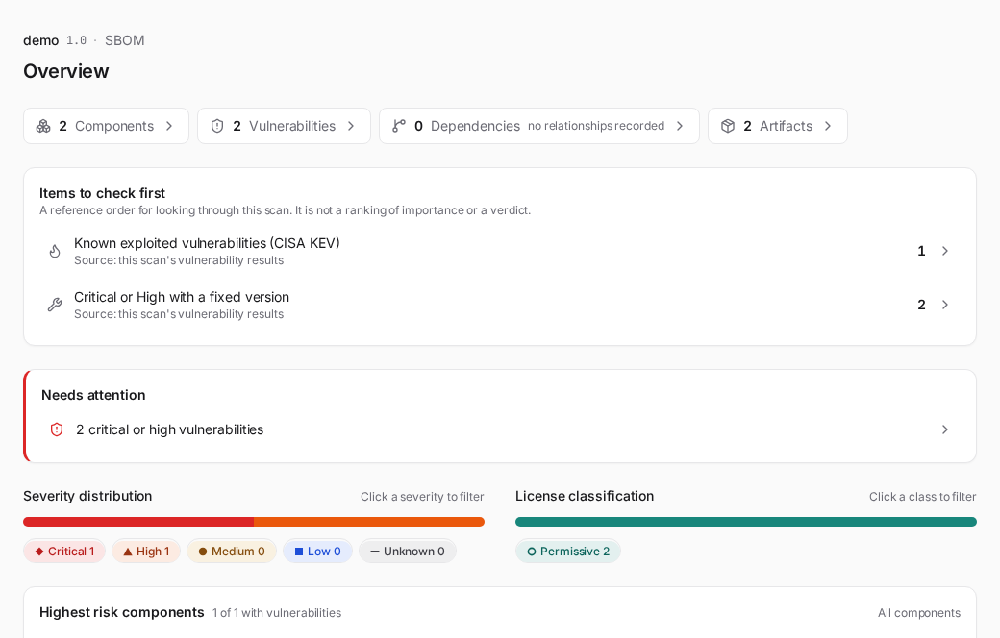

When the same project and version were scanned before, a card compares this run against the previous one (labeled by its version, or how long ago it ran): total component count (or "no component change") and whether the worst vulnerability severity got more severe, less severe, or stayed the same. Below that, two rows fill in a moment later with the specifics: components changed (added / removed / version-changed counts) and vulnerabilities changed (new / resolved counts), each opening into the actual names, with a component or a CVE id linking into Components or Vulnerabilities filtered to just that one, instead of the reader retyping it into the section's own search box.

**Components** lists everything detected, with search, a Filters menu (has vulnerabilities, direct only, needs review, end of life, outdated — only the ones this scan has data for are offered), and a Columns menu to show or hide Version, Type, Scope (direct vs transitive) and Risk (the worst vulnerability severity and count); a column this scan has no data for is not offered either. A component the bundled OSV snapshot knows to be a malicious package carries a "Malicious package" badge, ahead of the others, with the advisory id and snapshot date in its tooltip. A component past its upstream end-of-life carries an "End of life" badge, with the EOL date where known. A component that is not on its latest version is marked as outdated; with deps.dev enrichment on (`STALENESS_ENRICH=true`) its detail shows how many releases it is behind and its last-release date (see [Version currency](../concepts/reports-explained.md#version-currency)). Large SBOMs render in pages. Click a row to expand its detail in place — the PURL, source/download location, copyright, licenses and any vulnerabilities. Where the detail reports vulnerabilities, it also links into the Vulnerabilities section filtered to that component, and a vulnerability's own detail links back to its package in Components, so an investigation moves between the two lists without retyping the name.

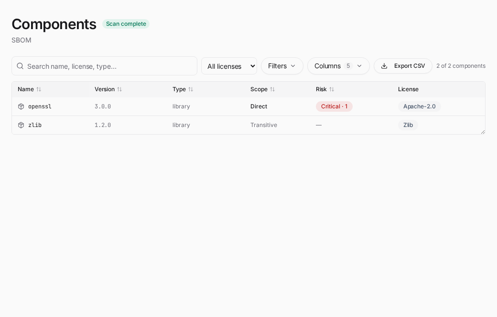

**Vulnerabilities** sorts by severity then CVSS, with a CVSS column and the fixed version, and each row expands in place to show the CVSS vector, description and references. Above the table, preset view chips (All, Fix available, Known exploited, Critical and High, each with its count) narrow the list in one click; a preset with no rows is disabled. A Layout switch changes the table between a flat list and one block per package: each package block shows how many CVEs it carries and the version that resolves them ("Upgrade to X to resolve N"). When one upgrade resolves several CVEs of a package, the "One upgrade resolves more than one CVE" card above the table lists it, one line per package. A Row height switch (Compact or Comfortable) is remembered in your browser and applies to the Components table as well. Click a band in the severity bar to filter to that severity, or search by CVE or package. Every row's detail also has a judgement field, where you can record your own read of that CVE against your product (affected, not affected, fixed, or under investigation, with an optional note), separate from the vendor/advisory status a report already carries; it is saved to the scan's own result folder, not into the SBOM itself. Once at least one judgement is on file for the scan, an "Export VEX" button above the table hands you the judgements as a CycloneDX VEX document (see the artifacts reference). "Import VEX" goes the other way: pick a CycloneDX VEX document a supplier sent and its statements appear on the matching rows with their own "Supplier VEX" label, next to your judgement and never replacing it. A statement is matched to a component through its `affects` reference, by purl or by name and version; a statement that names the product itself applies to every finding of that CVE that has no statement of its own. A document that describes a different product or version than the scanned SBOM is refused, statements about components the SBOM does not contain are left out (the screen says how many), and a statement with no `affects` is ignored. A refused or empty import changes nothing. When the scan ran Go reachability analysis, a finding govulncheck judged not reachable is left out of the severity figures and the Overview count, as in the security report, and listed below the severity bar in its own collapsible list, marked "Not reachable" with the reason (the affected package is not in the build, or no affected function is reached) and govulncheck's own detail. A reached finding stays in the table with a "Reached" badge whose tooltip gives the call path or the symbol.

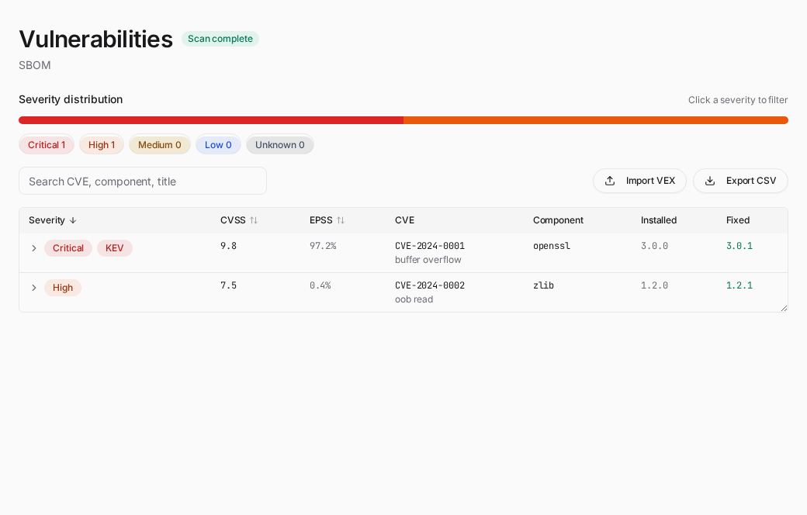

**Dependencies** shows the relationships recorded in the SBOM as a graph or a tree. Direct dependencies are highlighted and packages with known vulnerabilities are marked with their severity. Switch to the tree to expand direct and transitive dependencies as a hierarchy. An SBOM with more than 150 packages opens as the tree, because a graph of that size cannot be read, with a note that says so; switch to Graph to see it anyway.

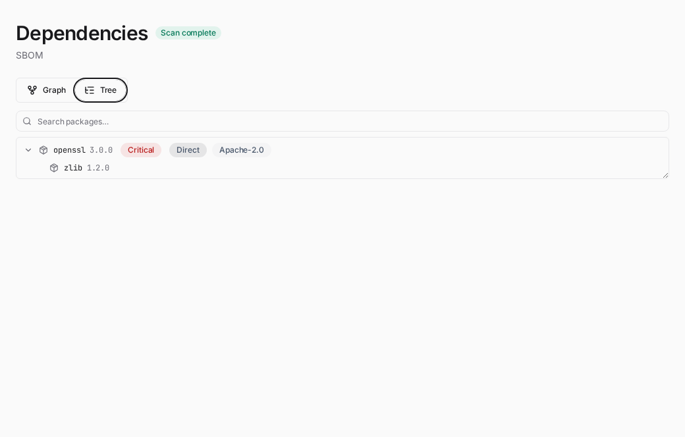

**Licenses** opens with a license classification axis that groups components by copyleft strength — network copyleft (AGPL), strong copyleft (GPL), weak copyleft (LGPL, MPL, EPL, …), permissive, review needed, and uncategorized. An unrecognised license is never assumed permissive; it falls to uncategorized so a person looks at it. Click a class to filter the rest of the section to it. Under the classification is the per-license distribution — how many components declare each license, busiest first, with the unlicensed bucket at the end. Picking a class narrows this list; clicking a license opens the Components table filtered to it, where it combines with the type, scope and risk filters. Below the distribution, when the scan declared an outbound license, come the dependencies whose terms clash with it — grouped worst first, each with the reasoning for its verdict. It is a documentation aid, not a legal determination. If no outbound license was declared the section says the check did not run and how to turn it on, rather than leaving an empty list to read as an all-clear. Then come the components whose terms need human review — AI behavioral-use (RAIL/Llama/Gemma) and non-commercial licenses.

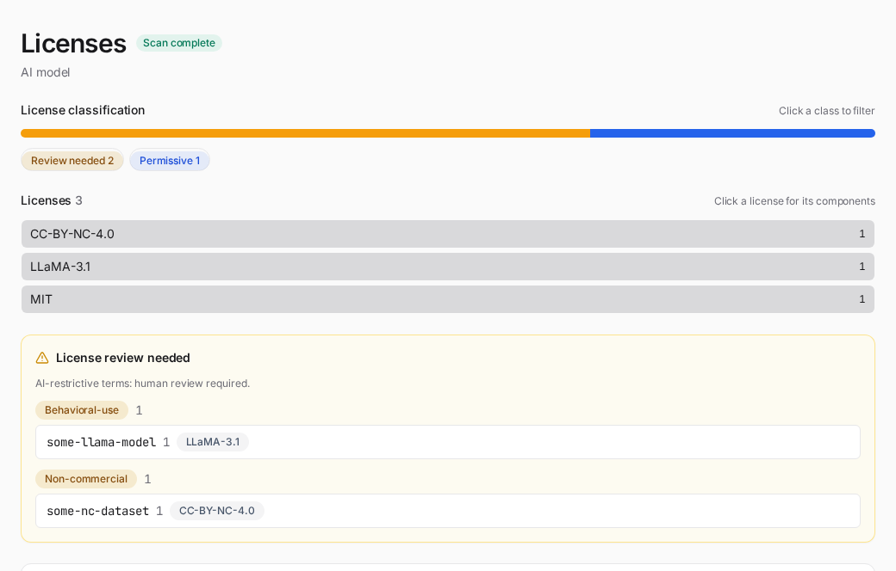

**SBOM Validation** appears under Risk & compliance for every scan, whether the SBOM was uploaded for review or generated by the scan itself — the intro line at the top says what the section measures either way: how well this SBOM's own fields meet the CycloneDX format and SBOM-related regulatory requirements, not a judgment of the scanned software. The one exception is a self-generated AI SBOM (an AIBOM, a model file scan, or a dataset scan with no upload): its G7 minimum-element checks are the more useful reading there, so they appear on **Models & datasets** instead of duplicating them here. The regulatory crosswalk shown with the checklist is for reference and makes no compliance determination. The screen shows the format verdict (pass or fail) and the base CycloneDX checks (timestamp, tools, top-level component, name and version coverage, PURL coverage, transitive dependencies), with the missing items listed for each failed check, plus, for a scan that is not an AI SBOM, the share of components that declare a license. A pass on a result that identified no software, or where no component declares a license, is shown as "Pass, see the note below" with a warning, because a pass only says that no required item failed. A crosswalk roll-up shows how the checks map to the regulatory baselines (EU CRA via BSI TR-03183-2, the US SBOM minimum elements of 2026). When the SBOM carries a machine-learning-model component, the G7 AI minimum-element checks (all advisory) appear here as a sub-block, grouped by the seven G7 clusters and tagged by data source — auto (read directly), inferred, declaration needed (shown as publisher's declaration once the publisher's declaration meets it; BomLens does not verify it), or review-needed when no automated source exists. The [AI model SBOM guide](../guides/ai-model.md#reading-the-conformance-check-report) explains the headline numbers and badges. If a best-effort post-process step failed while this SBOM was generated, a "Some conformance checks may be based on incomplete data" note names it here too; for a document someone else supplied, it suggests asking them to regenerate it instead of re-scanning.

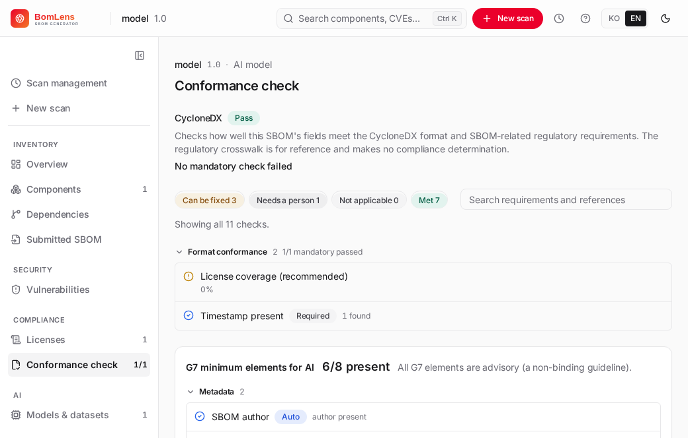

**Artifacts** lists the generated files (SBOM, notice, risk report, security report, conformance) grouped by kind, downloadable per format or as a single ZIP.

**Source tree** shows what the scan actually looked at, rather than only what it found. The tree on the left lists the files; picking one opens its text beside it. It appears for every scan that had files to read: a source scan, a directory or rootfs scan, a firmware image (after unpacking), a container image, and a build artifact that is an archive (jar, war, whl, zip, tar). A container image and an archive have no folder to walk, so BomLens unpacks a temporary copy, reads it, and deletes it before the scan ends. Symlinks are listed with the path they point at — in a container image nearly every command in `/bin` is a link into busybox, and leaving them out would show a tree in which those commands do not exist. When the scan ran with **License scan (ScanCode)** on, each file also carries the license detected in it.

The captured text is bounded so a scan's output folder stays a reasonable size: text files only, up to 256 KB each and 8 MB in total, and licence texts and package manifests are taken first so the evidence behind a finding is the part that survives a tight budget. A file with no text on screen says why — it is binary, or the capture reached its limit — and the line above the tree reports how many files were captured and how many were left out. Nothing is silently dropped.

**Submitted SBOM** appears when the scan read an SBOM someone else produced (SBOM upload / ANALYZE). Every other screen describes the CycloneDX document BomLens converted that input into, so this one describes the input itself: the format and spec version it was written in, its document name and identifier, when it was created, the tool that produced it, and the supplier or authors it names. Fields the supplier did not fill in are left out rather than shown blank — on a compliance screen a confident-looking wrong value costs more than a missing one. The entries themselves are not repeated here; the section links to Components, which lists them with sorting, filters and risk.

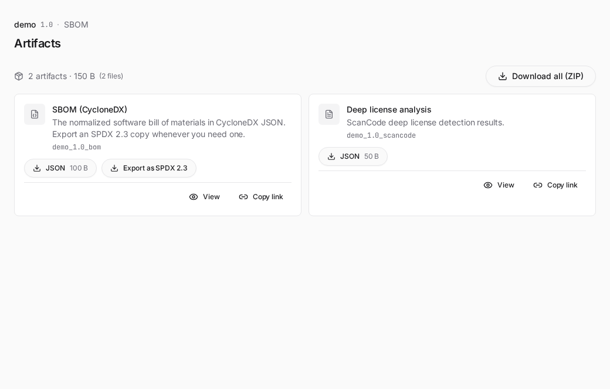

The SBOM card in that section carries an **Export as SPDX 2.3** button. It converts the finished CycloneDX BOM into `{Project}_{Version}_bom.spdx.json` and starts the download at once, without rescanning. The converted file then joins the card as an ordinary download chip and is included in the ZIP, and the button is no longer offered for a scan that already has an SPDX file. CycloneDX stays the primary format, and CycloneDX-only data (vulnerabilities, `bomlens:*` properties) is not carried over. Signing is available only in the CLI (`--spdx --sign`), so a file exported here is unsigned like every other artifact the UI produces.

Conversion needs syft. The scanner image ships it, so the usual deployment converts on the spot. Where it is missing, such as the desktop app's base UI image, BomLens runs the scanner image as a separate container to do the conversion, which downloads that image once on first use. Where neither is possible, the button is not shown.

An AI scan adds two cards. **SPDX 3.0.1 AI document** holds the document, with a draft badge while required fields are open, and its check; its check chips are labelled "Check JSON" and "Check MD". A "Rebuild with the saved declaration" button appears only when the document is behind the saved declaration or this BomLens (a declaration edited outside the screens, for instance); it rebuilds the document and downloads it. **AI declaration** holds the values you declared and the empty form; its "Upload declaration" button sends an edited file back, which the server checks and applies the same way as the questions on Models & datasets. When the document is rewritten, a signature the CLI made over the earlier one is removed, because it no longer matches.

### AI surfaces

For an AI/ML SBOM (a CycloneDX SBOM with a machine-learning-model component), the rail adds:

**Models & datasets** — each model card's identifier, architecture, task, license, supplier and integrity, a four-axis disclosure panel (weights / architecture / training data / training process, as documented in the BOM), and the datasets the model references. When the SBOM carries a model risk assessment, the card opens with the overall grade badge (ok / conditional / caution / review), the per-axis verdicts (license, file security, datasets — an unevaluated axis shows a dash), the reasons behind the grade, the quoted custom-license wording and lineage warning when present, and the usage scenario the verdict was judged for; each dataset row carries its own grade badge. A source the scan traced from a dataset's card is a row of its own, indented under that dataset, and a source the card names only in words carries a "needs checking" badge. The section ends with the reminder that the assessment is guidance, not legal advice. For AI model scans, the New scan form adds a usage-context selector (internal / product / redistribute / outputs-only) that tailors this assessment.

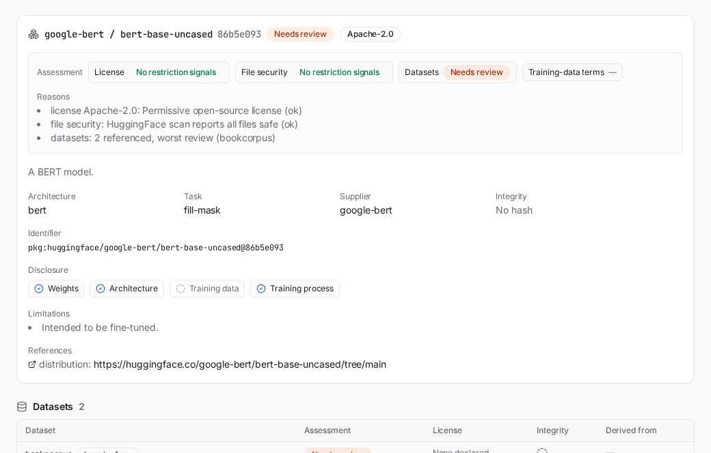

The section opens with the **SPDX 3.0.1 AI document** band. It says whether the document is a draft or complete, counts its fields in four groups (filled from the scan or declared, optional, your decision, and required but empty) and names the elements whose required fields are still empty. For a model someone else published it adds that filling them matters only if you distribute the document yourself. Below it, "Show the document's fields" unfolds a table of the model's fields with their value (dates in your locale, choices by their label) and where the value came from; it starts open for a model described from a declaration. Each dataset's fields are folded under it and open by themselves when they hold required fields still empty. The Overview's AI card shows the same draft or complete state with a link that opens the questions. **Fill in empty fields** opens questions for exactly the fields the scan left open, starting at the first step that has something open, in up to six steps: the base models' revisions, the model (the document's author, its release and build dates, who made it, the weights it distributes, and an optional "use and scope" group), the training data (how the model used each dataset the card names, the datasets' makers and dates, data the hub does not hold, and an optional "how it was trained" group), the service the model runs in (optional, described below), the decisions only the publisher can make (personal information, autonomy, safety risk), and a review. The step list shows how many items each step still holds, and a step left with items open is marked with a warning instead of a tick. "Unknown" is offered only where SPDX itself has such a value; a required date, author or address has none, so the question says that leaving it empty fails validation, quietly at first and as an error once you leave the field or the step. The review lists what will be saved, grouped like the steps; each "open" count jumps to its step and the first open field. Saving sends the answers to the server, which checks them against the scan and rewrites the document; you can save with required fields still open, and the document stays a draft until they are filled. Saving waits only on what the server would refuse: a value it cannot accept, or data the hub does not hold that has no name or address. An added entry left untouched is dropped. Answers in progress are kept while you look at other sections, and cancelling discards them. A declaration saved earlier that no longer fits the scan is reported on the band with its reasons. A scan from before this document existed shows a button that writes it instead.

For a model, the questions include an optional **Service** step after the training data. It asks "Do you run this model in a service, such as an app or an API?" with three answers: yes, no (the document covers the model alone) and later. Only yes adds anything: the service's name, version, address, provider (an organization) and release date, which SPDX requires of it, then folded groups for its purpose and whether a person is involved in the AI's decisions (involved, fully automatic, or not known), its input and output kinds, its data flows (each added by saying what data it is, then given a direction), the external AI models it calls through an API (identified by name, provider, version and address only), and the standards it follows with a public disclosure page. A group opens by itself only when it holds something to fix. The service's empty required fields keep the document a draft but never stop saving, and a service left empty is not recorded. Once a service answers whether a person is involved, the decisions step no longer asks the model's autonomy. The model step also has a folded group for regulatory filings (training compute in FLOPs such as 3.2e24, how it was counted, and whether adversarial testing was done, with the EU AI Act and Korean AI Basic Act articles as references, not legal advice) and asks the model's input and output kinds; a dataset's known bias is asked with its main questions. A service saved after the scan goes into the SPDX 3.0.1 document at once; the band then says a new scan brings it to the CycloneDX SBOM and the G7 checks, with a re-scan button. After that scan, a service card on Models & datasets shows the declared service with a "Publisher's declaration" badge: its provider, the model it runs, the number of data flows and the external models it calls. A G7 element met by such a declaration carries the same badge.

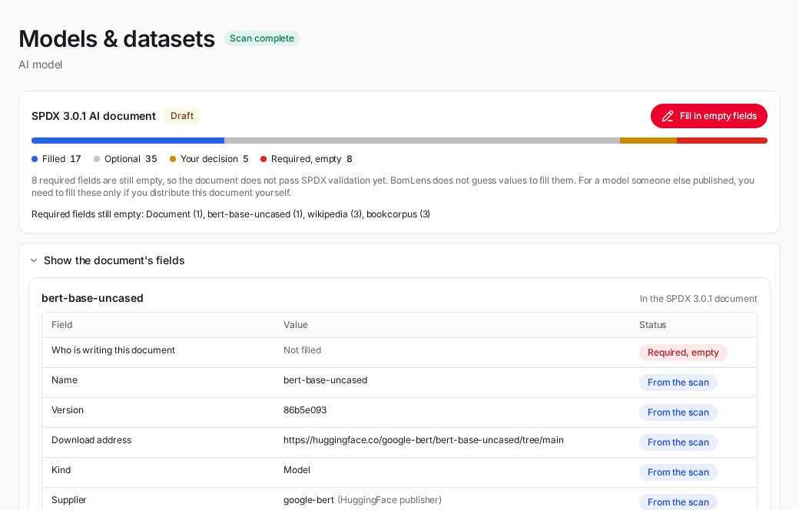

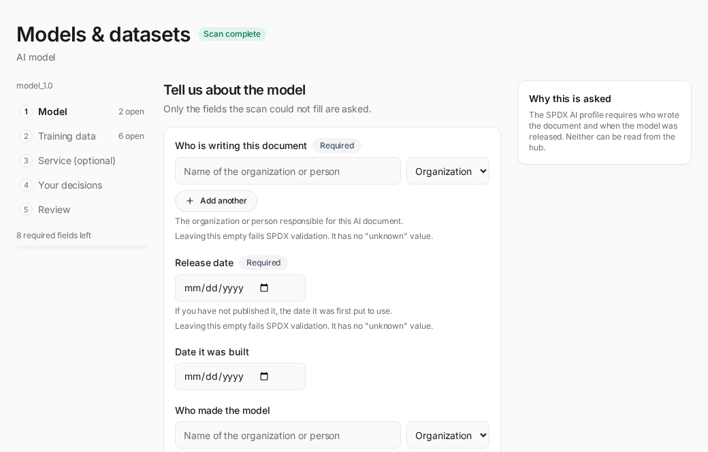

The G7 AI minimum-element checks are added only when the SBOM has a model component. For an AI SBOM generated by the scan itself they appear on **Models & datasets**, below the model cards; for one uploaded for review they appear on **SBOM Validation** instead, alongside the base format checks. Either way, the Overview leads an AI scan with a summary card — the model's risk verdict, the G7 headline and the regulatory framework coverage (EU AI Act, Korea AI Basic Act) — that links into whichever of the two sections carries the detail. It is advisory, not a certification, and the same data is written to the `_ai-profile` files (see [Artifacts](artifacts.md)).

## Scan management

The home screen — opened from the rail's Scan management link, the logo, or the top bar's Scan management (clock) menu — lists every past scan saved on this machine. Each scan's `{Project}_{Version}/` subfolder under the output base is one entry. A search box and scan-type filter chips (only the types that exist — Source, Container, RootFS, Firmware, AI model, SBOM) narrow the list. The type comes from what the scan was pointed at and, where that leaves it open, from the root component the SBOM declares — an analyzed supplier document reads as SBOM rather than as the Source its root usually claims to be. An "At risk" chip with its count filters the list to the scans that need attention, and the total scan and project counts are shown as plain text at the right of the same row. The table sorts by scan, generated time, components or top severity. Click a row to re-open its results, or delete one to remove its subfolder — a prompt confirms first, because the files are removed from disk and nothing is kept to restore. This is local files only — no account, no database.

## External lookup

Reachable from the top bar's icon at any time, or from a Cmd/Ctrl+K search whose term looks like an advisory id — with or without a scan loaded. Type a CVE/GHSA/GO/PYSEC/RUSTSEC/OSV/GSD/MAL id, a purl, or a bare package name (which then asks for an ecosystem and version), and the server checks it live against OSV.dev: full detail for one advisory, or every known vulnerability for one package version. The URL (`#/lookup?q=…`) is a shareable link that re-runs the same lookup on open.

This is the one feature that reaches outside the machine on its own initiative rather than as part of a scan — see [Local-first by design](../concepts/local-first.md) for what that means for a closed network. Set `EXTERNAL_LOOKUP=false` to remove it (the icon, the search row and the screen) entirely.

## Reporting a problem

When a scan ends, whether it succeeded or failed, the Overview ends with a Report a problem panel. It is folded after a successful scan and open after a failed one. It shows a diagnostics summary in full: the app and scanner image versions, the container engine, the scan mode and options, the result of each stage, and the `[WARN]` lines the scan collected. The summary is built from a fixed list of fields, so source contents, the scanned path and the project name are not part of it. Text taken from the scan itself (warnings and error messages) is filtered: user names in home-directory paths and text that looks like a credential are masked. The filter is best effort, and a folder name or other detail can remain, so read the summary before you paste it. **Copy summary** puts exactly the text you see on the clipboard, and **Open the issue form** opens the bug report form in your browser. Nothing is sent until you paste the text into the issue yourself. The run log has its own Copy log button, which copies the log as shown with credential-shaped text already masked; check it for paths and names too. The Help menu (web UI and desktop app) also links to the issue form, and so does the desktop app's start screen.

## Notes

> The firmware upload tile appears automatically whenever the Docker engine is running. See the
> [firmware guide](../guides/firmware.md) for how it works and how to point it at a different image tag.
>
> **Note:** the UI's source scan (current folder / ZIP / GitHub) analyzes the directory with cdxgen inside the container, the same engine the CLI's source mode uses. A lock file is not required — cdxgen resolves dependencies itself when one is missing (running `npm install`, `cargo generate-lockfile`, and the equivalent for other ecosystems) — but it does need network access to fetch packages during that resolution.

**Changing the port / on a conflict:** if the default port (8080) is taken by another service, specify a different port:
```bash
UI_PORT=9090 ./scripts/scan-sbom.sh --ui      # http://localhost:9090
```

**Reaching the UI from another machine:** the UI is published to the loopback interface, so it answers only on the machine that started it. It runs scans through the engine socket, which is why it is not offered to the network by default. If you do need it elsewhere, set the bind address and put an authenticating proxy in front of it:
```bash
UI_BIND_ADDRESS=0.0.0.0 ./scripts/scan-sbom.sh --ui
```

> **Note:** even though the UI is easy, a Docker engine must be installed and running (free: WSL2 + docker-ce, or Rancher Desktop). The launcher detects a missing or stopped Docker and shows the install link.
