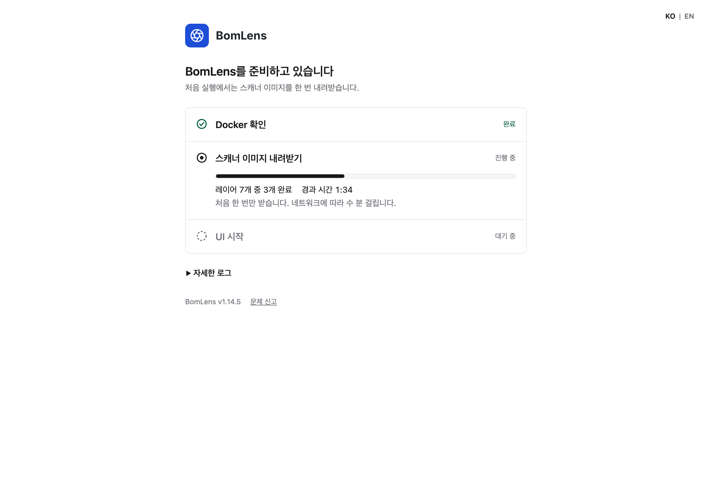
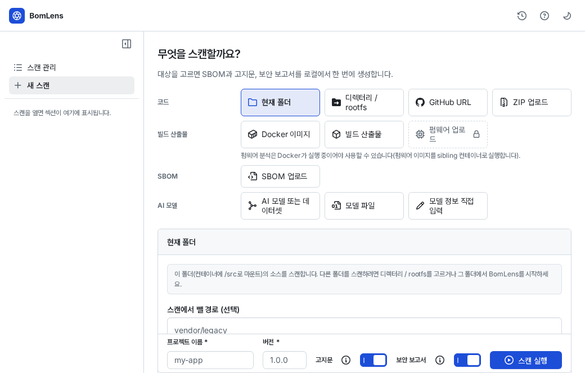
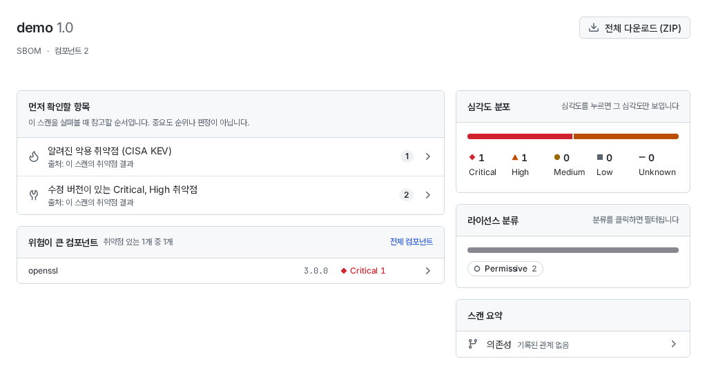

# 첫 스캔

설치부터 첫 [SBOM](../concepts/what-is-sbom.ko.md)까지 단계별로 안내합니다. 가장 빠른 길은 명령어가 필요 없습니다. 앱을 받아 더블클릭하면 됩니다.

BomLens는 Docker 엔진 위에서 동작하지만, 데스크톱 앱과 웹 UI가 Docker를 점검하고 이미지를 대신 받아 줍니다. Docker를 직접 다루는 건 CLI를 쓸 때뿐입니다. 엔진을 새로 설치해야 한다면 아래 [요구 사항](#요구-사항)을 참고하세요.

## 명령어 없이 시작하기 (권장)

사용하는 운영체제에 맞는 설치 파일, [Windows용 (.exe)](https://github.com/sktelecom/bomlens/releases/latest/download/BomLens-Setup.exe) 또는 [macOS용 (.dmg)](https://github.com/sktelecom/bomlens/releases/latest/download/BomLens-Setup.dmg)을 받아 더블클릭하면 콘솔 창 없이 UI가 열립니다. 처음 실행할 때 Docker를 점검하고 스캐너 이미지(디스크에서 약 1.4GB)를 받은 뒤 앱 자체 창에 UI를 보여 줍니다(로컬의 임의 포트를 쓰므로 브라우저에 입력할 고정 주소는 없습니다). 아직 미서명이라 Edge가 다운로드를 막거나 Windows SmartScreen 경고가 뜰 수 있습니다. 각 단계와 앱 업데이트 방법은 [비개발자 빠른 시작](../start/no-cli.ko.md)에, macOS에서 열리지 않을 때의 처리는 [문제 해결](troubleshooting.ko.md)에 있습니다. 내 프로젝트 폴더는 "폴더 선택" 타일의 "폴더 추가…" 버튼으로 고릅니다. 사내 저장소나 프록시가 필요한 프로젝트는 [자바(Maven)](../guides/java-maven.ko.md)와 [사내 네트워크](../guides/company-network.ko.md)를 보세요. 설치 파일 대신 스크립트(`sbom-ui.bat`)로 쓰는 대안은 [비개발자 빠른 시작의 방법 B](../start/no-cli.ko.md#방법-b-zip과-더블클릭-배치-파일-대안)에 단계별로 있습니다.



## 웹 UI

실행 외에는 명령어가 거의 필요 없습니다. 브라우저에서 실행해 스캔하고 결과를 내려받습니다.

```bash
git clone --depth 1 https://github.com/sktelecom/bomlens.git && cd bomlens
./scripts/scan-sbom.sh --ui     # http://localhost:8080 이 열리고, 산출물은 ~/sbom-output 아래 하위 폴더에 저장됩니다
#   Windows: scripts\sbom-ui.bat 더블클릭
```

`--depth 1`은 저장소 이력을 받지 않아 내려받는 양이 약 465MB에서 약 50MB로 줄어듭니다. 처음 실행할 때는 화면이 뜨기까지 1~2분 걸릴 수 있습니다. 스캐너 이미지가 없으면 받고(디스크에서 약 1.4GB), 있으면 새 버전이 있는지 확인하는 동안 서버가 아직 준비되지 않아, 자동으로 열린 브라우저 탭에 연결 오류가 보일 수 있습니다. 터미널에 `BomLens Web UI listening`이 나오면 탭을 새로고침하세요.

산출물은 `~/sbom-output`에 저장되고(`--output-dir`로 바꿉니다), 스캔마다 그 아래 `{Project}_{Version}/` 하위 폴더가 생깁니다(자세한 규칙은 [산출물 위치](../reference/cli.ko.md#산출물-위치) 참고). 포트가 사용 중이면 스크립트는 주소를 출력하기 전에 멈추고 쓸 수 있는 다른 포트를 알려 줍니다. 예: `UI_PORT=8081 ./scripts/scan-sbom.sh --ui`. Windows에서는 `sbom-ui.bat` 옆의 `scripts\bomlens.settings.txt`에 `UI_PORT=9090`을 적으세요([설정 파일](troubleshooting.ko.md#설정-파일-명령줄-불필요) 참고). 현재 폴더 소스를 스캔하려면 그 프로젝트 폴더에서 실행하고(클론 직후의 현재 폴더는 BomLens 저장소 자체이므로, 처음 한 번 써 볼 때는 `cd examples/nodejs && ../../scripts/scan-sbom.sh --ui`로 실행하세요), GitHub URL이나 ZIP, SBOM, 펌웨어, Docker 이미지는 UI에서 입력을 직접 주므로 아무 폴더에서나 실행해도 됩니다.



1. 프로젝트 이름과 버전을 입력합니다.
2. 스캔 대상을 고릅니다. 현재 폴더, GitHub URL, ZIP 업로드, SBOM 업로드, 펌웨어 업로드, Docker 이미지 중에서 선택합니다.
3. 스캔 실행을 누르면 진행 로그가 실시간으로 표시됩니다.
4. 완료되면 SBOM, 고지문, 오픈소스 위험 보고서, 보안 보고서를 열거나 내려받습니다.



> 펌웨어 업로드 타일은 Docker 엔진이 켜져 있으면 자동으로 나타납니다. 자세한 동작은 [펌웨어 분석 가이드](../guides/firmware.ko.md)를 참고하세요.

UI 화면 구성과 스캔 대상별 상세는 [웹 UI 레퍼런스](../reference/ui.ko.md)를 참고하세요.

## 첫 번째 SBOM 생성 (CLI)

자동화와 CI를 위한 고급 방식입니다. 클론한 저장소에서 실행합니다. 처음 실행하면 스캐너 이미지(디스크에서 약 1.4GB)와 언어별 이미지(디스크에서 3~16GB, 예를 들어 Node.js는 2.9GB, Java는 5.6GB)를 받으므로, 네트워크에 따라 몇 분에서 수십 분이 걸립니다. 스크립트는 받기 전에 이미지 크기를 출력하고, Docker 엔진의 여유 공간이 그 크기에 2GB를 더한 값보다 적으면 멈춥니다([크기와 정리](../reference/docker-image.ko.md#이미지가-디스크를-얼마나-차지하나요)). 오래 걸리는 단계에서는 1분마다 `Still running` 줄이 출력되므로, 터미널이 조용해도 멈춘 것은 아닙니다. 아래 명령은 번들로 포함된 Node.js 예제를 스캔합니다. 자신의 폴더를 스캔하려면 `--target`을 그 경로로 바꾸고, 현재 디렉터리를 스캔하려면 `--target`을 빼면 됩니다.

<!-- runnable -->
```bash
# 번들 예제 프로젝트의 모든 산출물
./scripts/scan-sbom.sh --project "MyApp" --version "1.0.0" --target examples/nodejs --all --generate-only
```

현재 디렉터리의 `MyApp_1.0.0/` 하위 폴더에 CycloneDX SBOM, 오픈소스 고지문, 보안 보고서, 위험 보고서, SPDX 사본이 `MyApp_1.0.0_…` 이름으로 생깁니다.

GitHub 저장소를 클론 없이 스캔하려면 `--target` 대신 `--git "https://github.com/org/repo"`를 씁니다. ZIP 소스(`--target app.zip`), 기존 SBOM(`--analyze sbom.json`), 펌웨어(`--target dev.bin --firmware`), Docker 이미지(`--target nginx:latest`) 등 입력 형태별 처리는 [시나리오별 가이드](../guides/by-input.ko.md)에 정리되어 있습니다.

> `--generate-only`는 산출물을 업로드 없이 로컬에만 저장합니다(취약점 스캔은 그대로 수행). `--all`은 SBOM에 고지문, 보안 보고서, SPDX 사본을 더해 만듭니다. 오픈소스 위험 보고서는 기본으로 만듭니다. 전체 옵션은 [CLI 레퍼런스](../reference/cli.ko.md#옵션-레퍼런스)에, 업로드는 `--trusca <project_id>`(또는 `UPLOAD_TARGET`)로 하며 절차는 [업로드 가이드](../guides/upload.ko.md)에 있습니다.

## 결과 파일 이해하기

스캔마다 `{Project}_{Version}/` 하위 폴더에 저장되고, 그 안의 파일 이름은 `{Project}_{Version}_…` 형식입니다. 예: `MyApp_1.0.0/MyApp_1.0.0_bom.json`.

| 파일 | 내용 |
|------|------|
| `{Project}_{Version}_bom.json` | SBOM (CycloneDX 1.6) |
| `{Project}_{Version}_NOTICE.{txt,html}` | 라이선스별로 묶은 오픈소스 고지문 |
| `{Project}_{Version}_security.{json,md,html}` | Trivy 취약점 보고서 |
| `{Project}_{Version}_risk-report.{md,html}` | 오픈소스 위험 보고서(기본 생성) |
| `{Project}_{Version}_bom.spdx.json` | SBOM의 SPDX 2.3 사본(`--spdx`나 `--all`을 쓸 때) |
| `{Project}_{Version}_conformance.{json,md,html}` | 선택한 프로필 기준의 SBOM 적합성 검사 결과(참고용) |
| `{Project}_{Version}_completeness.json` | 결과의 완전성([완전성 등급은 어떻게 읽나요?](#완전성-등급은-어떻게-읽나요)) |

입력과 옵션에 따라 생기는 다른 파일은 [산출물 레퍼런스](../reference/artifacts.ko.md)에 모두 있습니다. SBOM은 [CycloneDX 1.6](https://cyclonedx.org/) 형식의 JSON이고, 각 패키지를 식별하는 PURL 같은 용어는 [SBOM이란](../concepts/what-is-sbom.ko.md)에서 설명합니다.

### SBOM 내용 빠르게 확인하기

아래 예시는 `jq`를 씁니다. WSL2(우분투)는 `sudo apt-get install jq`, Windows Git Bash는 `winget install jqlang.jq`로 설치합니다. 설치가 번거롭다면 웹 UI 개요 화면에서 컴포넌트 수와 라이선스를 바로 볼 수 있습니다.

<!-- runnable -->
```bash
# 컴포넌트 수 확인
jq '.components | length' MyApp_1.0.0/MyApp_1.0.0_bom.json

# 사용된 라이선스 목록
jq '[.components[].licenses[]?.license.id] | unique' MyApp_1.0.0/MyApp_1.0.0_bom.json
```

## 요구 사항

BomLens에 필요한 건 Docker "엔진"뿐이고, 특정 제품에 묶이지 않습니다.

| 항목 | 최소 요구사항 |
|------|-------------|
| Docker | 20.10 이상 |
| 메모리 | Docker 엔진에 4 GB 이상 할당 |
| 디스크 공간 | 한 언어를 처음 스캔할 때 Docker 엔진에 여유 공간 약 10GB. .NET이나 여러 언어가 섞인 프로젝트는 20GB 이상 |
| OS | Linux, macOS, Windows |
| 아키텍처 | AMD64, ARM64 |

opt-in인 `--firmware`, `--deep-cve` 이미지를 포함해 발행되는 모든 이미지가 두 아키텍처를 지원하므로, ARM64 호스트(Apple Silicon 맥, Arm 서버)에서도 그대로 pull해 쓸 수 있습니다. 전체 목록은 [Docker 이미지 레퍼런스](../reference/docker-image.ko.md)를 참고하세요.

이 메모리 기준은 호스트 컴퓨터가 아니라 Docker 엔진 자체(Docker Desktop, Rancher Desktop, macOS의 Colima가 띄우는 가상 머신)에 해당합니다. Colima는 기본값이 2 GB인데, 매니페스트만 읽는 스캔에는 충분하지만 전이 의존성을 얻기 위해 실제로 빌드까지 실행해야 하는 언어(Java/Gradle, Java/Maven)에는 부족합니다. 4 GB 미만이면 이 빌드 단계가 메모리 부족으로 죽고, 스캔은 더 얕은 결과(직접 의존성만)로 대체됩니다. 엔진 메모리가 대략 4 GB 미만인 상태에서 Maven이나 Gradle 빌드를 돌리는 스캔(Java, Android, 또는 `pom.xml`이나 `build.gradle`이 있는 혼합 프로젝트)을 하면 빌드를 시작하기 전에 경고를 출력하고 바꿀 설정도 알려 줍니다(Colima는 `colima stop && colima start --memory 4`, Docker Desktop은 Settings > Resources > Memory이며, WSL 2 백엔드나 Windows의 Rancher Desktop, WSL2의 docker-ce는 `%UserProfile%\.wslconfig`에 `memory=4GB`를 적고 `wsl --shutdown`을 실행합니다). 이 경고는 참고용이며 스캔을 막지 않습니다. 그래도 의존성 그래프가 부실해 보인다면 스캔 결과의 경고 메시지에 관련 안내가 있는지 확인하세요.

이미 Docker를 쓰고 있다면(Docker Desktop, Rancher Desktop, Colima, WSL2의 docker-ce 등 무엇이든) 동작만 확인하고 넘어가세요. macOS, Linux, WSL2에서는 클론한 저장소의 점검 스크립트가 Docker 설치, 엔진 실행, 스캐너 이미지, 엔진 메모리, UI 포트를 한 번에 확인하고 항목마다 할 일을 알려 줍니다.

```bash
bash scripts/check-setup.sh
docker run --rm hello-world
```

점검 스크립트는 이 컴퓨터에 있는 BomLens 이미지와 크기, 그 합계, 엔진의 여유 디스크 공간도 보여 주고 공간이 부족하면 정리 방법을 알려 줍니다. `BOMLENS_SKIP_DISK_CHECK=1`을 지정하면 받기 전의 중단 점검을 건너뜁니다.

BomLens가 `Cannot reach the Docker engine`(Docker 엔진에 연결할 수 없음)이라며 멈추면 `docker` 명령은 있지만 엔진이 켜져 있지 않은 것입니다. Docker Desktop이나 Rancher Desktop을 켜고 아이콘이 안정될 때까지 기다리거나, Colima라면 `colima start`를 실행한 뒤 같은 명령을 다시 실행하세요.

### macOS와 Linux에서 Docker를 처음 설치할 때

| 환경 | 명령 또는 내려받기 |
|------|------------------|
| macOS, 무료이고 GUI 없음 | `brew install colima docker` 실행 후 `colima start --memory 4` |
| macOS, GUI | [Rancher Desktop](https://rancherdesktop.io/) 또는 Docker Desktop |
| Linux | `curl -fsSL https://get.docker.com \| sudo sh` 실행 후 `sudo usermod -aG docker "$USER"` 하고 다시 로그인 |

### Windows에서 Docker를 처음 설치한다면

Docker Desktop이 가장 간단하지만 일정 규모 이상의 조직에서는 유료 라이선스가 필요합니다. 무료로 쓰려면 다음을 권장합니다.

| 옵션 | 특징 |
|------|------|
| **WSL2 + docker-ce** (권장, 완전 무료) | WSL2 우분투에 docker-ce를 설치하고 그 안에서 `scan-sbom.sh`를 실행. `.bat`와 Windows 명명 파이프가 필요 없고 경로 변환 문제도 없음 — **CLI 전용, 위 1번(설치 파일 `.exe`) 흐름과는 안 맞음** |
| **Rancher Desktop** (무료, GUI) | Docker Desktop 대체 GUI, `docker` CLI 제공. `.bat`와 데스크톱 앱 흐름에 그대로 사용 |
| Docker Desktop | 가장 간편하지만 조직 사용 시 유료 라이선스 확인 필요 |

위에서 [명령어 없이 시작하기](#명령어-없이-시작하기-권장)(설치 파일 `.exe`)로 시작했다면 WSL2 + docker-ce가 아니라 Rancher Desktop이나 Docker Desktop을 설치하세요. 데스크톱 앱은 아직 WSL2 안의 Docker에 연결하는 방법을 모릅니다 — WSL2 쪽에 설치해도 앱은 계속 "Docker가 설치되어 있지 않습니다"라고 안내합니다.

WSL2 + docker-ce 설치 요약(관리자 PowerShell):

```powershell
wsl --install -d Ubuntu          # 설치 후 재부팅, 우분투 초기 설정
```

재부팅 뒤 WSL(우분투) 안에서:

```bash
sudo apt-get update && curl -fsSL https://get.docker.com | sudo sh
sudo usermod -aG docker "$USER"  # 로그아웃/로그인 후 적용
docker pull ghcr.io/sktelecom/bomlens:latest
```

이후 WSL 안에서 저장소를 클론하고 `./scripts/scan-sbom.sh ...`를 그대로 실행합니다. WSL2 없이 Windows에서 CLI를 쓰려면 [Git for Windows](https://git-scm.com/download/win)(Git Bash)를 설치하고 `scripts\scan-sbom.bat`를 씁니다.

## 스캔을 멈출 수 있나요?

웹 UI와 데스크톱 앱에서는 취소를 누르면 먼저 확인을 묻습니다. 스캔을 멈추고 그때까지 찾은 내용은 남기지 않기 때문입니다. 스캔 중에 브라우저 탭이나 앱 창을 닫아도 같은 식으로 취소되며, 목록에는 취소됨으로 표시됩니다. 명령줄에서는 Ctrl+C를 누릅니다.

## 완전성 등급은 어떻게 읽나요?

스캔마다 `{Project}_{Version}_completeness.json`이 생기고, 개요 화면과 보고서에 같은 등급이 나옵니다. 등급은 `complete`, `partial`, `unreliable` 중 하나입니다. `partial`이나 `unreliable`이면 목록이 짧을 수 있다는 뜻입니다. 락 파일이 없거나 빌드 단계가 실패한 경우가 그렇고, 이유도 함께 적힙니다. 취약점이 없다는 결과는 등급이 `complete`일 때만 "발견되지 않음"으로 읽으세요. 취약점 목록의 "Introduced by" 열은 각 취약점이 어느 직접 의존성을 통해 들어왔는지 보여 주므로, 무엇을 올려야 하는지 알 수 있습니다. 열 설명은 [웹 UI 참조](../reference/ui.ko.md), 등급 값은 [산출물 참조](../reference/artifacts.ko.md)에 있습니다.

## 다음 단계

| 목표 | 문서 |
|------|------|
| 입력 형태(GitHub, ZIP, SBOM, 펌웨어 등)별 처리 | [시나리오별 가이드](../guides/by-input.ko.md) |
| 고지문, 보안 보고서, 오픈소스 위험 보고서, 웹 UI | [고지문·보안 보고서 가이드](../guides/reports.ko.md) |
| 전체 옵션과 CI/CD 연동 방법 | [CLI 레퍼런스](../reference/cli.ko.md) |
| 언어별 예제 프로젝트 실습 | [지원 생태계](../reference/ecosystems.ko.md) |
| 안드로이드, 자바, iOS, C/C++ 프로젝트 | [안드로이드](../guides/android-gradle.ko.md), [자바(Maven)](../guides/java-maven.ko.md), [iOS](../guides/ios-swift.ko.md), [C/C++, 임베디드](../guides/identify-vendored.ko.md) |
| 프록시, 사내 인증서, 사내 저장소 | [사내 네트워크](../guides/company-network.ko.md) |
| 이미지 크기와 디스크 정리 | [Docker 이미지 참조](../reference/docker-image.ko.md#디스크-공간은-어떻게-비우나요) |
| 내부 구조 이해 | [아키텍처](../concepts/architecture.ko.md) |
| 프로젝트 기여 | [기여 가이드](https://github.com/sktelecom/bomlens/blob/main/CONTRIBUTING.ko.md) |
