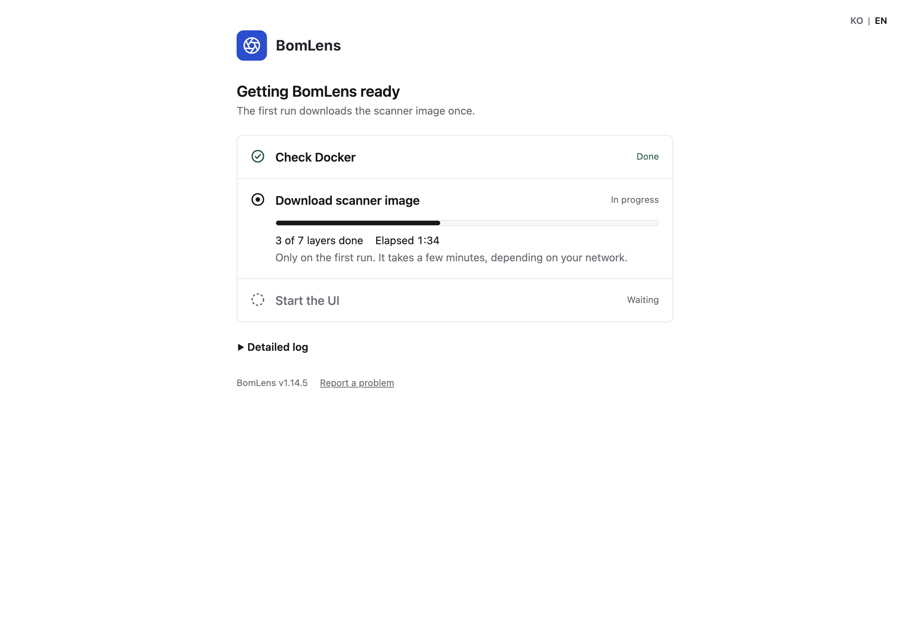
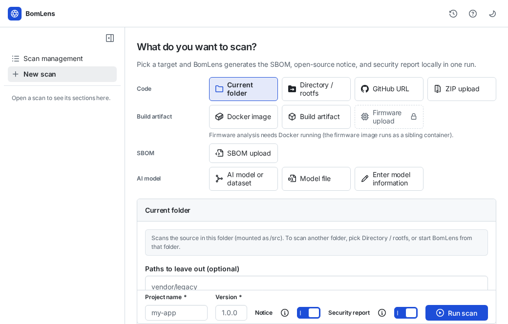

# First scan

From install to your first [SBOM](../concepts/what-is-sbom.md), step by step. The fastest path needs no command line: download the app and double-click it.

BomLens runs on a Docker engine, which you install yourself ([Requirements](#requirements) below). The desktop app and the web UI then check that the engine runs and pull the scanner image for you.

## Start without the command line (recommended)

Download the installer for your system, [Windows (.exe)](https://github.com/sktelecom/bomlens/releases/latest/download/BomLens-Setup.exe) or [macOS (.dmg)](https://github.com/sktelecom/bomlens/releases/latest/download/BomLens-Setup.dmg), and double-click it; the UI opens with no console window. On first run it checks Docker, pulls the scanner image ([size](#requirements)), and shows the UI in its own window (it listens on a random local port, so there is no fixed address to type in a browser). The app is unsigned for now, so Edge may hold the download back and Windows SmartScreen may warn when you open it. The [no-CLI quick start](../start/no-cli.md) shows each of those steps and how to update the app, and [Troubleshooting](troubleshooting.md) shows what to do on macOS. To scan your own project folder, pick the Choose folder tile and click Add folder… there; for a project that needs a company repository or proxy, see [Java (Maven)](../guides/java-maven.md) and [Company network](../guides/company-network.md). Prefer scripts over an installer? The `sbom-ui.bat` alternative is covered step by step in [Path B of the no-CLI quick start](../start/no-cli.md#path-b-zip-and-double-click-batch-file-alternative).



## Web UI

No commands beyond launching it: run in the browser, scan, and download results.

```bash
mkdir -p ~/bomlens && cd ~/bomlens
curl -fsSL https://github.com/sktelecom/bomlens/releases/latest/download/bomlens-cli.tar.gz | tar -xz
cd ~/my-project && ~/bomlens/scripts/scan-sbom.sh --ui   # run from the folder to scan; opens http://localhost:8080
#   Windows: unzip bomlens-cli-windows.zip and double-click scripts\sbom-ui.bat
```

`bomlens-cli.tar.gz` is the command line of the latest release for Linux, macOS and WSL: the scripts, the license files and the bundled Node.js example. On Windows without WSL, download [bomlens-cli-windows.zip](https://github.com/sktelecom/bomlens/releases/latest/download/bomlens-cli-windows.zip) from the same release instead. The first launch can take a minute or two before the page loads: the script downloads the scanner image of that release if it is missing, or checks for a newer one, and the browser tab it opens can show a connection error until the server is up. Reload the tab once the terminal prints `BomLens Web UI listening`.

Results go to `~/sbom-output` (change it with `--output-dir`): each scan saves to a `{Project}_{Version}/` subfolder under it (details in [Where outputs go](../reference/cli.md#where-outputs-go)). If the port is taken, the script stops before it prints an address and names a free port to use, for example `UI_PORT=8081 ~/bomlens/scripts/scan-sbom.sh --ui`. On Windows, put `UI_PORT=9090` in `scripts\bomlens.settings.txt` next to `sbom-ui.bat` instead (see [Settings file](troubleshooting.md#settings-file-no-command-line-needed)). The Current folder tile scans the folder you started from. For a GitHub URL, ZIP, SBOM, firmware, or Docker image you supply the input in the UI, so any folder works.



1. Enter a project name and version.
2. Pick a scan target: current folder, GitHub URL, ZIP upload, SBOM upload, firmware upload, or Docker image.
3. Click Run scan — logs stream live.
4. View or download the SBOM, the notice, the risk report, and the security report.

Screen layout and per-target details are in the [web UI reference](../reference/ui.md).

## Your first SBOM (CLI)

Advanced, for automation and CI. Run from the folder you extracted the archive into. The first run downloads the scanner image and a language image ([sizes](#requirements)), so allow a few minutes to tens of minutes depending on the network. Before a download the script prints the size and stops if the Docker engine has less free space than that plus 2 GB ([sizes and cleanup](../reference/docker-image.md#how-much-disk-do-the-images-take)). A long step prints a `Still running` line every minute, so a quiet terminal is not a hang. The command below scans the bundled Node.js example; point `--target` at your own folder, or drop `--target` to scan the current directory instead.

<!-- runnable -->
```bash
# All deliverables for the bundled example project
./scripts/scan-sbom.sh --project "MyApp" --version "1.0.0" --target examples/nodejs --all --generate-only
```

This produces a CycloneDX SBOM, an open-source notice, a security report, a risk report and an SPDX copy named `MyApp_1.0.0_…`, all in a `MyApp_1.0.0/` subfolder of the current directory.

To scan a GitHub repository without cloning it, use `--git "https://github.com/org/repo"` in place of `--target`. Other inputs, such as a ZIP source (`--target app.zip`), an existing SBOM (`--analyze sbom.json`) and firmware (`--target dev.bin --firmware`), are in the [input-scenarios guide](../guides/by-input.md), and a Docker image (`--target nginx:alpine`) in its [Docker image](../guides/by-input.md#docker-image) section.

> `--generate-only` saves the outputs locally without uploading (the vulnerability scan still runs). `--all` adds the notice, the security report and an SPDX copy to the SBOM; the risk report is made by default. The full options are in the [CLI reference](../reference/cli.md#options-reference). To upload the result to TRUSCA or a Dependency-Track server, use `--trusca <project_id>` (or `UPLOAD_TARGET`); the steps are in the [upload guide](../guides/upload.md).

## Understanding the results

Each scan lands in a `{Project}_{Version}/` subfolder, and the files inside are named `{Project}_{Version}_…`, for example `MyApp_1.0.0/MyApp_1.0.0_bom.json`:

| File | What it is |
|------|------------|
| `{Project}_{Version}_bom.json` | the SBOM (CycloneDX 1.6) |
| `{Project}_{Version}_NOTICE.{txt,html}` | open-source notice (고지문) grouped by license |
| `{Project}_{Version}_security.{json,md,html}` | Trivy vulnerability report |
| `{Project}_{Version}_risk-report.{md,html}` | open-source risk report (licenses + vulnerabilities), generated by default |
| `{Project}_{Version}_bom.spdx.json` | the SBOM as an SPDX 2.3 copy, with `--spdx` or `--all` |
| `{Project}_{Version}_conformance.{json,md,html}` | conformance check of the SBOM against the selected profile, for reference only |
| `{Project}_{Version}_completeness.json` | how complete the result is ([Reading the completeness grade](#reading-the-completeness-grade)) |

Other files appear for some inputs and options; [Artifacts](../reference/artifacts.md) lists them all. The SBOM is [CycloneDX 1.6](https://cyclonedx.org/) JSON, and [What is an SBOM](../concepts/what-is-sbom.md) explains its terms, such as the PURL that identifies each package.

### Quick checks on the SBOM

The examples below use `jq`. On WSL2 (Ubuntu) install it with `sudo apt-get install jq`, on Windows Git Bash with `winget install jqlang.jq`. If installing it is a hassle, the web UI overview shows the component count and licenses directly:

<!-- runnable -->
```bash
# Component count
jq '.components | length' MyApp_1.0.0/MyApp_1.0.0_bom.json

# Unique licenses
jq '[.components[].licenses[]?.license.id] | unique' MyApp_1.0.0/MyApp_1.0.0_bom.json
```

## Requirements

BomLens needs only a Docker *engine* — not a specific product.

| Item | Minimum |
|------|---------|
| Docker | 20.10+ |
| Memory | 4 GB+ allocated to the Docker engine |
| Disk | about 10 GB free in the Docker engine for a first scan of one language; 20 GB or more for .NET or a mixed-language tree. The scanner image takes about 1.4 GB on disk, and each language adds an image of 3 to 16 GB, for example 2.9 GB for Node.js and 5.6 GB for Java ([every image](../reference/docker-image.md#how-much-disk-do-the-images-take)) |
| OS | Linux, macOS, Windows |
| Arch | AMD64, ARM64. Every published image, the opt-in ones included, runs natively on both ([list](../reference/docker-image.md)) |

The memory figure is for the engine (the VM behind Docker Desktop, Rancher Desktop or Colima), not the host. Under 4 GB a Maven or Gradle build (Java, Android, or a mixed project) can run out of memory, and the scan then lists direct dependencies only. Such a scan warns before the build starts, without stopping. To raise the memory:

- Colima (2 GB by default): `colima stop && colima start --memory 4`.
- Docker Desktop: Settings > Resources > Memory.
- The WSL 2 backend (Rancher Desktop on Windows, docker-ce in WSL2): `memory=4GB` in `%UserProfile%\.wslconfig`, then `wsl --shutdown`.

If you already run a Docker engine (Docker Desktop, Rancher Desktop, Colima, docker-ce in WSL2, anything), confirm it works. On macOS, Linux and WSL2 the extracted archive has a check that tests Docker, the engine, the scanner image, engine memory and the UI port in one go and says what to do about each. Before the first scan it reports the scanner image as missing and prints the `docker pull` command for it; the first scan pulls the image anyway:

```bash
bash scripts/check-setup.sh
docker run --rm hello-world
```

The check also lists the BomLens images on the machine with their sizes, their total and the engine's free disk space, and says how to free space when it is low. `BOMLENS_SKIP_DISK_CHECK=1` skips the stop before a download.

If BomLens stops with `Cannot reach the Docker engine`, the `docker` command exists but the engine is not running. Start Docker Desktop or Rancher Desktop and wait for its icon to settle (in Rancher Desktop, Preferences > Container Engine must be dockerd (moby), not containerd), or run `colima start` for Colima, then run the command again.

### Installing Docker on macOS and Linux for the first time

| System | Command or download |
|--------|---------------------|
| macOS, free and no GUI | `brew install colima docker`, then `colima start --memory 4` |
| macOS, GUI | [Rancher Desktop](https://rancherdesktop.io/) or Docker Desktop |
| Linux | `curl -fsSL https://get.docker.com \| sudo sh`, then `sudo usermod -aG docker "$USER"` and log in again |

### Installing Docker on Windows for the first time

Docker Desktop is simplest, but it needs a paid license above a certain organization size. Free options:

| Option | Notes |
|--------|-------|
| **WSL2 + docker-ce** (free) | Install docker-ce inside WSL2 Ubuntu and run `scan-sbom.sh` there. No `.bat`, no Windows named pipe, no path-conversion issues. **CLI only — does not work with the `.exe` installer flow above.** |
| **Rancher Desktop** (free, GUI) | A drop-in GUI replacement for Docker Desktop with a `docker` CLI. Works with the `.bat` double-click and desktop-app flows. |
| Docker Desktop | Easiest, but check licensing for organizational use. |

If you started with [the installer](#start-without-the-command-line-recommended) (the `.exe`), install Rancher Desktop or Docker Desktop instead of WSL2 + docker-ce — the desktop app doesn't yet know how to reach Docker running inside WSL2, so it will keep reporting "Docker isn't installed" even after you set that up.

WSL2 + docker-ce, the short version (admin PowerShell):

```powershell
wsl --install -d Ubuntu          # reboot, then finish Ubuntu setup
```

Then inside WSL (Ubuntu):

```bash
sudo apt-get update && curl -fsSL https://get.docker.com | sudo sh
sudo usermod -aG docker "$USER"  # log out and back in to apply
```

Download and extract `bomlens-cli.tar.gz` inside WSL as in [Web UI](#web-ui) and run `./scripts/scan-sbom.sh ...` as above. For the CLI on Windows without WSL2, install [Git for Windows](https://git-scm.com/download/win) (Git Bash) and use `scripts\scan-sbom.bat` from `bomlens-cli-windows.zip`.

## Can I stop a scan?

In the web UI and the desktop app, Cancel asks first, because it stops the scan and keeps nothing it found. Closing the browser tab or the app window during a scan cancels it the same way, and the scan then appears in the list as Cancelled. On the command line, press Ctrl+C.

## Reading the completeness grade

Every scan writes `{Project}_{Version}_completeness.json`, and the Overview screen and the reports show the same grade: `complete`, `partial` or `unreliable`. A partial or unreliable grade means the list can be short, for example because a lock file is missing or a build step failed, and it names the reasons. Read a result with no vulnerabilities as "none found" only when the grade is `complete`. In the Vulnerabilities list, the Introduced by column names the direct dependency each finding arrives through, so you know which one to update. The columns are described in the [web UI reference](../reference/ui.md); the grade values in the [artifacts reference](../reference/artifacts.md).

## Next steps

| Goal | Doc |
|------|-----|
| Input forms (GitHub, ZIP, SBOM, firmware) | [Input scenarios](../guides/by-input.md) |
| Notice, security & risk reports, web UI | [Reports guide](../guides/reports.md) |
| Every option and CI/CD | [CLI reference](../reference/cli.md) |
| Language example projects | [Ecosystems](../reference/ecosystems.md) |
| Android, Java, iOS or C/C++ projects | [Android](../guides/android-gradle.md), [Java (Maven)](../guides/java-maven.md), [iOS](../guides/ios-swift.md), [C/C++ and embedded](../guides/identify-vendored.md) |
| Proxy, company CA and internal repositories | [Company network](../guides/company-network.md) |
| Image sizes and freeing disk | [Docker image reference](../reference/docker-image.md#how-much-disk-do-the-images-take) |
| Internals | [Architecture](../concepts/architecture.md) |
| Contributing | [Contributing guide](https://github.com/sktelecom/bomlens/blob/main/CONTRIBUTING.md) |
