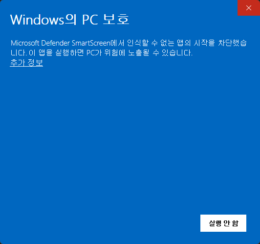
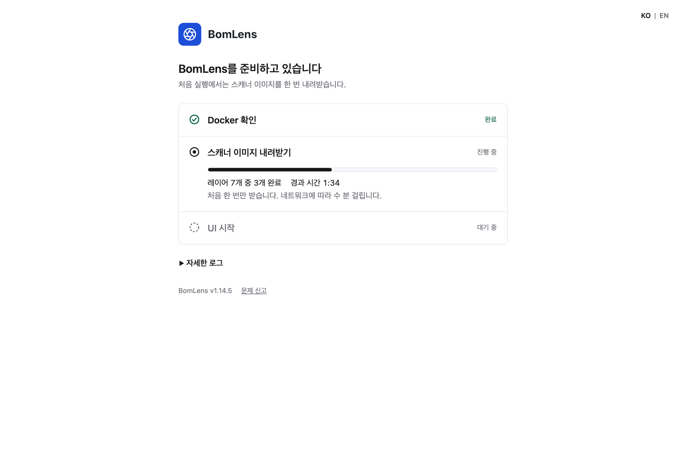
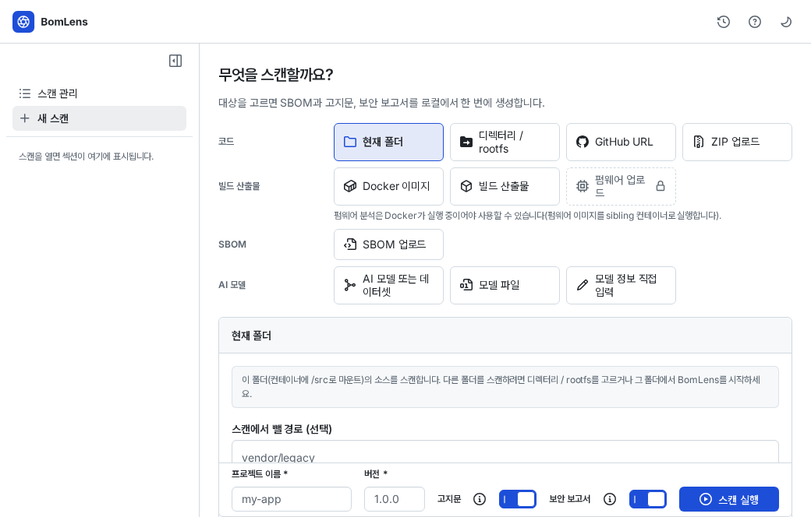
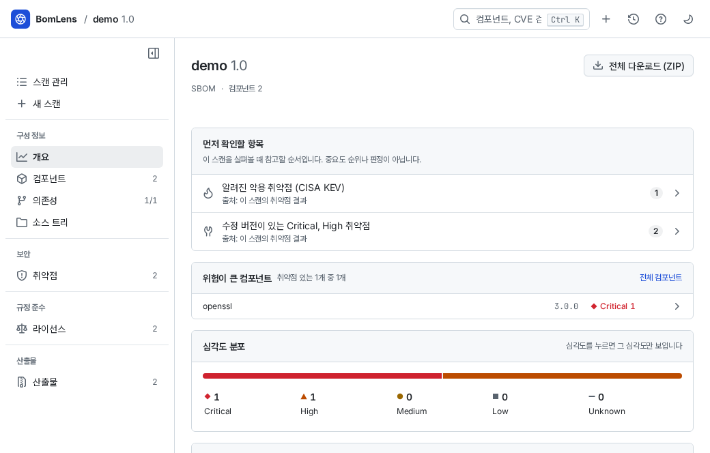

# 비개발자 빠른 시작 (CLI 불필요)

Windows에서는 명령어를 입력할 필요가 없습니다. macOS는 앱이 서명되기 전까지 터미널 명령 한 줄이 필요합니다. 이 문서는 설치부터 SBOM과 오픈소스 고지문을 만들기까지를 데스크톱 앱이나 브라우저 화면에서 클릭만으로 안내합니다. 잘 되지 않으면 [문제 해결](troubleshooting.ko.md)을 보세요.

SK텔레콤에 SBOM을 제출하는 공급사라면 스캔하기 전에 [직접 만든 SBOM을 제출할 때](../guides/supplier-sbom.ko.md#직접-만든-sbom을-제출할-때)를 보세요.

## 오픈소스 고지문이란

제품에 포함된 오픈소스 구성요소와 그 라이선스를 정리해 배포 시 함께 제공하는 문서입니다.
많은 오픈소스 라이선스(MIT, Apache-2.0, BSD 등)가 저작권 표시와 라이선스 전문을 제품에
동봉하도록 요구하기 때문에, 이를 모아 둔 고지문이 필요합니다.

BomLens는 소스 코드를 분석해 구성요소 목록([SBOM](../concepts/what-is-sbom.ko.md))을 만들고, 이를 바탕으로 고지문 파일 두 가지를 만듭니다. 배포물에 그대로 동봉하는 `..._NOTICE.txt`와 브라우저로 보기 좋은 `..._NOTICE.html`입니다. 이름 앞부분(`...`)에는 입력한 프로젝트 이름과 버전이 붙습니다. 예를 들어 `MyApp_1.0.0_NOTICE.txt`입니다.

## 준비물과 걸리는 시간

필요한 것은 Docker 엔진 하나뿐입니다. Windows에서 처음 설치한다면 무료이면서 더블클릭 흐름과
잘 맞는 **Rancher Desktop**을 권장합니다. 이미 Docker를 쓰고 있다면 그대로 두고 넘어가세요.
(다른 선택지의 자세한 비교는 [첫 스캔](../start/first-scan.ko.md) 문서에 있습니다.) 처음 한 번은 설치와 다운로드에 시간이 걸립니다. 대략 다음과 같습니다.

- Rancher Desktop 설치와 첫 기동: 약 5~10분
- 스캐너 이미지 첫 다운로드: 몇 분(네트워크에 따라 다름, 처음 한 번만)
- 프로젝트를 처음 스캔할 때 받는 언어별 이미지: 몇 분 더, 이것도 언어마다 한 번만

그래서 Docker 엔진에 여유 디스크 공간 약 10GB를 잡아 두세요. 이미지 크기는 [첫 스캔의 요구 사항](first-scan.ko.md#요구-사항)에 있습니다. 공간이 모자라면 명령줄은 받기 전에 메시지와 함께 멈추고, 웹 UI와 데스크톱 앱은 경고합니다.

한 번 준비해 두면, 락 파일이 이미 커밋된 프로젝트는 앱을 열고 스캔하는 데 1~2분이면 됩니다. 락 파일이 없으면 cdxgen이 스캔 전에 의존성을 직접 해석하는데([웹 UI 참조](../reference/ui.ko.md#새-스캔) 참고), `package-lock.json`이 없는 Node.js 프로젝트로 반복 실측한 결과 6~7분이 걸렸습니다.

## 따라 하기

방법은 두 가지입니다. 데스크톱 앱이 가장 간단하니 이쪽을 권장합니다.

### 방법 A: 데스크톱 앱 (권장)

1. **Docker 엔진 설치**. [rancherdesktop.io](https://rancherdesktop.io/)에서 Windows용 설치
   파일을 받아 설치하고 실행합니다. 설치 중 Kubernetes 사용 여부를 물으면 꺼도 됩니다. 컨테이너 엔진은 기본값인 dockerd(moby)로 둡니다. containerd로 바꾸면 `docker` 명령이 엔진에 연결하지 못합니다. WSL과 Rancher Desktop 설치에는 관리자 권한이 한 번 필요하므로, 권한이 없으면 IT 담당 부서에 Rancher Desktop 설치를 요청하세요. BomLens 앱은 관리자 권한 없이 설치됩니다. 작업
   표시줄 아이콘이 안정되면(보통 1~2분) 준비가 끝난 것입니다. macOS에서는 같은 사이트에서 macOS용 Rancher Desktop을 받습니다. 다른 선택지는 [macOS와 Linux에서 Docker를 처음 설치할 때](first-scan.ko.md#macos와-linux에서-docker를-처음-설치할-때)에 있습니다.
2. **앱 받아 실행**. [Windows용 BomLens 내려받기 (.exe)](https://github.com/sktelecom/bomlens/releases/latest/download/BomLens-Setup.exe)를
   누릅니다. 아직 미서명이라 Windows에서 두 가지 안내가 나올 수 있습니다. Edge는 다운로드 패널에 `BomLens-Setup.exe`가 일반적으로 다운로드되지 않는다는 메시지를 띄우고 열 방법을 보여 주지 않을 수 있습니다. 이때는 항목의 메뉴(점 세 개)에서 "유지"를 고르고, 다시 물으면 "자세히 보기"를 펼쳐 한 번 더 "유지"를 고르세요(정확한 이름은 Edge 버전에 따라 다릅니다). 그다음 받은 파일을 더블클릭합니다. "Windows가 PC를
   보호했습니다" 경고가 뜨면 "추가 정보"를 누르고 "실행"을 고릅니다. 콘솔 창 없이 앱이 열립니다. 설치 파일의 서명 규칙과 앱이 네트워크로 보내는 정보는 [코드 서명 정책](../reference/code-signing-policy.ko.md)에 있습니다. macOS에서는 [BomLens-Setup.dmg](https://github.com/sktelecom/bomlens/releases/latest/download/BomLens-Setup.dmg)를 받고 [macOS에서 앱이 열리지 않을 때](troubleshooting.ko.md#macos에서-앱이-열리지-않을-때)를 따릅니다.
3. **첫 실행 이미지 다운로드**. 처음 한 번만 스캐너 이미지를 받습니다. 앱이 아래처럼 진행 상황을
   보여주니 창을 닫지 말고 기다리세요. 이후 실행에서는 레지스트리에 더 새 이미지가 올라와 있으면
   자동으로 받아 반영하므로, 따로 다시 받을 필요가 없습니다. Docker가 설치되지 않았거나 꺼져 있으면, 앱이 스캔을 시작하는 대신 무엇을 해야 하는지 안내합니다.






이제 아래 [스캔하고 고지문 받기](#스캔하고-고지문-받기)로 갑니다.

### 방법 B: ZIP과 더블클릭 배치 파일 (대안)

데스크톱 앱 대신 스크립트로 쓰고 싶다면 이 길도 있습니다.

1. **Docker 엔진 설치**. 방법 A의 1번과 같습니다.
2. **도구 내려받기**. [최신 릴리스 페이지](https://github.com/sktelecom/bomlens/releases/latest)에서
   `bomlens-cli-windows.zip`을 내려받아 압축을 풉니다. 압축을 푼 폴더 안에 `scripts` 폴더가 보이면
   됩니다. (저장소 페이지의 초록색 Code 버튼으로도 ZIP을 받을 수 있지만, 그건 태그된 릴리스가 아니라
   개발 중인 최신 소스 스냅샷입니다.)
3. **웹 UI 실행**. `scripts` 폴더의 `sbom-ui.bat`을 더블클릭합니다. 처음에는 검은 창에 아래와 같은
   이미지 다운로드 안내가 나오고, 다 받으면 브라우저에
   `http://localhost:8080`이 열립니다. 스캔 결과는 `C:\Users\사용자이름\sbom-output` 아래 `{Project}_{Version}\` 하위 폴더에 저장됩니다.

```text
===========================================
  처음 실행이라 스캐너 이미지를 내려받습니다 (약 1.4GB).
  프로젝트를 처음 스캔할 때 언어별 이미지(약 3~16GB)를 한 번 더 내려받습니다.
  이미지:
  ghcr.io/sktelecom/bomlens:<릴리스 버전>
===========================================
===========================================
  BomLens 웹 UI
  주소:
  http://localhost:8080
  결과 저장 폴더:
  C:\Users\<사용자명>\sbom-output
  (이 창을 닫으면 중지됩니다)
===========================================
```

준비가 잘 됐는지 확인하려면 압축을 푼 폴더에서 `scripts\check-setup.bat`을 더블클릭하세요.
Docker 설치와 실행, 스캐너 이미지, Docker 엔진 메모리, 포트 상태를 Windows 표시 언어에 맞춰 점검해 줍니다.



## 앱은 어떻게 업데이트하나요?

앱은 시작할 때 새 릴리스가 있는지 확인합니다. 있으면 "업데이트 알림" 대화상자가 뜨고, "다운로드 페이지 열기"를 누르면 [최신 릴리스 페이지](https://github.com/sktelecom/bomlens/releases/latest)가 열립니다. 거기서 설치 파일을 받아 다시 실행하면 됩니다. 대화상자를 기다리지 않고 직접 받아도 같습니다. 설치 파일은 처음 받은 것과 마찬가지로 미서명이므로 Edge와 SmartScreen 단계도 같습니다. 스캔 결과는 홈 디렉터리 아래 `sbom-output` 폴더에 그대로 남습니다. 앱을 시작할 때 버전에 맞는 스캐너 이미지가 아직 없으면 그 이미지를 받아 옵니다.

## 스캔하고 고지문 받기

여기서부터는 데스크톱 앱과 웹 UI가 같습니다. 프로젝트 이름과 버전을 입력하고, 하려는 일에 맞는 타일을 고른 뒤 스캔 실행을 누릅니다. 진행 로그가 실시간으로 표시되고, 끝나면 결과 개요가 나타납니다.

<!-- tiles -->
| 하려는 일 | 고를 타일 | 가이드 |
|---|---|---|
| 이 컴퓨터에 있는 프로젝트 폴더 스캔 | 폴더 선택 | [웹 UI 참조](../reference/ui.ko.md#새-스캔) |
| ZIP으로 받은 소스 코드 스캔 | ZIP 업로드 | [소스 ZIP](../guides/by-input.ko.md#시나리오-2--소스-zip) |
| GitHub 저장소 스캔 | GitHub URL | [GitHub URL](../guides/by-input.ko.md#시나리오-1--github-url) |
| 받은 SBOM 검증 | SBOM 업로드 | [공급사 SBOM 검증 가이드](../guides/supplier-sbom.ko.md) |
| 컨테이너 이미지 스캔 | Docker 이미지 | [입력 시나리오별 처리 가이드](../guides/by-input.ko.md#한눈에-보기) |
| 펌웨어 이미지 분석 | 펌웨어 업로드 | [펌웨어](../guides/firmware.ko.md) |
| AI 모델의 SBOM 만들기 | AI 모델 또는 데이터셋 | [AI 모델 SBOM](../guides/ai-model.ko.md) |

데스크톱 앱에서는 "폴더 선택" 타일에 폴더를 고르는 "폴더 추가…" 버튼이 있습니다. `sbom-ui.bat` 경로에서는 실행 전에 [설정 파일](troubleshooting.ko.md#설정-파일-명령줄-불필요)에 `SBOM_UI_MOUNT_DIR=D:\my-project`처럼 그 폴더를 적으면 웹 UI가 접근할 수 있습니다(CLI로는 `--ui --mount <dir>`에 해당).



스캔이 끝나면 결과 화면에서 고지문을 포맷별 칩(`HTML`, `TXT`)으로 내려받습니다. 함께 만들어진
SBOM(`..._bom.json`)과 오픈소스 위험 보고서(`..._risk-report.html`)도 같은 화면에서 받을 수 있고,
전체를 ZIP 하나로 한 번에 받을 수도 있습니다. 내려받은 파일은 결과 폴더에도 저장됩니다.
각 파일이 무엇이고 언제 생기는지는 [산출물 레퍼런스](../reference/artifacts.ko.md)를 참고하세요.
