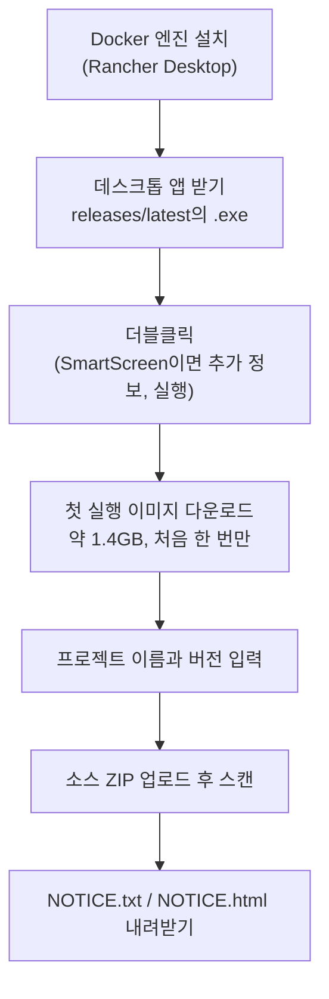
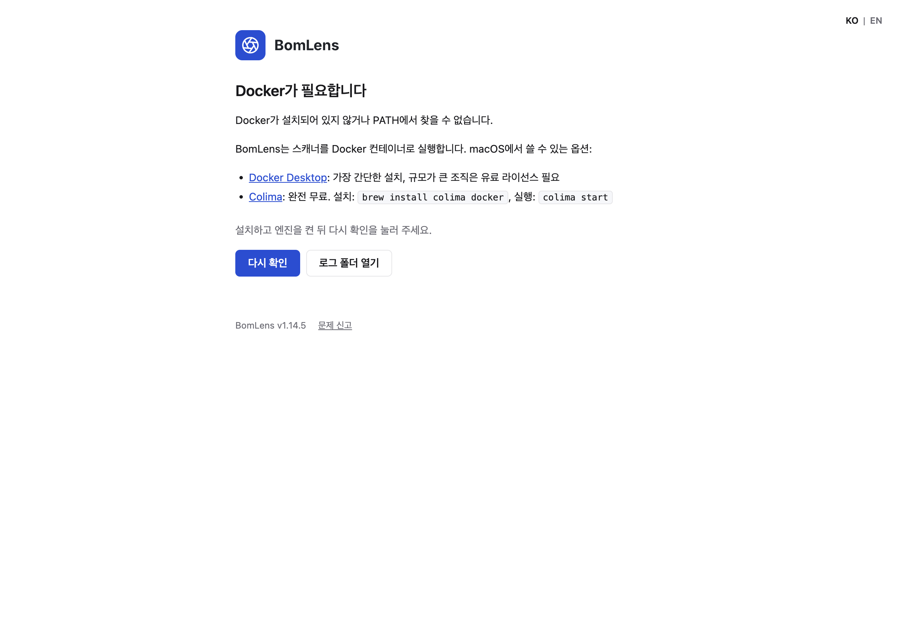

# 비개발자 빠른 시작 (CLI 불필요)

명령어를 한 번도 써본 적 없어도 됩니다. 이 문서는 오픈소스 라이선스 담당자가 개발팀에게
받은 소스 코드로 오픈소스 고지문을 만드는 가장 짧은 길만 담았습니다. 브라우저 화면에서
클릭만으로 끝납니다.

## 오픈소스 고지문이란

제품에 포함된 오픈소스 구성요소와 그 라이선스를 정리해 배포 시 함께 제공하는 문서입니다.
많은 오픈소스 라이선스(MIT, Apache-2.0, BSD 등)가 저작권 표시와 라이선스 전문을 제품에
동봉하도록 요구하기 때문에, 이를 모아 둔 고지문이 필요합니다.

이 도구는 소스 코드를 분석해 구성요소 목록([SBOM](../concepts/what-is-sbom.ko.md))을 만들고, 거기서 라이선스별로 구성요소를
묶어 고지문 두 가지를 생성합니다.

- `..._NOTICE.txt` — 배포물에 그대로 동봉하는 텍스트 형식
- `..._NOTICE.html` — 브라우저로 보기 좋은 형식

이름 앞부분(`...`)에는 입력한 프로젝트 이름과 버전이 붙습니다. 예를 들어 프로젝트가
`MyApp`, 버전이 `1.0.0`이면 `MyApp_1.0.0_NOTICE.txt`가 됩니다.

## 준비물과 걸리는 시간

필요한 것은 Docker 엔진 하나뿐입니다. Windows에서 처음 설치한다면 무료이면서 더블클릭 흐름과
잘 맞는 **Rancher Desktop**을 권장합니다. 이미 Docker를 쓰고 있다면 그대로 두고 넘어가세요.
(다른 선택지의 자세한 비교는 [첫 스캔](../start/first-scan.ko.md) 문서에 있습니다.)

처음 한 번은 설치와 다운로드에 시간이 걸립니다. 대략 다음과 같습니다.

- Rancher Desktop 설치와 첫 기동: 약 5~10분
- 스캐너 이미지 첫 다운로드(디스크에서 약 1.4GB): 몇 분(네트워크에 따라 다름, 처음 한 번만)
- 프로젝트를 처음 스캔할 때 받는 언어별 이미지(디스크에서 3~16GB, 예를 들어 Node.js는 2.9GB, Java는 5.6GB): 몇 분 더, 이것도 언어마다 한 번만

그래서 Docker 엔진에 여유 디스크 공간 약 10GB를 잡아 두세요. 모든 이미지의 크기와 공간을 비우는 방법은 [Docker 이미지 참조](../reference/docker-image.ko.md#이미지가-디스크를-얼마나-차지하나요)에 있습니다. 공간이 모자라면 명령줄은 받기 전에 메시지와 함께 멈추고, 웹 UI와 데스크톱 앱은 경고합니다.

한 번 준비해 두면, 락 파일이 이미 커밋된 프로젝트는 앱을 열고 스캔하는 데 1~2분이면 됩니다. 락 파일이 없으면 cdxgen이 스캔 전에 의존성을 직접 해석하는데([웹 UI 참조](../reference/ui.ko.md#새-스캔) 참고), `package-lock.json`이 없는 Node.js 프로젝트로 반복 실측한 결과 6~7분이 걸렸습니다.

## 따라 하기

방법은 두 가지입니다. 데스크톱 앱이 가장 간단하니 이쪽을 권장합니다. 전체 흐름은 다음과 같습니다.



### 방법 A — 데스크톱 앱 (권장)

1. **Docker 엔진 설치**. [rancherdesktop.io](https://rancherdesktop.io/)에서 Windows용 설치
   파일을 받아 설치하고 실행합니다. 설치 중 Kubernetes 사용 여부를 물으면 꺼도 됩니다. 작업
   표시줄 아이콘이 안정되면(보통 1~2분) 준비가 끝난 것입니다.
2. **앱 받아 실행**. [Windows용 BomLens 내려받기 (.exe)](https://github.com/sktelecom/bomlens/releases/latest/download/BomLens-Setup.exe)를
   누릅니다. 아직 미서명이라 Windows에서 두 가지 안내가 나올 수 있습니다. Edge는 다운로드 패널에 `BomLens-Setup.exe`가 일반적으로 다운로드되지 않는다는 메시지를 띄우고 열 방법을 보여 주지 않을 수 있습니다. 이때는 항목의 메뉴(점 세 개)에서 "유지"를 고르고, 다시 물으면 "자세히 보기"를 펼쳐 한 번 더 "유지"를 고르세요(정확한 이름은 Edge 버전에 따라 다릅니다). 그다음 받은 파일을 더블클릭합니다. "Windows가 PC를
   보호했습니다" 경고가 뜨면 "추가 정보"를 누르고 "실행"을 고릅니다. 콘솔 창 없이 앱이 열립니다. 설치 파일의 서명 규칙과 앱이 네트워크로 보내는 정보는 [코드 서명 정책](../reference/code-signing-policy.ko.md)에 있습니다.
3. **첫 실행 이미지 다운로드**. 처음 한 번만 스캐너 이미지를 받습니다. 앱이 아래처럼 진행 상황을
   보여주니 창을 닫지 말고 기다리세요. 이후 실행에서는 레지스트리에 더 새 이미지가 올라와 있으면
   자동으로 받아 반영하므로, 따로 다시 받을 필요가 없습니다.


Docker가 설치되지 않았거나 꺼져 있으면, 앱이 스캔을 시작하는 대신 무엇을 해야 하는지 안내합니다.



이제 아래 [스캔하고 고지문 받기](#스캔하고-고지문-받기)로 갑니다.

### 방법 B — ZIP과 더블클릭 배치 파일 (대안)

데스크톱 앱 대신 스크립트로 쓰고 싶다면 이 길도 있습니다.

1. **Docker 엔진 설치**. 방법 A의 1번과 같습니다.
2. **도구 내려받기**. [최신 릴리스 페이지](https://github.com/sktelecom/bomlens/releases/latest)에서
   `bomlens-cli-windows.zip`을 내려받아 압축을 풉니다. 압축을 푼 폴더 안에 `scripts` 폴더가 보이면
   됩니다. (저장소 페이지의 초록색 Code 버튼으로도 ZIP을 받을 수 있지만, 그건 태그된 릴리스가 아니라
   개발 중인 최신 소스 스냅샷입니다.)
3. **웹 UI 실행**. `scripts` 폴더의 `sbom-ui.bat`을 더블클릭합니다. 처음에는 검은 창에 아래와 같은
   이미지 다운로드 안내가 나오고, 다 받으면 브라우저에
   `http://localhost:8080`이 열립니다. 스캔 결과는 `C:\Users\사용자이름\sbom-output` 아래 `{Project}_{Version}\` 하위 폴더에 저장됩니다.

```text
===========================================
  처음 실행이라 스캐너 이미지를 내려받습니다 (약 1.4GB).
  프로젝트를 처음 스캔할 때 언어별 이미지(약 3~16GB)를 한 번 더 내려받습니다.
  이미지:
  ghcr.io/sktelecom/bomlens:latest
===========================================
===========================================
  BomLens 웹 UI
  주소:
  http://localhost:8080
  결과 저장 폴더:
  C:\Users\<사용자명>\sbom-output
  (이 창을 닫으면 중지됩니다)
===========================================
```

이 안내문의 크기는 대략적인 추정값입니다. 스캐너 이미지는 디스크에서 약 1.4GB, 언어별 이미지는 3~16GB를 차지합니다.

준비가 잘 됐는지 확인하려면 압축을 푼 폴더에서 `scripts\check-setup.bat`을 더블클릭하세요.
Docker 설치와 실행, 스캐너 이미지, Docker 엔진 메모리, 포트 상태를 Windows 표시 언어에 맞춰 점검해 줍니다.


## 앱은 어떻게 업데이트하나요?

앱은 시작할 때 새 릴리스가 있는지 확인합니다. 있으면 "업데이트 알림" 대화상자가 뜨고, "다운로드 페이지 열기"를 누르면 [최신 릴리스 페이지](https://github.com/sktelecom/bomlens/releases/latest)가 열립니다. 거기서 설치 파일을 받아 다시 실행하면 됩니다. 대화상자를 기다리지 않고 직접 받아도 같습니다. 설치 파일은 처음 받은 것과 마찬가지로 미서명이므로 Edge와 SmartScreen 단계도 같습니다. 스캔 결과는 홈 디렉터리 아래 `sbom-output` 폴더에 그대로 남습니다. 앱을 시작할 때 버전에 맞는 스캐너 이미지가 아직 없으면 그 이미지를 받아 옵니다.

## macOS에서 앱이 열리지 않을 때

현재 macOS 빌드는 아직 Apple Developer ID로 코드 서명·공증(notarization)되지 않았습니다. 그래서
macOS가 내려받은 앱을 격리(quarantine)합니다. Windows의 SmartScreen 경고와 같은 성격입니다.

macOS 버전에 따라 겪는 모습이 다릅니다. 최근 macOS는 아래 화면처럼 차단 대화상자를 띄우고
"휴지통으로 이동"만 내줍니다 — "확인하고 열기" 같은 우회 버튼은 없습니다. 예전 macOS는
"'BomLens'은(는) 손상되었기 때문에 열 수 없습니다"라는 문구를 썼는데, 표현만 다를 뿐 같은
미서명 앱 차단이며 앱이 실제로 손상된 것은 아닙니다. 버전에 따라서는 앱이 그냥 열리기도
하는데, 이때는 macOS가 앱을 원래 자리가 아닌 임시 읽기 전용 폴더에 복사해 실행합니다(App
Translocation). 열리기는 하지만 설치한 위치에서 도는 것이 아니라, 다음에 열 때 같은 상태가
유지된다는 보장이 없습니다.


어느 쪽이든 조치는 같습니다. 앱을 우클릭해 열기를 고르거나 시스템 설정의 "확인 없이 열기" 버튼을
누르는 방법은 최근 macOS에서 잘 통하지 않습니다. 믿을 수 있는 방법은 터미널에서 격리 속성을
지우는 것입니다.

1. `.dmg`를 열어 `BomLens.app`을 응용 프로그램(Applications) 폴더로 끌어다 놓습니다.
2. 터미널을 열어 아래 명령을 실행한 뒤, 평소처럼 응용 프로그램에서 BomLens를 엽니다.

   ```bash
   xattr -dr com.apple.quarantine /Applications/BomLens.app
   ```

Apple Silicon Mac에서 그래도 열리지 않으면 아래를 한 번 실행하고 다시 시도하세요.

```bash
codesign --force --deep -s - /Applications/BomLens.app
```

이 단계는 현재 macOS 빌드가 아직 서명·공증 전이라 필요한 것이며, 서명되면 사라집니다.

## 스캔하고 고지문 받기

여기서부터는 데스크톱 앱과 웹 UI가 같습니다.

1. 프로젝트 이름과 버전을 입력합니다.
2. 스캔 대상에서 "ZIP 업로드"를 고르고, 개발팀에게 받은 소스 코드 ZIP 파일을 올립니다.
3. 스캔 실행을 누릅니다. 진행 로그가 실시간으로 표시되고, 끝나면 결과 개요가 나타납니다.

> ZIP 대신 디스크에 이미 있는 폴더를 스캔하려면, 데스크톱 앱에는 **폴더 추가** 버튼이 있습니다. `sbom-ui.bat` 경로에서는 실행 전에 [설정 파일](#설정-파일-명령줄-불필요)에 `SBOM_UI_MOUNT_DIR=D:\my-project`처럼 그 폴더를 적으면 웹 UI가 접근할 수 있습니다(CLI로는 `--ui --mount <dir>`에 해당).


스캔이 끝나면 결과 화면에서 고지문을 포맷별 칩(`HTML`, `TXT`)으로 내려받습니다. 함께 만들어진
SBOM(`..._bom.json`)과 오픈소스 위험 보고서(`..._risk-report.html`)도 같은 화면에서 받을 수 있고,
전체를 ZIP 하나로 한 번에 받을 수도 있습니다. 내려받은 파일은 결과 폴더에도 저장됩니다.
각 파일이 무엇이고 언제 생기는지는 [산출물 레퍼런스](../reference/artifacts.ko.md)를 참고하세요.

SK텔레콤에 SBOM을 제출하는 공급사라면 스캔하기 전에 [직접 만든 SBOM을 제출할 때](../guides/supplier-sbom.ko.md#직접-만든-sbom을-제출할-때)를 보세요.


## 막혔을 때

- **무엇이 문제인지 모르겠어요**: `scripts\check-setup.bat`을 더블클릭하면 Docker와 이미지,
  포트 상태를 한 번에 점검해 다음에 할 일을 알려줍니다. Windows 표시 언어를 따라
  한국어 시스템이면 한국어로, 그 밖에는 영어로 나옵니다. 아래 설정 파일에
  `SBOM_LANG=ko`(또는 `en`)를 적으면 강제할 수 있습니다.
- **"Windows가 PC를 보호했습니다" 경고가 떠요**: 데스크톱 앱이 아직 미서명이라 그렇습니다.
  "추가 정보"를 누르고 "실행"을 고르면 됩니다.
- **macOS에서 앱이 안 열려요**: "손상됨" 경고가 뜨거나, 열리기는 하는데 임시 폴더에서 도는 경우
  모두 같은 미서명 차단입니다.
  [macOS에서 앱이 열리지 않을 때](#macos에서-앱이-열리지-않을-때)에서 터미널로 푸는 방법을 확인하세요.
- **"Docker가 설치되어 있지 않습니다"가 떠요**: Rancher Desktop을 설치하고 실행했는지 확인하세요.
- **"Docker 엔진이 실행 중이 아닙니다"가 떠요**: Rancher Desktop을 켜고 아이콘이 안정될 때까지
  기다린 뒤 다시 실행하세요.
- **스캔은 끝났는데 결과 폴더에 파일이 없어요**: 결과 폴더가 Docker의 파일 공유 범위 밖이면
  생길 수 있습니다. 이 도구는 홈 디렉터리(`C:\Users\...`) 아래 `sbom-output`에 저장하므로 보통
  안전합니다. 그래도 보이지 않으면 브라우저 화면의 다운로드 버튼으로 직접 받으세요.
- **브라우저가 자동으로 안 열려요**: 주소창에 `http://localhost:8080`을 직접 입력하세요.
  8080이 사용 중이면 런처가 비어 있는 다음 포트로 옮기고 그 주소를 출력하므로, 그 주소를 쓰세요.
  포트를 직접 정하려면 아래 설정 파일에 `UI_PORT=9090`을 넣으세요. 데스크톱 앱은 비어 있는 로컬 포트를
  알아서 고르므로 바꿀 것이 없습니다. 터미널에서 `scan-sbom.sh --ui`를 실행할 때 포트가 사용 중이면
  메시지와 함께 멈추고 쓸 수 있는 포트를 알려 줍니다. 예: `UI_PORT=8081 ./scripts/scan-sbom.sh --ui`.
- **디스크 공간이 부족하다는 메시지가 나와요**: Docker 엔진의 여유 공간이 받을 이미지 크기에 2GB를 더한
  값보다 적다는 뜻입니다. 필요 없는 이미지를 지워 [공간을 비우거나](../reference/docker-image.ko.md#디스크-공간은-어떻게-비우나요),
  `BOMLENS_SKIP_DISK_CHECK=1`을 지정해 그대로 시도하세요.
- **사내 저장소가 로그인을 요구해요**: 사내 저장소에서 내려받는 Maven이나 Gradle 프로젝트는 본인의
  `~/.m2/settings.xml`이나 `~/.gradle/gradle.properties`에 인증 정보가 있어야 합니다. 데스크톱 앱은 이 파일을
  읽기 전용으로 스캔에 넘기지만, 더블클릭하는 `sbom-ui.bat`은 넘기지 않습니다.
  [자바(Maven) 프로젝트는 어떻게 스캔하나요?](../guides/java-maven.ko.md#사내-저장소도-되나요)를 보세요.
- **사내 네트워크에서 "이미지 다운로드에 실패했습니다"가 떠요**: 거의 프록시 문제입니다.
  이미지는 런처가 아니라 **Docker 데몬**이 내려받으므로 명령 프롬프트의 프록시 설정은 효과가 없습니다.
  Docker Desktop은 `Settings > Resources > Proxies`, Rancher Desktop은 `Preferences > WSL > Proxy`
  에서 설정하세요. 프록시가 `localhost`까지 가로채면 스캔이 정상 동작해도 브라우저에 오류가 뜨므로
  프록시 우회 목록에 `localhost`를 추가하세요.
- **스캔이 `certificate signed by unknown authority`나 `PKIX path building failed`로 실패해요**:
  사내 프록시가 HTTPS를 검사하면서 자체 CA로 다시 서명하는데, 스캔 컨테이너가 그 CA를 신뢰하지 않아서입니다.
  IT 담당 부서에서 그 CA 번들을 PEM 형식으로 받아 `SBOM_EXTRA_CA_CERTS`로 BomLens에 알려 주세요.
  데스크톱 앱과 `sbom-ui.bat`은 지정하는 방법이 다르며, 둘 다 [사내 네트워크](../guides/company-network.ko.md#사내-인증서는-어떻게-신뢰하게-하나요)에 있습니다.
- **쓸 수 있는 네트워크가 아예 없어요**: 다운로드 대신 파일로 설치할 수 있습니다.
  `bomlens-image.tar`를 받아 `.bat` 파일들 옆에 두면 자동으로 사용합니다 — 네트워크도 명령줄도
  필요 없습니다. 아래 "설정 파일"을 참고하세요.

## 설정 파일 (명령줄 불필요)

명령 프롬프트에서 설정한 환경변수는 `.bat`을 더블클릭할 때 적용되지 않습니다. 그래서 `sbom-ui.bat`과
`check-setup.bat`은 텍스트 파일도 함께 읽습니다. `scan-sbom.bat`과 데스크톱 앱은 이 파일을 읽지 않습니다. `scripts\bomlens.settings.example.txt`를 같은 폴더에
`bomlens.settings.txt`로 복사한 뒤 필요한 줄의 주석을 해제하세요.

```
SBOM_LANG=ko
UI_PORT=9090
SBOM_PULL=never
SBOM_IMAGE_TAR=D:\bomlens-image.tar
```

파일에는 한국어와 영어 설명이 함께 들어 있습니다. 실제 환경변수를 설정해 두었다면 그쪽이 우선합니다.

## 지울 때

앱만 지워도 스캐너 이미지와 설정은 남습니다. 이미지가 10GB를 넘을 수 있어 디스크를 꽤 차지하므로,
완전히 지우려면 아래를 함께 정리하세요.

데스크톱 앱(macOS):

```bash
rm -rf /Applications/BomLens.app
rm -rf ~/Library/Application\ Support/sbom-generator-desktop
rm -f ~/Library/Preferences/com.sktelecom.sbom-generator.plist
```

Windows에서는 설정에서 앱 제거로 지우고, 남은 설정 폴더는 `%APPDATA%\sbom-generator-desktop`입니다.

스캐너 이미지는 어느 운영체제든 같습니다. 받아 둔 것만 골라 지우면 됩니다.

```bash
docker rmi ghcr.io/sktelecom/bomlens ghcr.io/sktelecom/bomlens-aibom \
           ghcr.io/sktelecom/bomlens-firmware ghcr.io/sktelecom/bomlens-deep-cve
```

스캔이 내려받은 언어별 이미지(`ghcr.io/cdxgen/...`, 안드로이드는 `bomlens-android-sdk<API>`)는 스캐너 이미지보다 크고, 위 명령으로는 지워지지 않습니다. [Docker 이미지 참조](../reference/docker-image.ko.md#디스크-공간은-어떻게-비우나요)에 이름으로 한꺼번에 지우는 명령이 있고, Docker Desktop, Rancher Desktop, Colima에서 엔진 디스크를 압축하는 방법도 있습니다. 디스크를 압축하기 전에는 Docker가 공간을 Windows나 macOS에 돌려주지 않습니다.

스캔 결과는 홈 디렉터리 아래 `sbom-output` 폴더에 있습니다. 보고서를 보관할 생각이면 지우지 마세요.

더 자세한 설명과 CLI 사용법은 [첫 스캔](../start/first-scan.ko.md)과
[고지문·보안 보고서 가이드](../guides/reports.ko.md) 문서를 참고하세요.

---

> **관련 문서**: [첫 스캔](../start/first-scan.ko.md) | [고지문·보안 보고서 가이드](../guides/reports.ko.md)
