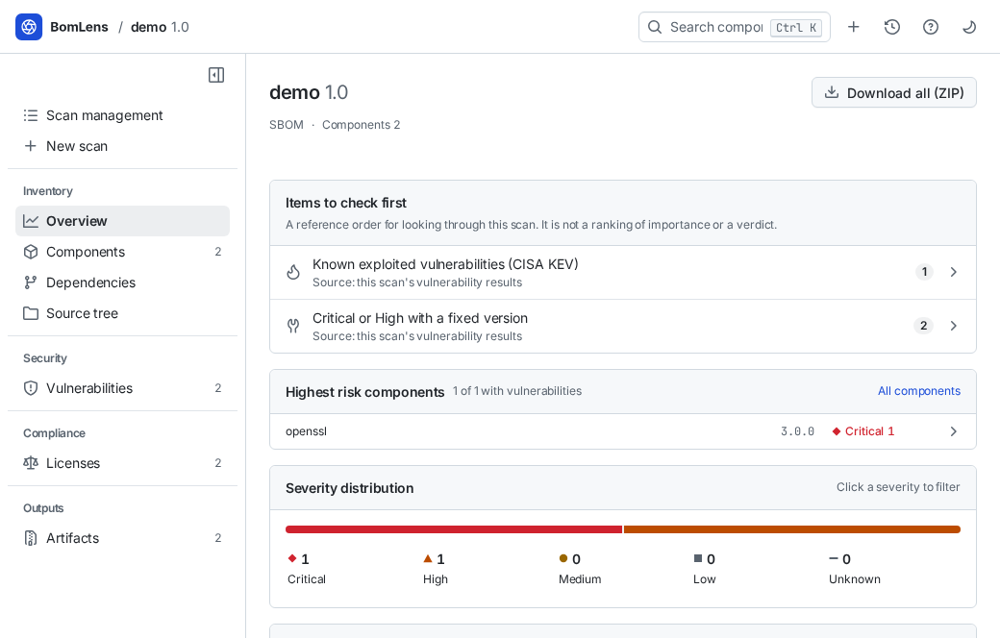

# No-CLI quick start (no command line)

On Windows you do not need to type any command. On macOS one Terminal command is needed until the app is signed. This page goes from installing to an SBOM and an open-source notice, with clicks in the desktop app or the browser. If something does not work, see [Troubleshooting](troubleshooting.md).

If you are a supplier submitting the SBOM to SK Telecom, see [Submitting an SBOM you made](../guides/supplier-sbom.md#submitting-an-sbom-you-made) before you scan.

## What is an open-source notice

A document that lists the open-source components in a product and their licenses, provided alongside the product when it ships. Many open-source licenses (MIT, Apache-2.0, BSD, and others) require the copyright notice and the full license text to be included with the product, so a notice that gathers them is needed.

BomLens analyzes the source to build a component list (an [SBOM](../concepts/what-is-sbom.md)) and writes two notice files from it: `..._NOTICE.txt` to ship as-is with the distribution, and `..._NOTICE.html` to read in a browser. The prefix (`...`) is the project name and version you entered, for example `MyApp_1.0.0_NOTICE.txt`.

## What you need and how long it takes

All you need is a Docker engine. On Windows, for a first install, **Rancher Desktop** is recommended: it is free and fits the double-click flow well. If you already use Docker, leave it as is and move on. (A detailed comparison of the other options is in [First scan](../start/first-scan.md).) The first time, install and download take a while. Roughly:

- Installing and first launch of Rancher Desktop: about 5–10 minutes
- First download of the scanner image: a few minutes, varying by network, only the first time
- First scan of a project, which fetches a language image: several more minutes, also once per language

So plan for about 10 GB of free disk space in the Docker engine. The image sizes are in the [requirements of First scan](first-scan.md#requirements). The command line stops with a message before a download when the space is not enough; the web UI and the desktop app warn.

Once set up, opening the app and scanning afterward takes 1–2 minutes for a project with a lock file already committed. Without one, cdxgen resolves dependencies itself before it can scan them (see the [web UI reference](../reference/ui.md#new-scan)), which took 6–7 minutes in repeated testing on a Node.js project with no `package-lock.json`.

## Walkthrough

There are two paths. The desktop app is the simplest, so it is recommended.

### Path A: desktop app (recommended)

1. **Install a Docker engine**. Download the Windows installer from [rancherdesktop.io](https://rancherdesktop.io/), install it, and run it. If it asks whether to use Kubernetes during install, you can turn it off. Keep the container engine set to dockerd (moby), the default; with containerd the `docker` command cannot reach an engine. Installing WSL and Rancher Desktop needs administrator rights once, so without them ask your IT team to install Rancher Desktop. The BomLens app itself installs without administrator rights. When the taskbar icon settles (usually 1–2 minutes), it is ready. On macOS, download Rancher Desktop for macOS from the same site; the other choices are in [Installing Docker on macOS and Linux](first-scan.md#installing-docker-on-macos-and-linux-for-the-first-time).
2. **Get and run the app**. Click [Download BomLens for Windows (.exe)](https://github.com/sktelecom/bomlens/releases/latest/download/BomLens-Setup.exe). The app is unsigned for now, so two Windows prompts can appear. In Edge, the downloads panel may say that `BomLens-Setup.exe` is not commonly downloaded and show no way to open it: open the item's menu (the three dots), choose Keep, and if it asks again, expand Show more and choose Keep anyway (the exact labels depend on your Edge version). Then double-click the file. If Windows shows a "Windows protected your PC" warning, click its More info (추가 정보) link and choose Run anyway (실행) on the screen that follows; the dialog's own labels are in your Windows display language, so a Korean-language Windows shows Korean text as in the screenshot below. The app opens with no console window. The signing rules for the installer and what the app sends over the network are in the [code signing policy](../reference/code-signing-policy.md). On macOS, download [BomLens-Setup.dmg](https://github.com/sktelecom/bomlens/releases/latest/download/BomLens-Setup.dmg) instead and follow [If the app won't open on macOS](troubleshooting.md#if-the-app-wont-open-on-macos).
3. **First-run image download**. The scanner image is pulled just once. The app shows progress as below, so leave the window open and wait. On later launches, the app pulls a newer image automatically when one has been published, so there is nothing to redownload by hand. If Docker is not installed or is stopped, the app tells you what to do instead of starting a scan.


Now go to [Scan and get the notice](#scan-and-get-the-notice) below.

### Path B: ZIP and double-click batch file (alternative)

If you prefer a script over the desktop app, this path works too.

1. **Install a Docker engine**. Same as step 1 of Path A.
2. **Download the tool**. On the [latest release page](https://github.com/sktelecom/bomlens/releases/latest), download `bomlens-cli-windows.zip` from the assets and unzip it. You should see a `scripts` folder inside the unzipped folder. (The green Code button on the repository page also gives you a ZIP, but that one is an unreleased snapshot of the current source, not a tagged release.)
3. **Run the web UI**. Double-click `sbom-ui.bat` in the `scripts` folder. At first a black window shows the image download notice below, and once done a browser opens `http://localhost:8080`. Each scan's results are saved to a `{Project}_{Version}\` subfolder under `C:\Users\<your-name>\sbom-output`.

```text
===========================================
  First run: downloading the scanner image (about 0.35 GB, 1.4 GB on disk).
  The first scan of a project also fetches a language image (about 3 to 16 GB).
  Image:
  ghcr.io/sktelecom/bomlens:<release version>
===========================================
===========================================
  BomLens web UI
  Address:
  http://localhost:8080
  Results folder:
  C:\Users\<you>\sbom-output
  (closing this window stops the UI)
===========================================
```

To check that everything is ready, double-click `scripts\check-setup.bat` in the unzipped folder. It checks Docker installation and status, the scanner image, the Docker engine's memory and port status, in your Windows display language.


## How do I update the app?

At startup the app checks for a newer release. When there is one, an Update available dialog offers Open download page, which opens the [latest release page](https://github.com/sktelecom/bomlens/releases/latest). Download the installer there and run it again; you can also do this without waiting for the dialog. The installer is unsigned like the first one, so the same Edge and SmartScreen steps apply. Your scan results stay in the `sbom-output` folder under your home directory. When the app starts, it pulls the scanner image that matches its version if that image is not on the machine yet.

## Scan and get the notice

From here the desktop app and the web UI are the same. Enter the project name and version, pick the tile for what you want to do, and click Run scan. The progress log streams in real time, and the result overview appears when it finishes.

<!-- tiles -->
| What you want to do | Tile to pick | Guide |
|---|---|---|
| Scan a project folder on this computer | Choose folder | [Web UI reference](../reference/ui.md#new-scan) |
| Scan source code you received as a ZIP | ZIP upload | [Source ZIP](../guides/by-input.md#scenario-2--source-zip) |
| Scan a repository on GitHub | GitHub URL | [GitHub URL](../guides/by-input.md#scenario-1--github-url) |
| Check an SBOM you received | SBOM upload | [Supplier SBOM validation](../guides/supplier-sbom.md) |
| Scan a container image | Docker image | [Docker image](../guides/by-input.md#docker-image) |
| Analyze a firmware image | Firmware upload | [Firmware](../guides/firmware.md) |
| Make an SBOM for an AI model | AI model or dataset | [AI model SBOM](../guides/ai-model.md) |

In the desktop app, Choose folder has an Add folder… button that opens a folder picker. On the `sbom-ui.bat` path, put `SBOM_UI_MOUNT_DIR=D:\my-project` in the [settings file](troubleshooting.md#settings-file-no-command-line-needed) before running so the web UI can reach that folder (the CLI equivalent is `--ui --mount <dir>`).



When the scan finishes, download the notice from the results screen as per-format chips (`HTML`, `TXT`). The SBOM (`..._bom.json`) and the risk report (`..._risk-report.html`) generated alongside are available on the same screen, and you can also download everything as a single ZIP. Downloaded files are saved to the results folder as well. For what each file is and when it appears, see the [artifacts reference](../reference/artifacts.md).
