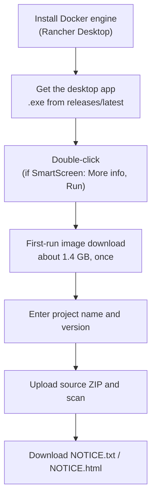
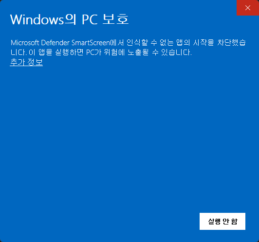
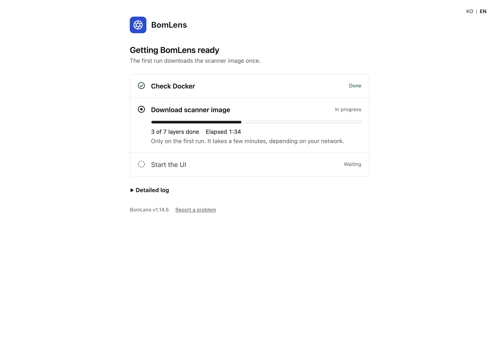
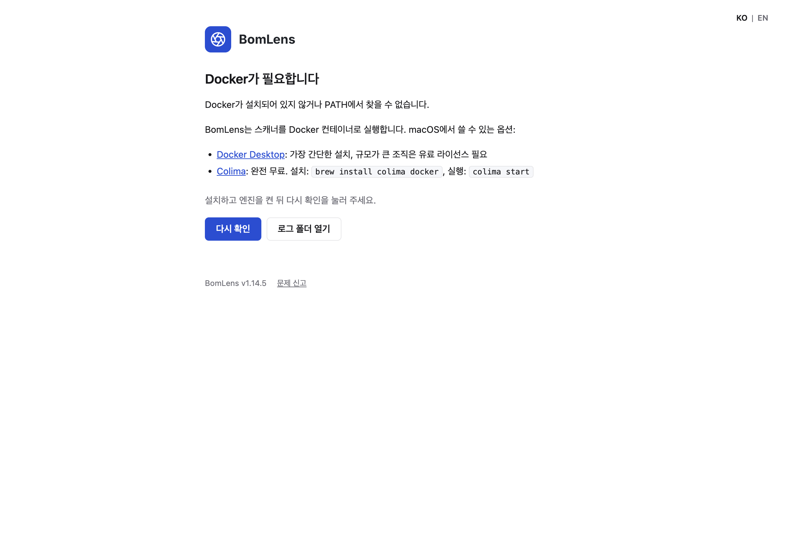
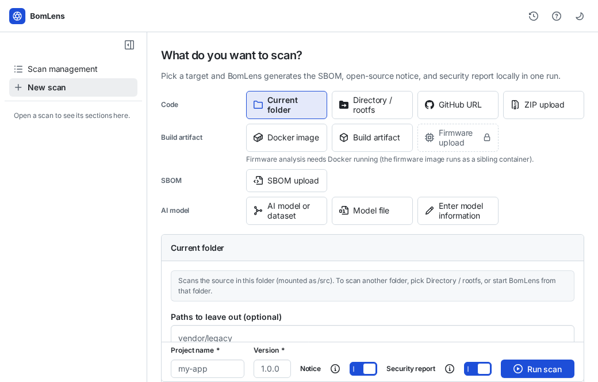
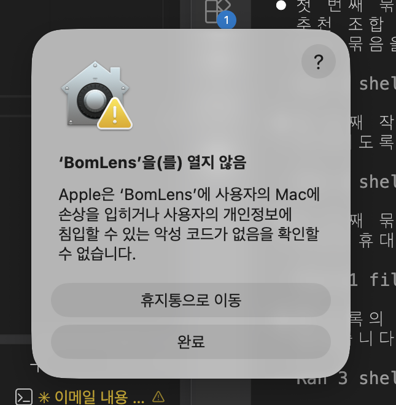
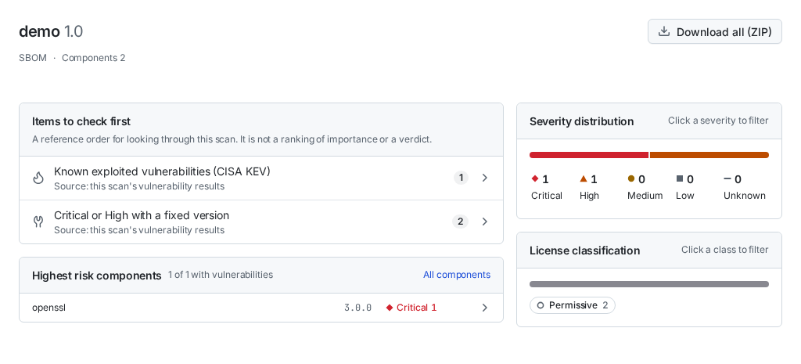

# No-CLI quick start (no command line)

You do not need to have ever typed a command. This page covers the shortest path for an open-source license manager to turn source code received from a dev team into an open-source notice. It is all clicks in a browser.

## What is an open-source notice

A document that lists the open-source components in a product and their licenses, provided alongside the product when it ships. Many open-source licenses (MIT, Apache-2.0, BSD, and others) require the copyright notice and the full license text to be included with the product, so a notice that gathers them is needed.

This tool analyzes source code to build a component list (an [SBOM](../concepts/what-is-sbom.md)), then groups components by license to generate two notice files.

- `..._NOTICE.txt` — a text format to ship as-is with the distribution
- `..._NOTICE.html` — a format that reads well in a browser

The prefix (`...`) is the project name and version you entered. For example, if the project is `MyApp` and the version is `1.0.0`, the file is `MyApp_1.0.0_NOTICE.txt`.

## What you need and how long it takes

All you need is a Docker engine. On Windows, for a first install, **Rancher Desktop** is recommended: it is free and fits the double-click flow well. If you already use Docker, leave it as is and move on. (A detailed comparison of the other options is in [First scan](../start/first-scan.md).)

The first time, install and download take a while. Roughly:

- Installing and first launch of Rancher Desktop: about 5–10 minutes
- First download of the scanner image (about 1.4 GB on disk): a few minutes, varying by network, only the first time
- First scan of a project, which fetches a language image (3 to 16 GB on disk, for example 2.9 GB for Node.js and 5.6 GB for Java): several more minutes, also once per language

So plan for about 10 GB of free disk space in the Docker engine. [Image sizes and how to free the space](../reference/docker-image.md#how-much-disk-do-the-images-take) lists every image. The command line stops with a message before a download when the space is not enough; the web UI and the desktop app warn.

Once set up, opening the app and scanning afterward takes 1–2 minutes for a project with a lock file already committed. Without one, cdxgen resolves dependencies itself before it can scan them (see the [web UI reference](../reference/ui.md#new-scan)), which took 6–7 minutes in repeated testing on a Node.js project with no `package-lock.json`.

## Walkthrough

There are two paths. The desktop app is the simplest, so it is recommended. The overall flow:



### Path A — desktop app (recommended)

1. **Install a Docker engine**. Download the Windows installer from [rancherdesktop.io](https://rancherdesktop.io/), install it, and run it. If it asks whether to use Kubernetes during install, you can turn it off. When the taskbar icon settles (usually 1–2 minutes), it is ready.
2. **Get and run the app**. Click [Download BomLens for Windows (.exe)](https://github.com/sktelecom/bomlens/releases/latest/download/BomLens-Setup.exe). The app is unsigned for now, so two Windows prompts can appear. In Edge, the downloads panel may say that `BomLens-Setup.exe` is not commonly downloaded and show no way to open it: open the item's menu (the three dots), choose Keep, and if it asks again, expand Show more and choose Keep anyway (the exact labels depend on your Edge version). Then double-click the file. If Windows shows a "Windows protected your PC" warning, click its More info (추가 정보) link and choose Run anyway (실행) on the screen that follows; the dialog's own labels are in your Windows display language, so a Korean-language Windows shows Korean text as in the screenshot below. The app opens with no console window. The signing rules for the installer and what the app sends over the network are in the [code signing policy](../reference/code-signing-policy.md).
3. **First-run image download**. The scanner image is pulled just once. The app shows progress as below, so leave the window open and wait. On later launches, the app pulls a newer image automatically when one has been published, so there is nothing to redownload by hand.





If Docker is not installed or is stopped, the app tells you what to do instead of starting a scan.



Now go to [Scan and get the notice](#scan-and-get-the-notice) below.

### Path B — ZIP and double-click batch file (alternative)

If you prefer a script over the desktop app, this path works too.

1. **Install a Docker engine**. Same as step 1 of Path A.
2. **Download the tool**. On the [latest release page](https://github.com/sktelecom/bomlens/releases/latest), download `bomlens-cli-windows.zip` from the assets and unzip it. You should see a `scripts` folder inside the unzipped folder. (The green Code button on the repository page also gives you a ZIP, but that one is an unreleased snapshot of the current source, not a tagged release.)
3. **Run the web UI**. Double-click `sbom-ui.bat` in the `scripts` folder. At first a black window shows the image download notice below, and once done a browser opens `http://localhost:8080`. Each scan's results are saved to a `{Project}_{Version}\` subfolder under `C:\Users\<your-name>\sbom-output`.

```text
===========================================
  First run: downloading the scanner image (about 1.4 GB).
  The first scan of a project also fetches a language image (about 3 to 16 GB).
  Image:
  ghcr.io/sktelecom/bomlens:latest
===========================================
===========================================
  BomLens web UI
  Address:
  http://localhost:8080
  Results folder:
  C:\Users\<you>\sbom-output
  (closing this window stops the UI)
===========================================
```

The sizes in that notice are rough estimates. The scanner image takes about 1.4 GB on disk and a language image 3 to 16 GB.

To check that everything is ready, double-click `scripts\check-setup.bat` in the unzipped folder. It checks Docker installation and status, the scanner image, the Docker engine's memory and port status, in your Windows display language.



## How do I update the app?

At startup the app checks for a newer release. When there is one, an Update available dialog offers Open download page, which opens the [latest release page](https://github.com/sktelecom/bomlens/releases/latest). Download the installer there and run it again; you can also do this without waiting for the dialog. The installer is unsigned like the first one, so the same Edge and SmartScreen steps apply. Your scan results stay in the `sbom-output` folder under your home directory. When the app starts, it pulls the scanner image that matches its version if that image is not on the machine yet.

## If the app won't open on macOS

The current macOS build is not yet signed and notarized with an Apple Developer ID, so macOS quarantines the downloaded app. It is the same kind of block as the SmartScreen warning on Windows.

What you see depends on your macOS version. Recent macOS shows a block dialog like the one below, offering only "Move to Trash" — there is no button to open it anyway. Older macOS instead said the app "is damaged and can't be opened," which is the same unsigned-app block despite the wording; the app is not actually damaged. On some versions the app may simply open instead, in which case macOS is running it from a temporary read-only copy rather than from where you installed it (App Translocation). It runs, but not from the location you chose, and nothing guarantees the same state the next time you open it.



The fix is the same either way. Right-clicking the app and choosing Open, or the "Open anyway" button in System Settings, usually does not clear it on recent macOS. The reliable way is to remove the quarantine attribute from a terminal.

1. Open the `.dmg` and drag `BomLens.app` into your Applications folder.
2. Open Terminal and run the command below, then open BomLens from Applications as usual.

   ```bash
   xattr -dr com.apple.quarantine /Applications/BomLens.app
   ```

If it still won't open on an Apple Silicon Mac, run this once and try again:

```bash
codesign --force --deep -s - /Applications/BomLens.app
```

This step is only needed because the current macOS build is not yet signed and notarized, and it goes away once the app is signed.

## Scan and get the notice

From here the desktop app and the web UI are the same.

1. Enter the project name and version.
2. For the scan target, choose "ZIP upload" and upload the source code ZIP received from the dev team.
3. Click run. The progress log streams in real time, and the result overview appears when it finishes.

> To scan a folder already on your disk instead of a ZIP, the desktop app has an **Add folder** button. On the `sbom-ui.bat` path, put `SBOM_UI_MOUNT_DIR=D:\my-project` in the [settings file](#settings-file-no-command-line-needed) before running so the web UI can reach that folder (the CLI equivalent is `--ui --mount <dir>`).


When the scan finishes, download the notice from the results screen as per-format chips (`HTML`, `TXT`). The SBOM (`..._bom.json`) and the risk report (`..._risk-report.html`) generated alongside are available on the same screen, and you can also download everything as a single ZIP. Downloaded files are saved to the results folder as well. For what each file is and when it appears, see the [artifacts reference](../reference/artifacts.md).



## When you get stuck

- **I don't know what's wrong**: double-click `scripts\check-setup.bat` to check Docker, the image, and port status at once, and it tells you what to do next. It follows your Windows display language: Korean on a Korean system, English everywhere else. To force one, put `SBOM_LANG=en` (or `ko`) in the settings file described below.
- **A "Windows protected your PC" warning appears**: this is because the desktop app is still unsigned. Click "More info" and choose "Run anyway".
- **macOS will not open the app**: the "damaged" warning, or a launch that works but runs from a temporary copy, are both the same unsigned-app block. See [If the app won't open on macOS](#if-the-app-wont-open-on-macos) to clear it from a terminal.
- **It says "Docker is not installed"**: make sure Rancher Desktop is installed and running.
- **It says "the Docker engine is not running"**: start Rancher Desktop, wait for the icon to settle, then run it again.
- **The scan finished but there are no files in the results folder**: this can happen if the results folder is outside Docker's file-sharing scope. This tool saves to `sbom-output` under your home directory (`C:\Users\...`), which is usually safe. If you still don't see them, download them directly with the download buttons in the browser.
- **The browser doesn't open automatically**: type `http://localhost:8080` into the address bar yourself. If port 8080 was busy the launcher moves to the next free port and prints the address it chose, so use that one. To fix the port yourself, put `UI_PORT=9090` in the settings file below. The desktop app picks a free local port on its own, so there is nothing to change. From a terminal, `scan-sbom.sh --ui` stops with a message when its port is busy and names a free one, for example `UI_PORT=8081 ./scripts/scan-sbom.sh --ui`.
- **A message says there is not enough free disk space**: the Docker engine has less free than the image to download plus 2 GB. [Free the space](../reference/docker-image.md#how-do-i-free-the-space) by removing images you no longer need, or set `BOMLENS_SKIP_DISK_CHECK=1` to try anyway.
- **My company's repository needs a login**: a Maven or Gradle project that downloads from a private repository needs the credentials in your own `~/.m2/settings.xml` or `~/.gradle/gradle.properties`. The desktop app passes them into the scan read-only; the double-click `sbom-ui.bat` does not. See [How do I scan a Java project that builds with Maven?](../guides/java-maven.md#does-my-private-repository-work).
- **"Image download failed" on a company network**: this is almost always a proxy. The image is downloaded by the **Docker daemon**, not by the launcher, so proxy settings in your command prompt have no effect — set them in Docker Desktop (`Settings > Resources > Proxies`) or Rancher Desktop (`Preferences > WSL > Proxy`). If the proxy also intercepts `localhost`, add `localhost` to its bypass list, otherwise the browser shows an error even when the scan is running fine.
- **Scans fail with `certificate signed by unknown authority` or `PKIX path building failed`**: your network's proxy inspects HTTPS and re-signs it with its own CA, which the scan containers do not trust. Get that CA bundle in PEM form from your IT team and give it to BomLens as `SBOM_EXTRA_CA_CERTS`. The desktop app and `sbom-ui.bat` take it in different ways, both described in [Company network](../guides/company-network.md#how-do-i-trust-my-company-ca).
- **No usable network at all**: the launcher can install from a file instead of downloading. Ask for `bomlens-image.tar`, put it next to the `.bat` files, and it is used automatically — no network, no command line. See "Settings file" below.

## Settings file (no command line needed)

Environment variables you type in a command prompt do not apply when you double-click a `.bat`, so `sbom-ui.bat` and `check-setup.bat` also read a plain text file. `scan-sbom.bat` and the desktop app do not. Copy `scripts\bomlens.settings.example.txt` to `bomlens.settings.txt` in the same folder and uncomment what you need:

```
SBOM_LANG=en
UI_PORT=9090
SBOM_PULL=never
SBOM_IMAGE_TAR=D:\bomlens-image.tar
```

The file is commented in both English and Korean. A real environment variable, if you set one, still wins over the file.

## Removing it

Deleting the app leaves the scanner images and the settings behind. The images can exceed 10 GB, so clear these too if you want it gone completely.

Desktop app (macOS):

```bash
rm -rf /Applications/BomLens.app
rm -rf ~/Library/Application\ Support/sbom-generator-desktop
rm -f ~/Library/Preferences/com.sktelecom.sbom-generator.plist
```

On Windows, uninstall the desktop app from Settings; the settings folder left behind is `%APPDATA%\sbom-generator-desktop`.

The scanner images are the same on every operating system. Remove only the ones you actually pulled.

```bash
docker rmi ghcr.io/sktelecom/bomlens ghcr.io/sktelecom/bomlens-aibom \
           ghcr.io/sktelecom/bomlens-firmware ghcr.io/sktelecom/bomlens-deep-cve
```

The language images a scan downloaded (`ghcr.io/cdxgen/...`, and `bomlens-android-sdk<API>` for Android) are larger than the scanner image, and the command above does not remove them. The [Docker image reference](../reference/docker-image.md#how-do-i-free-the-space) has one command that removes all of them by name, and how to compact the engine's disk afterwards on Docker Desktop, Rancher Desktop and Colima. Docker does not give the space back to Windows or macOS until the disk is compacted.

Your scan results live in the `sbom-output` folder under your home directory. Leave it alone if you want to keep the reports.

For more detail and command-line usage, see [First scan](../start/first-scan.md) and the [Notice and security guide](../guides/reports.md).

---

> **Related**: [First scan](../start/first-scan.md) | [Notice and security guide](../guides/reports.md)
