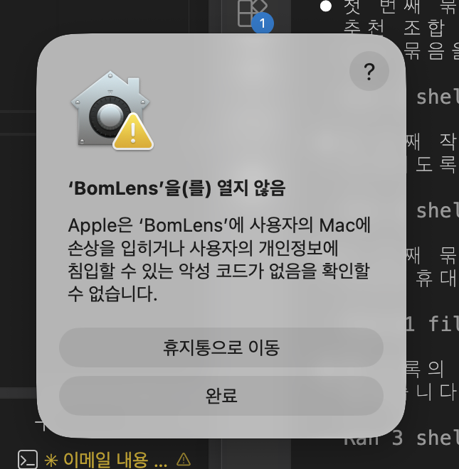

# 문제 해결

[비개발자 빠른 시작](no-cli.ko.md)의 데스크톱 앱과 더블클릭 웹 UI(`sbom-ui.bat`)에서 생기는 문제의 조치 방법입니다. 사내 네트워크에서 생기는 문제는 [사내 네트워크](../guides/company-network.ko.md)에 있습니다.

## 막혔을 때

- **무엇이 문제인지 모르겠어요**: 데스크톱 앱은 시작 화면에 점검 항목(Docker, 엔진, 스캐너 이미지)을 보여 주고, 실패한 항목이 있으면 할 일을 알려 줍니다.
  zip 경로라면 압축을 푼 폴더의 `scripts\check-setup.bat`(데스크톱 앱에는 설치되지 않습니다)을 더블클릭해 Docker와 이미지, 포트 상태를 한 번에 점검하면 다음에 할 일을 알려줍니다. Windows 표시 언어를 따라 한국어 시스템이면 한국어로, 그 밖에는 영어로 나옵니다. 아래 설정 파일에 `SBOM_LANG=ko`(또는 `en`)를 적으면 강제할 수 있습니다.
- **"Windows가 PC를 보호했습니다" 경고가 떠요**: 데스크톱 앱이 아직 미서명이라 그렇습니다.
  "추가 정보"를 누르고 "실행"을 고르면 됩니다.
- **macOS에서 앱이 안 열려요**: "손상됨" 경고가 뜨거나, 열리기는 하는데 임시 폴더에서 도는 경우
  모두 같은 미서명 차단입니다.
  [macOS에서 앱이 열리지 않을 때](#macos에서-앱이-열리지-않을-때)에서 터미널로 푸는 방법을 확인하세요.
- **"Docker가 설치되어 있지 않습니다"가 떠요**: Rancher Desktop을 설치하고 실행했는지 확인하세요.
- **"Docker 엔진이 실행 중이 아닙니다"가 떠요**: Rancher Desktop을 켜고 아이콘이 안정될 때까지
  기다린 뒤 다시 실행하세요.
- **스캔은 끝났는데 결과 폴더에 파일이 없어요**: 결과 폴더가 Docker의 파일 공유 범위 밖이면
  생길 수 있습니다. 이 도구는 홈 디렉터리(`C:\Users\...`) 아래 `sbom-output`에 저장하므로 보통
  안전합니다. 그래도 보이지 않으면 브라우저 화면의 다운로드 버튼으로 직접 받으세요.
- **브라우저가 자동으로 안 열려요**: 주소창에 `http://localhost:8080`을 직접 입력하세요.
  8080이 사용 중이면 런처가 비어 있는 다음 포트로 옮기고 그 주소를 출력하므로, 그 주소를 쓰세요.
  포트를 직접 정하려면 아래 설정 파일에 `UI_PORT=9090`을 넣으세요. 데스크톱 앱은 비어 있는 로컬 포트를
  알아서 고르므로 바꿀 것이 없습니다. 터미널에서 `scan-sbom.sh --ui`를 실행할 때 포트가 사용 중이면
  메시지와 함께 멈추고 쓸 수 있는 포트를 알려 줍니다. 예: `UI_PORT=8081 ./scripts/scan-sbom.sh --ui`.
- **디스크 공간이 부족하다는 메시지가 나와요**: Docker 엔진의 여유 공간이 받을 이미지 크기에 2GB를 더한
  값보다 적다는 뜻입니다. [디스크 공간은 어떻게 비우나요?](../reference/docker-image.ko.md#디스크-공간은-어떻게-비우나요)를 보거나,
  `BOMLENS_SKIP_DISK_CHECK=1`을 지정해 그대로 시도하세요.
- **사내 저장소가 로그인을 요구해요**: 사내 저장소에서 내려받는 Maven이나 Gradle 프로젝트는 본인의
  `~/.m2/settings.xml`이나 `~/.gradle/gradle.properties`에 인증 정보가 있어야 합니다. 데스크톱 앱은 이 파일을
  읽기 전용으로 스캔에 넘기지만, 더블클릭하는 `sbom-ui.bat`은 넘기지 않으므로 이런 프로젝트는 데스크톱 앱이나 `scan-sbom.bat`으로 스캔합니다.
  [자바(Maven) 프로젝트는 어떻게 스캔하나요?](../guides/java-maven.ko.md#사내-저장소도-되나요)를 보세요.
- **사내 네트워크에서 "이미지 다운로드에 실패했습니다"가 떠요**: 이미지는 Docker 엔진이 내려받으므로
  엔진에 프록시를 설정해야 합니다. [Docker 엔진 자체의 프록시와 인증서는 어떻게 하나요?](../guides/company-network.ko.md#docker-엔진-자체의-프록시와-인증서는-어떻게-하나요)를 보세요.
- **스캔이 `certificate signed by unknown authority`나 `PKIX path building failed`로 실패해요**:
  사내 CA를 `SBOM_EXTRA_CA_CERTS`로 BomLens에 알려 주세요. [사내 인증서는 어떻게 신뢰하게 하나요?](../guides/company-network.ko.md#사내-인증서는-어떻게-신뢰하게-하나요)를 보세요.
- **쓸 수 있는 네트워크가 아예 없어요**: 다운로드 대신 파일로 설치할 수 있습니다.
  `bomlens-image.tar`를 받아 `.bat` 파일들 옆에 두면 자동으로 사용하며, 네트워크도 명령줄도
  필요 없습니다. 아래 "설정 파일"을 참고하세요.

## macOS에서 앱이 열리지 않을 때

현재 macOS 빌드는 아직 Apple Developer ID로 코드 서명·공증(notarization)되지 않았습니다. 그래서
macOS가 내려받은 앱을 격리(quarantine)합니다. Windows의 SmartScreen 경고와 같은 성격입니다.

macOS 버전에 따라 겪는 모습이 다릅니다. 최근 macOS는 아래 화면처럼 차단 대화상자를 띄우고
"휴지통으로 이동"만 내줍니다. "확인하고 열기" 같은 우회 버튼은 없습니다. 예전 macOS는
"'BomLens'은(는) 손상되었기 때문에 열 수 없습니다"라는 문구를 썼는데, 표현만 다를 뿐 같은
미서명 앱 차단이며 앱이 실제로 손상된 것은 아닙니다. 버전에 따라서는 앱이 그냥 열리기도
하는데, 이때는 macOS가 앱을 원래 자리가 아닌 임시 읽기 전용 폴더에 복사해 실행합니다(App
Translocation). 열리기는 하지만 설치한 위치에서 도는 것이 아니라, 다음에 열 때 같은 상태가
유지된다는 보장이 없습니다.



어느 쪽이든 조치는 같습니다. 앱을 우클릭해 열기를 고르거나 시스템 설정의 "확인 없이 열기" 버튼을
누르는 방법은 최근 macOS에서 잘 통하지 않습니다. 믿을 수 있는 방법은 터미널에서 격리 속성을
지우는 것입니다.

1. `.dmg`를 열어 `BomLens.app`을 응용 프로그램(Applications) 폴더로 끌어다 놓습니다.
2. 터미널을 열어 아래 명령을 실행한 뒤, 평소처럼 응용 프로그램에서 BomLens를 엽니다.

   ```bash
   xattr -dr com.apple.quarantine /Applications/BomLens.app
   ```

Apple Silicon Mac에서 그래도 열리지 않으면 아래를 한 번 실행하고 다시 시도하세요.

```bash
codesign --force --deep -s - /Applications/BomLens.app
```

이 단계는 현재 macOS 빌드가 아직 서명·공증 전이라 필요한 것이며, 서명되면 사라집니다.

## 설정 파일 (명령줄 불필요)

명령 프롬프트에서 설정한 환경변수는 `.bat`을 더블클릭할 때 적용되지 않습니다. 그래서 `sbom-ui.bat`과
`check-setup.bat`은 텍스트 파일도 함께 읽습니다. `scan-sbom.bat`과 데스크톱 앱은 이 파일을 읽지 않습니다. `scripts\bomlens.settings.example.txt`를 같은 폴더에
`bomlens.settings.txt`로 복사한 뒤 필요한 줄의 주석을 해제하세요.

```
SBOM_LANG=ko
UI_PORT=9090
SBOM_PULL=never
SBOM_IMAGE_TAR=D:\bomlens-image.tar
```

파일에는 한국어와 영어 설명이 함께 들어 있습니다. 실제 환경변수를 설정해 두었다면 그쪽이 우선합니다.

## 지울 때

앱만 지워도 스캐너 이미지와 설정은 남습니다. 이미지가 10GB를 넘을 수 있어 디스크를 꽤 차지하므로,
완전히 지우려면 아래를 함께 정리하세요.

데스크톱 앱(macOS):

```bash
rm -rf /Applications/BomLens.app
rm -rf ~/Library/Application\ Support/sbom-generator-desktop
rm -f ~/Library/Preferences/com.sktelecom.sbom-generator.plist
```

Windows에서는 설정에서 앱 제거로 지우고, 남은 설정 폴더는 `%APPDATA%\sbom-generator-desktop`입니다.

스캐너 이미지는 어느 운영체제든 같습니다. 목록을 본 뒤, 나온 이미지를 이름과 태그로 하나씩 지웁니다(태그 없이 이름만 주면 `:latest`만 지워집니다).

```bash
docker images 'ghcr.io/sktelecom/*'
docker rmi ghcr.io/sktelecom/bomlens:<TAG> ghcr.io/sktelecom/bomlens-aibom:<TAG>   # 목록에 나온 REPOSITORY:TAG
```

스캔이 내려받은 언어별 이미지(`ghcr.io/cdxgen/...`, 안드로이드는 `bomlens-android-sdk<API>`)는 스캐너 이미지보다 크고, 위 명령으로는 지워지지 않습니다. [Docker 이미지 참조](../reference/docker-image.ko.md#디스크-공간은-어떻게-비우나요)에 이름으로 한꺼번에 지우는 명령이 있고, Docker Desktop, Rancher Desktop, Colima에서 엔진 디스크를 압축하는 방법도 있습니다. 디스크를 압축하기 전에는 Docker가 공간을 Windows나 macOS에 돌려주지 않습니다.

스캔 결과는 홈 디렉터리 아래 `sbom-output` 폴더에 있습니다. 보고서를 보관할 생각이면 지우지 마세요.
