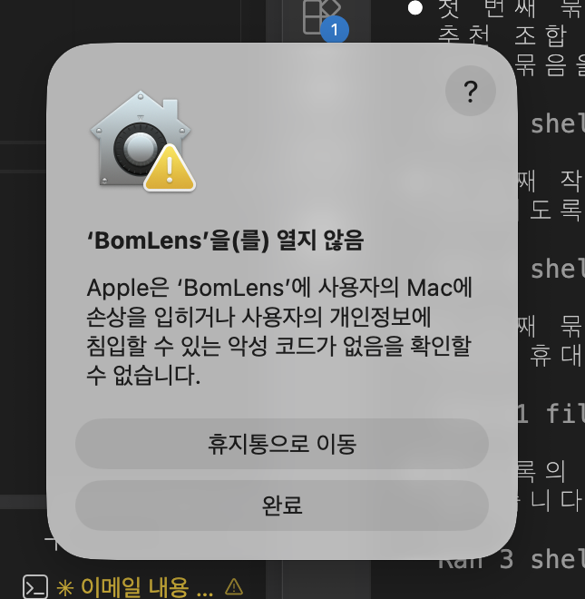

# Troubleshooting

Fixes for the desktop app and the double-click web UI (`sbom-ui.bat`) from the [no-CLI quick start](no-cli.md). Problems on a company network are covered in [Company network](../guides/company-network.md).

## When you get stuck

- **I don't know what's wrong**: the desktop app's startup screen shows each check (Docker, the engine, the scanner image) and, when one fails, what to do. On the zip path, double-click `scripts\check-setup.bat` in the unzipped folder (it is not installed with the desktop app) to check Docker, the image, and port status at once, and it tells you what to do next. It follows your Windows display language: Korean on a Korean system, English everywhere else. To force one, put `SBOM_LANG=en` (or `ko`) in the settings file described below.
- **A "Windows protected your PC" warning appears**: this is because the desktop app is still unsigned. Click "More info" and choose "Run anyway".
- **macOS will not open the app**: the "damaged" warning, or a launch that works but runs from a temporary copy, are both the same unsigned-app block. See [If the app won't open on macOS](#if-the-app-wont-open-on-macos) to clear it from a terminal.
- **It says "Docker is not installed"**: make sure Rancher Desktop is installed and running.
- **It says "the Docker engine is not running"**: start Rancher Desktop, wait for the icon to settle, then run it again.
- **The scan finished but there are no files in the results folder**: this can happen if the results folder is outside Docker's file-sharing scope. This tool saves to `sbom-output` under your home directory (`C:\Users\...`), which is usually safe. If you still don't see them, download them directly with the download buttons in the browser.
- **The browser doesn't open automatically**: type `http://localhost:8080` into the address bar yourself. If port 8080 was busy the launcher moves to the next free port and prints the address it chose, so use that one. To fix the port yourself, put `UI_PORT=9090` in the settings file below. The desktop app picks a free local port on its own, so there is nothing to change. From a terminal, `scan-sbom.sh --ui` stops with a message when its port is busy and names a free one, for example `UI_PORT=8081 ./scripts/scan-sbom.sh --ui`.
- **A message says there is not enough free disk space**: the Docker engine has less free than the image to download plus 2 GB. See [How do I free the space?](../reference/docker-image.md#how-do-i-free-the-space), or set `BOMLENS_SKIP_DISK_CHECK=1` to try anyway.
- **My company's repository needs a login**: a Maven or Gradle project that downloads from a private repository needs the credentials in your own `~/.m2/settings.xml` or `~/.gradle/gradle.properties`. The desktop app passes them into the scan read-only; the double-click `sbom-ui.bat` does not, so use the desktop app or `scan-sbom.bat` for such a project. See [How do I scan a Java project that builds with Maven?](../guides/java-maven.md#does-my-private-repository-work).
- **"Image download failed" on a company network**: the Docker engine downloads the image, so it needs the proxy setting. See [What about the Docker engine's own proxy and CA?](../guides/company-network.md#what-about-the-docker-engines-own-proxy-and-ca).
- **Scans fail with `certificate signed by unknown authority` or `PKIX path building failed`**: give BomLens your company CA as `SBOM_EXTRA_CA_CERTS`. See [How do I trust my company CA?](../guides/company-network.md#how-do-i-trust-my-company-ca).
- **No usable network at all**: the launcher can install from a file instead of downloading. Ask for `bomlens-image.tar` and put it next to the `.bat` files, and it is used automatically, with no network and no command line. See "Settings file" below.

## If the app won't open on macOS

The current macOS build is not yet signed and notarized with an Apple Developer ID, so macOS quarantines the downloaded app. It is the same kind of block as the SmartScreen warning on Windows.

What you see depends on your macOS version. Recent macOS shows a block dialog like the one below, offering only "Move to Trash". There is no button to open it anyway. Older macOS instead said the app "is damaged and can't be opened," which is the same unsigned-app block despite the wording; the app is not actually damaged. On some versions the app may simply open instead, in which case macOS is running it from a temporary read-only copy rather than from where you installed it (App Translocation). It runs, but not from the location you chose, and nothing guarantees the same state the next time you open it.



The fix is the same either way. Right-clicking the app and choosing Open, or the "Open anyway" button in System Settings, usually does not clear it on recent macOS. The reliable way is to remove the quarantine attribute from a terminal.

1. Open the `.dmg` and drag `BomLens.app` into your Applications folder.
2. Open Terminal and run the command below, then open BomLens from Applications as usual.

   ```bash
   xattr -dr com.apple.quarantine /Applications/BomLens.app
   ```

If it still won't open on an Apple Silicon Mac, run this once and try again:

```bash
codesign --force --deep -s - /Applications/BomLens.app
```

This step is only needed because the current macOS build is not yet signed and notarized, and it goes away once the app is signed.

## Settings file (no command line needed)

Environment variables you type in a command prompt do not apply when you double-click a `.bat`, so `sbom-ui.bat` and `check-setup.bat` also read a plain text file. `scan-sbom.bat` and the desktop app do not. Copy `scripts\bomlens.settings.example.txt` to `bomlens.settings.txt` in the same folder and uncomment what you need:

```
SBOM_LANG=en
UI_PORT=9090
SBOM_PULL=never
SBOM_IMAGE_TAR=D:\bomlens-image.tar
```

The file is commented in both English and Korean. A real environment variable, if you set one, still wins over the file.

## Removing it

Deleting the app leaves the scanner images and the settings behind. The images can exceed 10 GB, so clear these too if you want it gone completely.

Desktop app (macOS):

```bash
rm -rf /Applications/BomLens.app
rm -rf ~/Library/Application\ Support/sbom-generator-desktop
rm -f ~/Library/Preferences/com.sktelecom.sbom-generator.plist
```

On Windows, uninstall the desktop app from Settings; the settings folder left behind is `%APPDATA%\sbom-generator-desktop`.

The scanner images are the same on every operating system. List them, then remove each one listed by its name and tag (a name without its tag removes only `:latest`):

```bash
docker images 'ghcr.io/sktelecom/*'
docker rmi ghcr.io/sktelecom/bomlens:<TAG> ghcr.io/sktelecom/bomlens-aibom:<TAG>   # the REPOSITORY:TAG pairs listed
```

The language images a scan downloaded (`ghcr.io/cdxgen/...`, and `bomlens-android-sdk<API>` for Android) are larger than the scanner image, and the command above does not remove them. The [Docker image reference](../reference/docker-image.md#how-do-i-free-the-space) has one command that removes all of them by name, and how to compact the engine's disk afterwards on Docker Desktop, Rancher Desktop and Colima. Docker does not give the space back to Windows or macOS until the disk is compacted.

Your scan results live in the `sbom-output` folder under your home directory. Leave it alone if you want to keep the reports.
